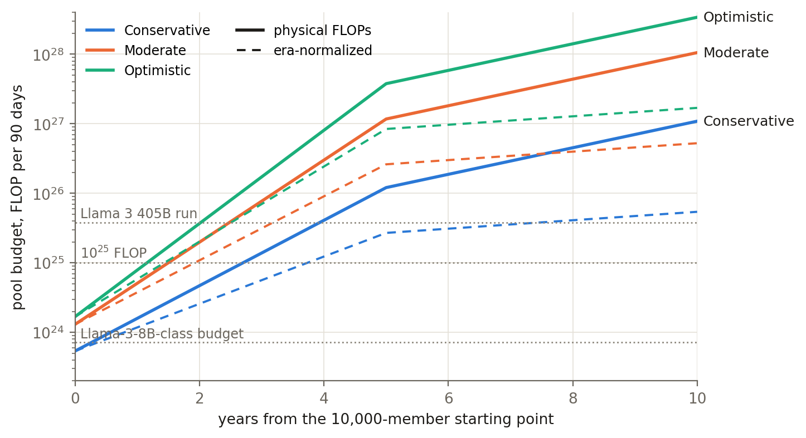
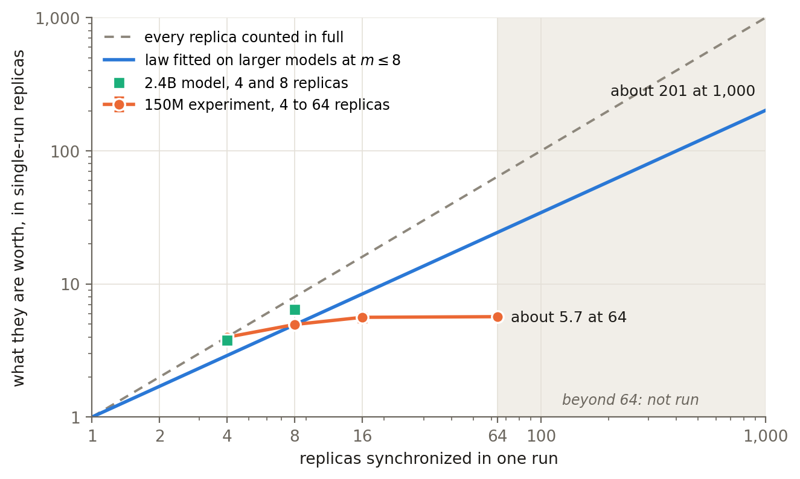
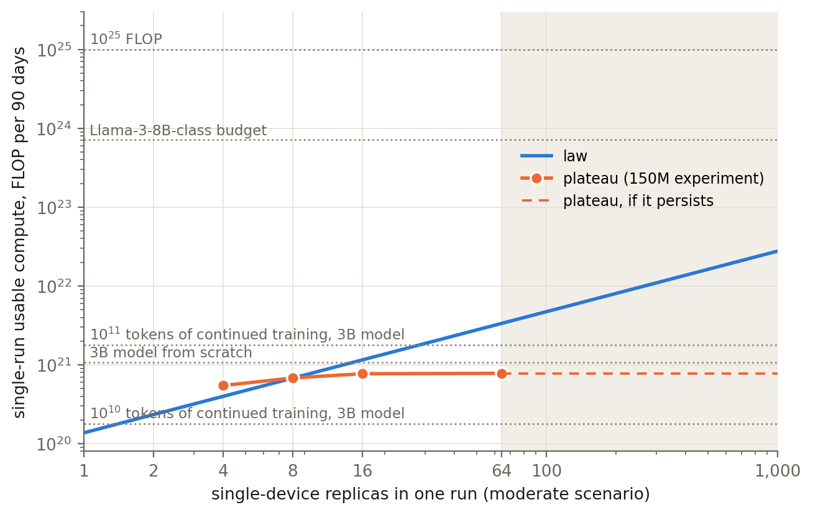
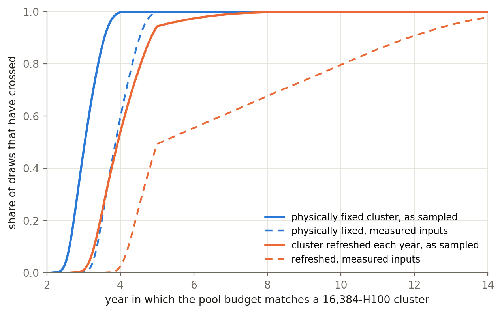

# Distributed Compute Sufficiency: Aggregate Abundance and Single-Run Scarcity in Volunteer AI Training

**R. Insite**

Working paper, V6.0 (November 2026; first drafted March 2026), the first public version. It is a working paper: not peer-reviewed or formally published.

---

# Abstract

Can volunteers who pool consumer GPUs train AI models that matter? We model the effective training compute of such a pool from published results through November 2026, discounted for infrequent synchronization (DiLoCo-class methods) and, within one run, for the falling contribution of each added replica. A pool is *sufficient for a task* when its members' compute, in the form the task can use, covers the task within its period. We keep three quantities apart: the pool budget, the compute one run can use, and parity with a datacenter. The pool budget is large: about 234,000 RTX-4090-class GPUs at half duty match the effective compute of the 16,384-H100 cluster that trained Llama 3 (about 368,000 at the utilization measured on a consumer-majority fleet). One run cannot spend it. At the replica counts that have been run (8 to 64), a 90-day run on single devices uses about $10^{21}$ FLOP: enough to continue training a small existing model, or to train a 3-billion-parameter model from scratch on about fifteen devices (about four months if the gain from added replicas plateaus, as the one experiment at 64 found). Parity with a growing frontier holds in 18\% of Monte-Carlo draws and needs datacenter growth below about 15\% a year. The pool's natural product is many small runs in parallel; one frontier-scale model needs an architecture, such as path composition, not yet shown at that scale. The binding open problem is how much each added replica contributes. Data curation, Byzantine robustness, ownership and governance are outside the model.

---

# 1. Introduction

## 1.1 The Compute Concentration Problem

Frontier training compute grows 4--5$\times$ per year [12, 13]. Per-chip performance contributes only 1.35$\times$ of that [11]; the rest is capital. The xAI Colossus facility, first brought online in 2024, had by March 2025 reached 200,000 accelerators, with an estimated hardware cost of \$7 billion and an estimated power requirement of 300 MW [74]; its successor, Colossus 2, held the record for data-center IT power at about 950 MW by mid-2026 [63], and Epoch AI projected it at about 1.1 million H100-equivalents of compute for July 2026 [64]. McKinsey puts AI-related data-center capacity demand at 156 GW by 2030, with \$5.2 trillion in cumulative AI capital expenditure [40], and four of the largest hyperscalers (Alphabet, Microsoft, Meta and Amazon) were expected, as of February 2026, to spend nearly \$700 billion combined in 2026 alone [75], a tally that stood at \$725 billion by June [76]. The result is that training a frontier model now requires a hyperscaler or a nation-state: in the largest public dataset of AI supercomputers the United States accounts for about 75\% of total performance and China for 15\% (March 2025; the dataset is estimated to capture 10--20\% of existing capacity) [74], and everyone else shares the remainder. Over the same three years, the communication cost of *distributed* training fell by two to three orders of magnitude [3, 32]. This paper asks what follows from that collision.

## 1.2 Three Literatures That Do Not Talk to Each Other

Three bodies of work address components of this problem without connecting them:

**Neural scaling laws** [1, 2, 13] establish precise empirical relationships between compute and model quality ($L(C) \propto C^{-\alpha}$). These laws treat compute as a homogeneous, centralized input. They do not model how compute is organized, how communication topology affects efficiency, or how heterogeneous resources combine.

**Communication-efficient distributed optimization** [3, 4, 5, 8] demonstrates that training can be performed with orders-of-magnitude less communication than synchronous methods require. DiLoCo [3] reduces synchronization frequency by $500\times$; OpenDiLoCo [4] validates this across continents at consumer-grade bandwidth. But these works focus on algorithmic efficiency at a fixed point in time. They do not project forward: how does DiLoCo-class efficiency interact with bandwidth growth and hardware trends?

**Volunteer and decentralized computing** [14, 15, 16] proves that large-scale distributed computation is organizationally feasible. SETI@home, as reported in the BOINC paper, sustained $\sim$500,000 participants, whose $\sim$1 million computers together exceeded the world's fastest supercomputer [15]. Petals runs 176B-parameter inference across volunteer GPUs [14]. But these systems either distribute embarrassingly parallel workloads (BOINC) or demonstrate inference and parameter-efficient fine-tuning without pre-training (Petals). None formalizes the conditions under which volunteer resources become sufficient for competitive model training.

Each literature holds one piece of the answer. None of them connects the pieces, and the connection is where the question lives.

## 1.3 Contribution: Distributed Compute Sufficiency

Whether a compute cooperative can work is no longer, at its core, a distributed-systems question. The systems-side parameters are measured and favorable in the regimes measured: communication efficiency is 0.93 between cloud nodes at consumer-like link speeds [4] --- 0.945 in the largest internet-scale run deployed since, on datacenter-class peers [43] --- the penalty for infrequent synchronization shrinks with model size [24], and bandwidth requirements stay flat to 100B parameters [32]. Four technical prerequisites remain open --- DiLoCo-class quality at 100B+ dense scale, concentration of aggregate compute into single runs (Section 5.4.1), data curation, and Byzantine robustness (Section 7). None of them appears among the parameters that move the convergence date *conditional on being met*; each gates whether the compute is usable at all. What moves it are two variables outside optimization theory entirely: how many people join, and how fast datacenter fleets grow. A cooperative's fate in aggregate is a race between a membership curve and a capital-expenditure curve. For a single training run the binding variable is a third one, which membership does not move: how much each added replica contributes (Section 5.3; Table 14a).

We formalize this through **Distributed Compute Sufficiency (DCS)**: a pool is *sufficient for a task* when the compute its own members contribute, in the form that task can use, covers the task within its period. The condition is always relative to a stated task and period; it is not one threshold. Three quantities carry the analysis and are kept apart throughout. The **pool budget** is the total effective compute of all members over a period: it is the test when the task is many runs in parallel, and a necessary condition for any one run. **Single-run usable compute** is what one synchronized training run can draw from the pool: it is the test when the task is one run, and it grows far more slowly than the pool (Section 5.3). **Parity** compares the pool budget with a stated datacenter; the paper reports it, and sufficiency does not require it. The tasks considered run from the continued training of an existing small model, through small models trained from scratch, to the budgets of documented frontier runs (Table 18). For parity, the model's synthetic object is a closed-form **crossover time** (Section 6.2, Equation 32): the year of datacenter parity, written explicitly as a function of membership at maturity, membership growth, datacenter chip-deployment growth, and the consumer-to-datacenter equivalence ratio. Everything the paper imports --- scaling laws, communication cost, convergence bounds, infrastructure trends --- exists to make the three quantities, and that crossover, computable.

Our model proceeds in four steps:

1. **Datacenter compute trajectory** (Section 3.1): We model centralized training capacity as a function of chip deployment, per-chip performance, and Model FLOP Utilization (MFU), calibrated against production figures from PaLM, Llama 3, and other frontier systems [36, 37].

2. **Cooperative compute trajectory** (Sections 3.2--3.4): We derive effective cooperative compute by combining raw aggregate FLOP/s with a communication efficiency factor $\eta_{\text{coop}}$ (derived from Ben-Nun and Hoefler's allreduce cost model [7], amortized over DiLoCo's $H$-step inner loop [3]) and a quality factor $q(H, \kappa)$ (derived from Wang and Joshi's convergence bounds [8]).

3. **Empirical grounding** (Section 4): We parameterize the model with TeleGeography bandwidth data [10], Epoch AI hardware and compute trends [11, 12], OpenDiLoCo and INTELLECT-1 training results [4, 31], and MFU measurements from frontier production runs [36, 37].

4. **Projections and sensitivity** (Sections 5--6): We present convergence timelines under conservative, moderate, and optimistic membership scenarios, and identify the dominant parameters through systematic sensitivity analysis.

**Scope.** This paper models compute only. Who should own such a pool, how it would be governed, and what the unit of participation should be are outside its scope and are treated in separate work by the author.

## 1.4 Two to Three Orders of Magnitude in Three Years

The communication cost of distributed training dropped by two to three orders of magnitude in three years (500$\times$ from DiLoCo's local steps alone [3]), and that single fact is what makes this paper's question askable. Standard data-parallel training of a 1B model requires $\sim$100 Gbit/s per worker [32] --- far beyond consumer internet. DiLoCo [3] reduces this to $\sim$200 Mbit/s by synchronizing every 500 steps instead of every step. Streaming DiLoCo [32] overlaps communication with computation, holding bandwidth constant at $\sim$1--5 Gbit/s for models up to 100B parameters in simulations of datacenter-speed workers. Deployed internet-scale runs now push further still: the 72B Covenant run combined 30-step synchronization with sparse 2-bit compression for a $>$146$\times$ reduction over its own baseline, under an enforced 110 Mbit/s upload cap on datacenter-class (8$\times$B200) peers [43]. Because the bandwidth a worker needs scales with its own FLOP/s (Equation 33), a consumer GPU needs proportionally less than the simulated datacenter-speed workers; on that basis a home fiber connection is plausibly sufficient for the synchronization traffic of training participation, though not by itself for the memory, upload-asymmetry and verification conditions of Sections 3.5, 7.2 and 7.4.

The remaining question is not whether individual workers can participate efficiently --- OpenDiLoCo has already demonstrated 93\% communication efficiency at consumer-like link speeds [4] --- but whether enough workers can be assembled for the pool budget, how much of it one run can draw (Section 5.3), and whether the architectural constraints (memory limits, data curation, security) can be addressed. The model developed in this paper formalizes these conditions and evaluates their feasibility against empirical trends.

The analysis reveals a structural distinction. The pool budget grows with membership and crosses every fixed target considered within a few years: $10^{25}$ FLOP per 90 days is supplied in aggregate between year 1.2 and year 2.7 across the scenarios on a physical comparator (Table 18). Single-run usable compute does not follow it: at replica counts that have been run it is about $10^{21}$ FLOP per 90 days, enough to continue the training of an existing small model or, on the law's reading, to train a compute-optimal small model from scratch, and far short of the larger budgets (Tables 14a, 14b). Parity with a *continuously growing* frontier is a separate, more demanding condition that depends on whether datacenter capital investment decelerates (Section 6.2). A pool does not need to match the largest cluster to be sufficient for a task. The hardware substrate underneath it keeps widening: models in the 2--9B parameter range now run on smartphones [92, 93], and cumulative shipments of GenAI-capable smartphones were projected to pass 1 billion units by the third quarter of 2026 [65] (Section 8.5).

---

# 2. Related Work

The model developed in this paper draws from three bodies of literature that have remained largely disconnected: neural scaling laws, communication-efficient distributed optimization, and volunteer computing.

## 2.1 Neural Scaling Laws

Kaplan et al. [1] established empirical power-law relationships between model loss and three scaling variables --- parameters $N$, dataset size $D$, and compute budget $C$. For the compute-optimal regime, the key relation is:

$$L(C) = \left(\frac{C_c^{\min}}{C}\right)^{\alpha_C}, \quad \alpha_C \approx 0.050$$

where $C_c^{\min} \approx 2.68 \times 10^{28}$ FLOPs [1]. This power law provides a direct mapping from aggregate compute to achievable loss, regardless of how that compute is organized --- a property we exploit in Section 3 to compare cooperative and datacenter configurations on a common scale.

Hoffmann et al. [2] (Chinchilla) revised the optimal allocation of compute between parameters and tokens, demonstrating that compute-optimal training requires $N_{\text{opt}} \propto C^{0.5}$ and $D_{\text{opt}} \propto C^{0.5}$ --- equal scaling of both dimensions. This result, which overturned the Kaplan-era practice of training large models on relatively few tokens, provides the Chinchilla-optimal model sizes used in our projections (Section 5.4).

Sevilla et al. [13] decomposed the history of ML compute into three eras with distinct growth rates: a pre-deep-learning era (21.3-month doubling), a deep-learning era (5.7-month doubling from 2010), and a large-scale era (9.9-month doubling from 2015). The two later trends run concurrently rather than in sequence: large-scale models from late 2015 follow the slower trend while regular-scale models continue on the faster one [13]. The slower growth at the largest scale is consistent with capital constraints on frontier training, the form of the deceleration thesis discussed in Section 5.5.

A shared limitation of the scaling law literature is that it treats compute as a homogeneous input. The laws do not distinguish between 1,000 H100s running synchronously and 100,000 consumer GPUs coordinating via DiLoCo. Our model bridges this gap by introducing efficiency factors ($\eta_{\text{coop}}$, $q$) that convert heterogeneous distributed compute into an effective compute metric compatible with the scaling laws.

## 2.2 Communication-Efficient Distributed Training

Reducing the communication cost of distributed training has been a central concern in systems research. Dean et al. [6] (DistBelief) demonstrated that large-scale distributed training is feasible using parameter servers, establishing the architectural template for subsequent systems. Ben-Nun and Hoefler [7] provided a comprehensive survey of parallel and distributed deep learning, including the allreduce communication cost model (Equation 7) that we use to derive $\eta_{\text{coop}}$ in Section 3.3.

Lin et al. [5] showed that 99.9% of gradient exchange in distributed SGD is redundant, achieving up to 600$\times$ compression via Deep Gradient Compression. This is complementary to DiLoCo's approach: DGC reduces the volume of each sync, while DiLoCo reduces the frequency. MuLoCo [33] and SparseLoCo [34] demonstrate that combining both approaches yields communication reductions of $>$4,000$\times$ over standard data-parallel training. The same lineage includes low-rank gradient compression by power iteration (PowerSGD [104]) and the combination of random sparsification, top-$K$ sparsification and quantization in CocktailSGD [105], which reports up to 117$\times$ compression when fine-tuning models of up to 20B parameters and about a 1.2$\times$ slowdown on a 500 Mbit/s network relative to a datacenter network; that result concerns fine-tuning, not pre-training. Earlier systems work on wide-area training (Gaia [106]) cut traffic between datacenters by withholding updates judged insignificant, with experiments across 11 cloud regions.

Douillard et al. [3] (DiLoCo) introduced Distributed Low-Communication training, in which workers perform $H = 500$ local optimization steps before synchronizing via a Nesterov-momentum outer optimizer. DiLoCo communicates $500\times$ less than fully synchronous training and matches or exceeds synchronous baselines at 150M parameters [3]. Jaghouar et al. [4] (OpenDiLoCo) validated DiLoCo across two continents at 1.1B parameters with 90--95% compute utilization and 6.9% communication overhead at consumer-grade bandwidth (127--935 Mbit/s). Subsequent work has extended DiLoCo to 10B (INTELLECT-1) [31] and 15B (MuLoCo) [33], with scaling laws predicting that DiLoCo advantages increase with model size [24].

Douillard et al. [20] (DiPaCo) introduced a modular variant in which the network is partitioned into paths, each trained by a separate worker. DiPaCo further reduces communication by limiting synchronization to shared modules, and eliminates the memory constraint that limits DiLoCo to model sizes fitting on a single device. We elevate DiPaCo from a peripheral technique to a core architectural component of the cooperative model (Section 3.6).

Charles et al. [24] established the first comprehensive scaling laws for DiLoCo, showing that $L(N, m) = A \cdot N^{\alpha} \cdot m^{\beta}$ with $\beta = 0.0116$, measured at a fixed synchronization cadence of $H = 30$ (we write $m$ for the number of replicas, which [24] writes $M$; in this paper $M$ is membership) --- the loss penalty from distributing across $m$ replicas is small at the replica counts studied ($m \leq 8$) and *shrinks* with model size, though its compute equivalent is not small (Section 3.3.2). At 2.4B parameters, DiLoCo with $m = 2$ outperforms data-parallel training. This result directly validates our cooperative compute model's assumption that distributed training becomes more viable at scale.

Kolehmainen et al. [26] (NoLoCo) eliminated all-reduce entirely, replacing it with pairwise local averaging. Communication per outer step drops from $O(|\theta| \log N)$ to $O(|\theta|)$ per worker, with sync steps estimated at $\sim$10$\times$ faster than DiLoCo for hundreds of accelerators over internet [26]. NoLoCo converges up to 4\% faster than DiLoCo, and the perplexity gap to centralized training shrinks with model size [26] --- consistent with Charles et al.'s scaling laws.

Kutuzov et al. [27] (AdLoCo) proved that adaptive batching reduces total communications to $O(\ln N)$ --- logarithmic rather than linear in training iterations. As training converges, batch sizes grow automatically, reducing sync frequency. This provides a theoretical communication complexity floor for DiLoCo-family methods.

Two adjacent lines complete the map. DeMo [52] decouples momentum states and transmits only a sparsified fast-transform component, cutting per-GPU communication up to 85$\times$ at 300M--1B scale --- the compression lineage that SparseLoCo [34] extends to pre-training at 72B [43]. SWARM parallelism [53] takes the orthogonal route: temporary randomized pipelines across unreliable, heterogeneous devices, training a 13B model on preemptible instances under 200 Mbit/s --- the closest published precedent for the consumer model-parallel runs of node0 [49] and Agora [61].

McMahan et al. (2017) [50] introduced Federated Averaging (FedAvg), which applies local SGD in the federated learning setting where data cannot leave client devices. While the cooperative compute model does not require on-device data (Section 6.3), FedAvg established the practical viability of local SGD at scale and motivated the convergence theory applied in our analysis. Reddi et al. [107] proposed federated versions of adaptive optimizers and analysed their convergence under heterogeneous data in non-convex settings; DiLoCo describes its own outer optimizer as following that algorithm [3].

## 2.3 Convergence Theory for Local SGD

Wang and Joshi [8] provide a unified convergence analysis for cooperative SGD, establishing the theoretical bounds used in our quality factor derivation (Section 3.3.2). For the IID case, they prove $O(1/\sqrt{mK})$ convergence with linear speedup in the number of workers $m$, recovering the minimax rate when total compute $K \geq m^3 H^2$ [8]. For the non-IID case, the heterogeneity penalty scales as $H^2 \kappa^2$ and --- because it carries the optimized learning rate's $\eta^2 \propto m/K$ factor --- decays only under a far stricter compute condition than the IID term ($K \geq m^3 H^4$ rather than $m^3 H^2$) [8], so at practical sync intervals it acts as an effective quality floor, making data curation strategy critical for cooperative compute (Section 6.3).

Two earlier results frame these bounds. Stich [108] proved that local SGD attains linear speed-up in the number of workers while reducing the number of communication rounds by up to a factor of $T^{1/2}$ (with $T$ the number of iterations) relative to mini-batch SGD; the analysis assumes smooth, strongly convex objectives, and the paper states that it does not yet provide guarantees for the non-convex setting. Karimireddy et al. [109] showed that federated averaging suffers from client drift when data are heterogeneous and proposed control variates (SCAFFOLD) to correct it. The size of the heterogeneity penalty therefore depends on the algorithm and is not a fixed property of local-step training; none of the works cited here demonstrates SCAFFOLD at language-model pre-training scale.

Assran et al. [9] (Stochastic Gradient Push) demonstrated that decentralized gossip-based optimization achieves the same $O(1/\sqrt{mK})$ rate as centralized approaches, without requiring a central aggregation server. This result is relevant because a cooperative at $M > 10^6$ members cannot rely on a single aggregation point; gossip or hierarchical topologies become necessary, and the theory ensures convergence is preserved.

## 2.4 Volunteer and Decentralized Computing

Anderson [15] (BOINC) reports that volunteer computing can sustain participation at scale: in 2004 SETI@home had $\sim$500,000 active participants, and its $\sim$1 million computers sustained $\sim$70 TFLOPS, about twice the fastest supercomputer of the era (the 35-TFLOPS Earth Simulator) [15]. However, BOINC distributes embarrassingly parallel workloads with no inter-worker communication, a fundamental limitation for gradient-based training.

Diskin et al. [16] bridged the gap between volunteer computing and ML training, demonstrating that 40 volunteers with 91 heterogeneous devices could train a 17M-parameter model in 8 days, achieving a $66\times$ cost advantage over on-demand cloud compute [16]. Their DeDLOC protocol handles dynamic participation and heterogeneous hardware, but relies on frequent synchronization incompatible with low-bandwidth links.

Borzunov et al. [14] (Petals) demonstrated distributed inference on 176B-parameter models using pipeline parallelism across 14 servers spanning Europe and North America. While Petals addresses inference and parameter-efficient fine-tuning rather than pre-training, it validates the networking infrastructure (DHT-based discovery, NAT traversal, fault tolerance) required for internet-distributed ML at frontier model scale [14].

Ryabinin and Gusev [19] proposed crowdsourced training using Mixture-of-Experts architectures with DHT-based coordination, an architectural approach that shares DiPaCo's insight --- routing computation through subsets of a modular network reduces per-worker memory requirements.

INTELLECT-2 [30] demonstrated the first globally distributed RL training of a 32B model with permissionless, heterogeneous participants (3090s through H100s), run with two-step asynchrony; in the report's ablation on a 1.5B model, asynchrony of up to four steps matched the synchronous baseline. INTELLECT-3 [25] scaled to 106B MoE parameters --- though as RL post-training rather than pre-training, on 512 H200 GPUs in a single managed cluster: a retreat from the permissionless setting on both axes. The permissionless line was instead advanced by Covenant-72B [43], which pre-trained a 72B dense model from scratch over the open internet with $\geq$70 unique contributing peers (March 2026), and by Pluralis's node0 [49], which trained a 7.5B model *model-parallel* across 303 participants and over 1.7k consumer-grade GPUs with a 16 GB VRAM minimum, followed by Pluralis's Agora run [61], which pre-trained an 8.6B model on 500B tokens over 40 days in May--June 2026 across 330 contributor nodes (at most 60 concurrent), with a contributor fleet 55\% RTX 4090/5090 by node count and the rest datacenter or workstation cards. These runs bracket the field's live question: internet-scale coordination is proven, but at 72B the "peers" were datacenter-class 8$\times$B200 pods, while the largest consumer-majority run sits at 8.6B, trained pipeline-parallel rather than DiLoCo-style.

Dong et al. [29] survey decentralized LLM training, treating it as a resource-driven paradigm and categorizing existing efforts into community-driven and organizational approaches [29]. The survey is descriptive rather than predictive; it does not model when decentralized resources become sufficient, which is the question this paper's scaling analysis addresses.

The commercial landscape includes token-incentivized platforms (Gensyn, Bittensor, Akash) that aggregate distributed GPU resources via blockchain-based coordination and economic incentives. These systems demonstrate market interest in decentralized compute but have not yet produced models competitive with centralized labs, and face challenges where token speculation dynamics can overwhelm compute utility.

## 2.5 Security in Distributed Learning

Blanchard et al. [17] formalized the Byzantine fault tolerance problem for distributed SGD, proving that robust aggregation (Krum) can tolerate up to $f$ Byzantine workers among $n \geq 2f + 3$ workers in total. Simple averaging --- the aggregation rule used by DiLoCo's outer optimizer --- is provably vulnerable to a single malicious worker [17]. Chen et al. [18] addressed the straggler problem in synchronous distributed training via backup workers, a technique relevant to cooperative settings where participant reliability varies.

The security dimension remains the least resolved challenge for cooperative compute. DiLoCo's infrequent synchronization ($H = 500$ steps between outer updates) creates a large attack surface per sync round, but also limits the attacker's influence to one pseudo-gradient contribution per $H$ steps. INTELLECT-2's TOPLOC mechanism [30] provides verification for RL rollouts but does not generalize to pre-training verification. We discuss this limitation further in Section 7.4. The permissionless runs cited in this paper rest on an incentive and verification mechanism that scores each peer's pseudo-gradient contribution (Gauntlet [111]), deployed for a 1.2B-parameter run; it is an engineering mechanism, not a proof of Byzantine robustness.

## 2.6 Where This Model Sits

The contribution of this paper is to connect these literatures: we use scaling laws [1, 2] to define a quality metric, communication cost theory [7] and convergence bounds [8] to derive an efficiency function, and infrastructure data [10, 11, 12] to parameterize growth trajectories. The result is a dynamic model that asks: given how membership, hardware, and bandwidth evolve, when does cooperative compute reach the quality levels predicted by scaling laws for a given compute budget? Shen et al. [28] ask a related question --- whether distributed edge devices can break centralized scaling barriers --- but present a qualitative position paper rather than a quantitative model. To our knowledge, no existing work combines scaling laws with communication cost theory, convergence bounds, and infrastructure trend data into a unified crossover model.

Two recent quantitative analyses bound this question from opposite sides, and both deserve engagement. Epoch AI's multi-datacenter analysis [46] finds that a 10 GW "virtual cluster" spread across dozens of sites is technically and economically feasible at $\sim$5\% overhead --- strong independent support for the systems-side conclusion, from the datacenter direction. Epoch's follow-up on internet-scale decentralized training [45] cuts the other way: it measures today's largest decentralized runs at $6\times10^{22}$--$6\times10^{23}$ FLOP, roughly 1,000$\times$ below frontier, and concludes that "at the current rate of growth, we won't see decentralized training runs catch up to the frontier of training in scale this decade" [45]. Section 6.2 shows that this conclusion and our model largely agree: sustained frontier parity fails in our framework too, absent datacenter deceleration. Where we differ is the question asked --- Epoch evaluates the parity race, while this paper's central object is sufficiency for a stated task, which their analysis does not address and to which the 2026 record speaks only in part: Covenant-72B, a useful 72B model trained permissionlessly [43], used $\sim$4.8$\times10^{23}$ FLOP ($6 \times 72\text{B}$ parameters $\times$ 1.1T tokens), about 20$\times$ below $10^{25}$ FLOP, one of the pool-budget targets used in this paper, on datacenter-class peers. On the policy side, RAND's analysis of pooling Europe's fragmented compute [47] applies the same distributed-training toolchain to a different concentration problem, suggesting the crossover framework generalizes beyond volunteer cooperatives.

We position this contribution precisely against the three closest works. Charles et al. [24] establish a per-run *quality* scaling law for DiLoCo, $L(N, m)$ --- a relation this paper *consumes* as an input (Section 3.3.2), not one it re-derives; our objects are the exogenous membership trajectory $M(t)$ and the resulting parity crossover, axes Charles et al. do not model. Dong et al. [29] survey decentralized training and name the scaling-law gap qualitatively; we quantify the crossover boundary and rank the parameters that move it. DiPaCo [20] supplies the architecture (and the "compute cheap, communication expensive" design assumption) that the Large-regime projections adopt unchanged; our addition is to place its path count on a membership-driven trajectory and to bound when that regime becomes necessary. The synthetic result is therefore neither a new scaling law nor a new architecture, but the closed-form crossover condition (Equation 32) that follows from composing these established results with infrastructure-growth data.

---

# 3. Model

We present a parametric model of cooperative compute capability as a dynamic function of hardware trends, communication costs, and convergence theory. The model proceeds in six parts: we first establish the datacenter compute trajectory as a baseline (Section 3.1), then define cooperative compute in raw terms (Section 3.2), derive the effective cooperative compute after communication and convergence penalties (Section 3.3), state the sufficiency condition and the parity condition (Section 3.4), analyze the memory constraints that determine feasible training regimes (Section 3.5), and finally present DiPaCo as the enabling architecture for frontier-scale cooperative training (Section 3.6).

Throughout, we adopt the convention that compute $C$ refers to training FLOPs, using the standard approximation $C \approx 6ND$ for a dense transformer with $N$ parameters trained on $D$ tokens [1, 2]. All utilization metrics are expressed as Model FLOP Utilization (MFU) --- the fraction of peak hardware FLOP/s performing useful forward and backward pass computation --- following the definition formalized by Chowdhery et al. (2022) [36].

## 3.1 Datacenter Compute Trajectory

The effective training compute available to a datacenter cluster at time $t$ is:

$$C_{\text{dc}}(t) = N_{\text{chips}}(t) \times P_{\text{chip}}(t) \times \eta_{\text{dc}} \quad (1)$$

where $N_{\text{chips}}(t)$ is the number of accelerator chips deployed, $P_{\text{chip}}(t)$ is the per-chip peak FLOP/s, and $\eta_{\text{dc}}$ is the datacenter Model FLOP Utilization. *Rate versus total compute.* $C_{\text{dc}}(t)$, and the cooperative analogue $C_{\text{coop,eff}}(t)$ (Equation 6), are effective compute **rates** (FLOP/s); the total compute of a training run of duration $T$ is $C_{\text{run}} = C(t)\cdot T$. Neural scaling laws $L(\cdot)$ take *total run compute* $C_{\text{run}}$ (the loss projections of Section 5 and Equation 29), whereas the datacenter-parity condition (Equation 22) compares *rates*, where a common run duration cancels. We write $C_{\text{run}}$ wherever the total is meant.

**Hardware growth rates.** Epoch AI's analysis of 47 ML accelerators (2010--2023) finds that computational performance (FP32) doubles every 2.3 years, corresponding to approximately $1.35\times$ per year [11]. This rate holds for both ML-specific accelerators and general-purpose GPUs, though the absolute performance differs substantially. We assume that chip counts in frontier fleets grow at approximately $2\times$ per year, bounded by capital expenditure and power infrastructure --- a modeling assumption, since [12] measures training compute rather than chip counts. The combined hardware capacity growth is therefore approximately $2.7\times$ per year. For comparison, Epoch AI estimates that the computing capacity of AI chips sold worldwide has grown 3.3$\times$ per year since 2022 (90\% CI 2.7--4.1$\times$) [62]; the paper's 2.7$\times$ sits at the lower bound of that interval, so the datacenter baseline used here is, if anything, understated --- a direction against the cooperative.

This hardware capacity growth rate is distinct from the *frontier training compute growth rate*, which Sevilla and Roldan (2024) measure at $4.2\times$/year for frontier models post-2018 (90% CI: $3.6\times$ to $4.9\times$) [12], and which Epoch AI's maintained trend series still placed at $\sim$5$\times$/year as of February 2026 [48]. The gap between hardware capacity growth ($\sim 2.7\times$/year) and frontier training compute growth ($\sim 4.2\times$/year) reflects increasing investment intensity per training run --- organizations deploying larger fractions of their clusters for single experiments --- rather than purely hardware improvements. For our convergence analysis, we use the hardware capacity growth rate as the baseline, since this represents the physical resource against which cooperative compute must compete.

**Datacenter utilization $\eta_{\text{dc}}$.** We set $\eta_{\text{dc}} \approx 0.40$ as our central estimate, with a defensible range of $[0.30, 0.50]$. This value reflects Model FLOP Utilization (MFU) as reported across frontier training runs:

- PaLM 540B on 6,144 TPU v4 chips: 46.2% MFU [36]
- Llama 3 405B on 16,384 H100 GPUs: $\sim$38--43% MFU [37]
- Megatron-Turing NLG 530B on 2,240 A100 GPUs: 30.2% MFU, as computed in the PaLM report [36] (throughput reported in [38])
- OPT-175B on 992 A100 GPUs: 147 TFLOP/s per GPU reported [39]; the source states no MFU, so OPT is not used in the calibration

Among the primary-reported runs above, none reports MFU above PaLM's 46.2% [36, 37]. The gap between peak FLOP/s and realized MFU arises from compounding losses --- approximately: activation recomputation (25--33% overhead), pipeline bubble fraction (5--15%), data-parallel communication (5--15%), tensor-parallel communication (5--10%), and memory bandwidth bottlenecks (10--20%); an illustrative engineering decomposition, not a measured budget. These losses are multiplicative, yielding 40--50% MFU as a realistic ceiling for large-scale training. Note that $\eta_{\text{dc}} = 0.40$ is *not* hardware uptime or GPU activity rate (which can be 80--90%), but the fraction of theoretical peak FLOP/s producing useful model training work.

**Loss achievable by datacenter.** Given effective compute $C_{\text{dc}}(t)$, the achievable loss follows from Kaplan et al.'s power-law scaling [1]:

$$L(C) = \left(\frac{C_c^{\min}}{C}\right)^{\alpha_C} \quad (2)$$

where $\alpha_C \approx 0.050$ and $C_c^{\min} \approx 3.1 \times 10^8$ PF-days ($= 2.68 \times 10^{28}$ FLOP) [1, Eq. 1.3]. This relationship spans more than seven orders of magnitude in compute [1].

Alternatively, using Hoffmann et al.'s three-term decomposition with compute-optimal allocation [2]:

$$\hat{L}(N, D) = E + \frac{A}{N^{\alpha}} + \frac{B}{D^{\beta}} \quad (3)$$

where $E$ is the irreducible loss (entropy of natural text), $A/N^{\alpha}$ captures the finite-capacity penalty, and $B/D^{\beta}$ the finite-data penalty [2, Eq. 2]. The compute-optimal allocation is:

$$N_{\text{opt}}(C) = G \cdot (C/6)^{a}, \quad D_{\text{opt}}(C) = G^{-1} \cdot (C/6)^{b} \quad (4)$$

with $a \approx b \approx 0.50$ and $G = (\alpha A / \beta B)^{1/(\alpha + \beta)}$ [2, Eq. 4, Table 2]. The key departure from Kaplan et al. is the equal-scaling result: model size and training tokens should grow in equal proportion, each by $\sqrt{2}$ for a doubling of compute at $a \approx b \approx 0.5$; equivalently, each doubling of model size calls for a doubling of training tokens [2]. This supersedes Kaplan et al.'s earlier finding of $N \propto C^{0.73}$, which was biased by a fixed training schedule [2].

The power-law form of Equation (2) has an important implication for our analysis: small differences in effective compute translate to small differences in loss. A $2\times$ compute advantage improves loss by only a factor of $2^{-0.050} \approx 0.966$ (3.4% improvement). This means cooperative compute does not require exact FLOP parity with datacenter compute to produce competitively useful models.

## 3.2 Cooperative Compute Trajectory

The raw cooperative compute at time $t$ is:

$$C_{\text{coop,raw}}(t) = M(t) \times \delta \times P_{\text{consumer}}(t) \quad (5)$$

where:

- $M(t)$ is the number of participating members. We treat $M(t)$ as an exogenous parameter --- the model characterizes what cooperative compute *can achieve* at a given membership level, without predicting adoption dynamics. Historical precedent provides rough reference points: SETI@home reached $\sim$500,000 participants (2004, as reported in [15]), and Folding@home grew to over a million devices in 2020 [42].

- $\delta \in [0,1]$ is the fraction of each member's compute resources donated to cooperative training. We assume $\delta \approx 0.5$ as a baseline, reflecting part-time contribution. This is conservative relative to dedicated mining rigs but generous relative to casual participation.

- $P_{\text{consumer}}(t)$ is the average per-device FLOP/s available for ML training. Consumer GPU computational performance doubles every $\sim$2.3 years ($\sim 1.35\times$/year) [11], the same rate as datacenter accelerators. The relevant metric is tensor-core performance at reduced precision (FP16/BF16), not FP32 throughput. For reference, the RTX 4090 achieves $\sim$165 TFLOPS [59] and the H100 $\sim$989 TFLOPS [73] at dense BF16 tensor precision (FP32 accumulate) --- a ratio of approximately $6\times$ per chip. Since both consumer and datacenter chips improve at similar rates [11], this ratio remains roughly constant over time and does not affect the convergence dynamics.

Because $P_{\text{consumer}}(t)$ and $P_{\text{chip}}(t)$ grow at comparable rates ($\sim 1.35\times$/year) [11], the per-chip performance terms approximately cancel in any ratio of cooperative to datacenter compute. The convergence dynamics are therefore dominated by $M(t)$ on the cooperative side and $N_{\text{chips}}(t)$ on the datacenter side, plus the efficiency terms $\eta_{\text{coop}}$ and $\eta_{\text{dc}}$.

## 3.3 Effective Cooperative Compute

Raw cooperative compute must be discounted by two factors: communication overhead (how much time is lost to synchronization) and convergence quality (how much training quality is sacrificed by infrequent synchronization). The effective cooperative compute is:

$$C_{\text{coop,eff}}(t) = C_{\text{coop,raw}}(t) \times \eta_{\text{coop}}(t) \times q(H, \kappa) \quad (6)$$

where $\eta_{\text{coop}}(t)$ captures communication efficiency and $q(H, \kappa)$ captures convergence quality. We derive each in turn.

### 3.3.1 Communication Efficiency $\eta_{\text{coop}}$

In synchronous data-parallel training, each step requires an allreduce of the full gradient vector across all $P$ workers. Ben-Nun and Hoefler [7] analyze four allreduce algorithms and show that Rabenseifner's algorithm achieves the information-theoretic lower bound. The communication cost per allreduce of $|w|$ values across $P$ workers is:

$$T_{\text{comm}} = 2\alpha \log_2(P) + 2\gamma \cdot |w| \cdot \beta \cdot \frac{P-1}{P} \quad (7)$$

where $\alpha$ is the point-to-point network latency, $\gamma$ is the size of a single data value in bytes, $|w|$ is the number of parameters, and $\beta = 1/B$ is the inverse per-node bandwidth [7, Section 2.5]. The first term captures the latency cost (logarithmic in workers) and the second the bandwidth cost (linear in model size, approaching a constant as $P$ grows) [7].

For internet-distributed training, the parameter regime differs markedly from datacenter settings:

- $\alpha \approx 50$--$200$ ms (our parameterization of internet round-trip latency; InfiniBand latencies are of order microseconds, and [7] notes only that InfiniBand has "significantly lower latencies")
- $\gamma = 2$ bytes (FP16 pseudo-gradients, validated by OpenDiLoCo [4])
- $\beta(t)$ = inverse of available bandwidth per node, improving with fiber deployment (international bandwidth CAGR 23--28% [10])

Without modification, these parameters would make distributed training over the internet prohibitively slow. The critical innovation of DiLoCo [3] is to amortize this cost over $H$ local training steps. Each worker performs $H$ steps of local SGD (using AdamW as the inner optimizer), then workers synchronize by all-reducing the *pseudo-gradients* $\Delta_i = \theta^{(t-1)} - \theta_i^{(t)}$ (the difference between the starting parameters and each worker's locally-updated parameters) [3, Algorithm 1]. A Nesterov momentum outer optimizer then updates the global parameters [3]. The amortized communication cost per training step is therefore:

$$T_{\text{comm,amort}} = \frac{T_{\text{comm}}}{H} = \frac{2\alpha \log_2(P) + 2\gamma \cdot |w| \cdot \beta(t) \cdot \frac{P-1}{P}}{H} \quad (8)$$

The communication efficiency is then:

$$\eta_{\text{coop}}(t) = \frac{T_{\text{compute}}}{T_{\text{compute}} + T_{\text{comm,amort}}} \quad (9)$$

where $T_{\text{compute}}$ is the time for one local training step:

$$T_{\text{compute}} = \frac{6 \cdot |w| \cdot B_{\text{tokens}}}{F_{\text{worker}}} \quad (10)$$

with $B_{\text{tokens}}$ the per-step batch size in tokens and $F_{\text{worker}}$ the worker's FLOP/s.

**Empirical validation.** OpenDiLoCo [4] provides a direct calibration point. Training a 1.1B parameter model across four nodes in three countries on two continents (Canada, Finland, United States), with inter-node bandwidth of 127--935 Mbit/s and $H = 500$:

- Independent training between syncs: $\sim$67.5 minutes per 500 inner steps [4]
- Average all-reduce time: 300 seconds ($\sim$5 minutes) [4]
- **Communication overhead: 6.9% of total training time** [4]
- **Compute utilization: 90--95%** [4]

This implies $\eta_{\text{coop}} \approx 0.93$ at consumer-grade bandwidth with $H = 500$ for billion-parameter models. The model of Equation (9) reproduces this independently. At 127 Mbit/s (the slowest measured link), transmitting the $1.1 \times 10^9 \times 2$ bytes = 2.2 GB of pseudo-gradients takes $\sim$139 seconds one way; Equation (7)'s bandwidth term at $P = 4$ is $2\gamma |w| \beta \cdot \frac{P-1}{P} \approx 2 \times 139 \times 0.75 \approx 208$ seconds (the latency term $2\alpha \log_2 P$ is sub-second), so $T_{\text{comm}} \approx 208$ seconds. With $H = 500$ and $T_{\text{compute}} \approx 8.1$ seconds per step (67.5 min / 500), $T_{\text{comm,amort}} = 208/500 \approx 0.42$ seconds, giving $\eta_{\text{coop}} = 8.1 / (8.1 + 0.42) \approx 0.95$. The model thus *predicts* $\sim$0.95 against OpenDiLoCo's *measured* 0.93; the small gap reflects DHT/libp2p coordination overhead and straggler effects not captured by the idealized allreduce cost.

**Scaling behavior.** At fixed $H$ and fixed per-step batch, $\eta_{\text{coop}}$ is approximately independent of model size (Equation 33, Section 6.4). Larger models require more compute per step ($T_{\text{compute}} \propto |w|$) and proportionally more communication ($T_{\text{comm}} \propto |w|$), but since $H$ amortizes $T_{\text{comm}}$ by a fixed factor, the ratio $T_{\text{compute}} / T_{\text{comm,amort}}$ remains approximately constant. What improves is that practical training runs use larger batch sizes at larger scales, increasing $T_{\text{compute}}$ without proportionally increasing $T_{\text{comm}}$. Streaming DiLoCo [32] demonstrates this explicitly: by synchronizing parameter subsets sequentially and overlapping communication with computation, it achieves, in simulation for datacenter-speed workers ($H = 100$, 60\% MFU), a constant bandwidth requirement of $\sim$1--5 Gbit/s for models up to 100B parameters [32]. Standard data-parallel training would require 100--300 Gbit/s for the same model sizes. Bandwidth requirements for DiLoCo-class cooperative training therefore do *not* scale with model size: the residential connection that suffices for a 1B model suffices for a 100B model, and growing the target does not price anyone out of participating.

INTELLECT-1 [31] provides further validation at 10B parameters across three continents: 83--96% compute utilization and 36.2--41.4% MFU, with up to 2,000$\times$ communication reduction via int8 quantization of pseudo-gradients.

### 3.3.2 Convergence Quality Factor $q(H, \kappa)$

Communication efficiency captures the *throughput* cost of distributed training. The *quality* cost --- whether the model trained with $H$ local steps achieves the same loss as a fully-synchronous model with equal total compute --- is a distinct and theoretically deeper question.

Wang and Joshi [8] provide a unified convergence framework for cooperative SGD algorithms. Their analysis parameterizes the training protocol by $(\tau, W, v)$: communication period $\tau$ (equivalent to our $H$), mixing matrix $W$, and $v$ auxiliary variables. For PSASGD (Periodic Synchronous Averaging SGD), the closest theoretical analog to DiLoCo, the convergence bound with full averaging ($W = J$, $\zeta = 0$, $v = 0$) is [8, Corollary 2]:

$$\mathbb{E}\left[\frac{1}{K}\sum_{k=1}^{K} \|\nabla F(\mathbf{x}_k)\|^2\right] \leq \frac{2[F(\mathbf{x}_1) - F_{\inf}]}{\eta K} + \frac{\eta L \sigma^2}{m} + \eta^2 L^2 \sigma^2 (\tau - 1) \quad (11)$$

where $K$ is total iterations, $m$ the number of workers, $\eta$ the learning rate, $L$ the Lipschitz smoothness constant, $\sigma^2$ the stochastic gradient variance bound, and $\tau$ the communication period [8].

The first two terms match the convergence rate of fully-synchronous SGD: $O(1/\sqrt{mK})$ with optimized learning rate. The third term is the *network error* from local updates, scaling linearly in $(\tau - 1)$. With optimized learning rate $\eta = (1/L)\sqrt{m/K}$ and subject to $10m\tau^2 \leq K$, the bound becomes [8, Corollary 2]:

$$O\left(\frac{1}{\sqrt{mK}}\right) + O\left(\frac{m(\tau - 1)}{K}\right) \quad (12)$$

**Linear speedup condition (IID).** The network error vanishes relative to the synchronous SGD rate when $K \geq m^3 \tau^2$ [8]. Under this condition, PSASGD achieves the same $O(1/\sqrt{mK})$ convergence as fully synchronous SGD --- linear speedup in the number of workers $m$.

**Non-IID extension.** Under heterogeneous data distributions with bounded gradient dissimilarity $\kappa^2$ --- defined as $(1/m)\sum_{i=1}^{m}\|\nabla F_i(\mathbf{x}) - \nabla F(\mathbf{x})\|^2 \leq \kappa^2$ [8, Theorem 2] --- the bound acquires an additional term:

$$\mathbb{E}\left[\frac{1}{K}\sum_{k=1}^{K}\|\nabla F(\mathbf{u}_k)\|^2\right] \leq [\text{IID bound}] + C \cdot \kappa^2 \quad (13)$$

where $C$ is bounded by a quantity proportional to $\tau^2$ [8, Theorem 2]. The critical difference from the IID case is that the heterogeneity penalty scales *quadratically* in $\tau$ (not linearly), making cooperative SGD "less robust to the choice of $\tau$ in the non-IID case" [8]. The linear speedup condition tightens to $K \geq m^3 \tau^4$ [8, Corollary 2].

**Quality factor definition.** We define the quality factor as the ratio of effective training quality to ideal synchronous training quality:

$$q(H, \kappa) = 1 - \varepsilon(H, \kappa) \quad (14)$$

This multiplicative formulation treats quality degradation as a compute discount: effective compute $C_{\text{eff}} = C_{\text{raw}} \times q$, so that $L(C_{\text{eff}})$ applies the standard scaling law. An alternative formulation models the degradation as an additive loss penalty: $L_{\text{coop}} = L(C_{\text{raw}}) + \Delta(H, \kappa)$. For $q \geq 0.90$ (the operating range in our scenarios), the two formulations produce similar results. At lower quality factors ($q < 0.80$, corresponding to high data heterogeneity), the multiplicative approximation may diverge from the additive model; we adopt it for consistency with the scaling law framework but note this limitation.

Where, using the PSASGD specialization of Wang and Joshi [8]:

$$\varepsilon_{\text{IID}}(H, m, K) = O\left(\frac{m(H-1)}{K}\right) \quad (15)$$

$$\varepsilon_{\text{non-IID}}(H, m, K, \kappa) = O\left(\frac{m(H-1)}{K}\right) + O\left(\frac{m H^2 \kappa^2}{K}\right) \quad (16)$$

Two properties of these bounds are essential for cooperative compute:

1. **IID: quality penalty vanishes with scale.** For sufficient total compute $K \geq m^3 H^2$, the network error becomes negligible and $q \to 1$. Because this threshold grows as the *cube* of the worker count $m$, it is met not by enlarging the cooperative but by keeping $m$ small: in the DiLoCo regime $m$ is the number of synchronizing replicas (2 to 8 in most published runs [24], up to 64 in [3]; $\sim$4 in OpenDiLoCo [4]), each itself a data-parallel group of many members (Section 3.5), so $m^3 H^2$ stays modest while total steps $K$ is large. Raw member-level gossip (large $m$) lies outside this centralized-averaging bound and would instead invoke the decentralized analysis of Assran et al. [9].

2. **Non-IID: a heterogeneity penalty that is an effective floor in practice.** Wang and Joshi's heterogeneity term is $C \kappa^2$ with $C \propto \eta^2 L^2 \tau^2$ [8, Theorem 2]; under their optimized learning rate $\eta = (1/L)\sqrt{m/K}$ the factor $\eta^2 \propto m/K$, so this term too decays with total compute, as $O(m H^2 \kappa^2 / K)$ --- but $H^2$-slower than the IID network error, tightening the linear-speedup condition from $K \geq m^3 H^2$ to $K \geq m^3 H^4$ [8, Corollary 2]. At the large sync intervals used in practice ($H = 500$, so $H^4 \approx 6 \times 10^{10}$), the compute needed to drive this term to zero is far beyond any realistic budget, so it acts as an *effective* quality floor whenever $\kappa > 0$. For a cooperative with curated shared data ($\kappa \to 0$) the term is suppressed at the source; for federated data contributions ($\kappa > 0$) it makes data-distribution curation --- not raw compute --- the binding constraint on achievable quality.

**Empirical calibration.** DiLoCo [3] provides empirical evidence that the theoretical worst case is pessimistic in practice:

- At 150M parameters with $H = 500$ and 8 workers: DiLoCo *matches or exceeds* synchronous data-parallel training (15.02 vs 15.30 PPL), suggesting $\varepsilon \leq 0$ in this regime [3]. The theoretical bounds above are derived for SGD, while DiLoCo uses AdamW (inner) with Nesterov momentum (outer). The Nesterov outer optimizer appears to provide a regularization benefit beyond what the SGD-based theory predicts; we apply the SGD bounds as a conservative approximation, consistent with the empirical finding that actual quality exceeds theoretical predictions throughout the validated range.
- At 150M with non-IID data (k-means clustering): "DiLoCo exhibits very strong robustness" [3]; even with 50% communication dropout, degradation is only 2.1% PPL [3].
- At 1.1B parameters with $H = 125$: gap of 0.24 PPL relative to data-parallel baseline (10.76 vs 10.52) [4]. At $H = 500$ with the same batch size: gap widens to 0.62 PPL (11.14 vs 10.52) [4]. This degradation at larger batch sizes is consistent with theory: the effective number of tokens between synchronizations increases with batch size, requiring more frequent sync to maintain quality [4].

Recent scaling law analysis by Charles et al. (2025) [24] systematically studied DiLoCo across nine model sizes from 35M to 10B parameters, with hyperparameter sweeps on the seven up to 2.4B and the synchronization cadence fixed at $H = 30$. The key finding: "when well-tuned, DiLoCo scales *better* than data-parallel training with model size" [24]. DiLoCo advantages *increase* with scale, including improved downstream generalization and larger optimal batch sizes [24]. This provides evidence --- though not proof --- that $\varepsilon(H)$ does not grow with model size, and may in fact decrease.

**Compute-equivalent envelope.** Because the scaling exponent is shallow, small loss gaps convert to large compute discounts: defining $q_{\text{emp}} = \exp(-\Delta L / (\alpha_C L_{\text{ref}}))$ with $L$ in nats and $\alpha_C \approx 0.05$ (an optimistic conversion that sets irreducible loss $E = 0$; any $E > 0$ lowers $q_{\text{emp}}$ further), the published calibration points span a wide envelope: $q_{\text{emp}} \gtrsim 1.0$ for DiLoCo 150M at $H = 500$ and for the well-tuned settings of Charles et al. [3, 24], $\approx 0.83$ for OpenDiLoCo 1.1B at $H = 125$, and $\approx 0.61$ for the batch-stressed OpenDiLoCo 1.1B run at $H = 500$ [4]. The scenario values $q \in [0.90, 0.98]$ (Section 5.1) therefore presuppose the well-tuned regime; they are not a floor. Two considerations bound the risk in opposite directions. Asymptotically, the Wang--Joshi network penalty decays as $\Delta \propto 1/K$ while reducible loss decays as $C^{-\gamma}$ with $\gamma < 1$, so $\Delta / C^{-\gamma} \to 0$ and $q(C) \to 1$: a fixed $q$ is conservative in the large-compute limit and optimistic at small scale. Empirically, tuning dominates: the same 1.1B scale yields $q_{\text{emp}}$ from 0.61 to parity depending on $H$, batch size, and optimizer configuration. We accordingly treat $q$ as a bounded scenario parameter, report sensitivity to its halving in Table 19, and regard projections that rely on $q$ outside the published $(N, m, H, B)$ envelope as conditional.

**Replica count.** The scenario values of $q$ are also held independent of the number of synchronizing replicas. Charles et al.'s law [24] does not support that at large replica counts. Pushed through the same compute-equivalence map, $L \propto m^{0.0116}$ gives $q \approx m^{-0.0116/0.05} = m^{-0.23}$: $q \approx 0.85$ at 2 replicas, 0.62 at 8, 0.34 at 100 and 0.20 at 1,000. Their measured 2.4B points are kinder ($+0.3\%$ loss at $m = 4$ gives $q \approx 0.94$; $+1.1\%$ at $m = 8$ gives $q \approx 0.80$), and the penalty shrinks with model size [24], but no reading of the law supports $q \in [0.90, 0.98]$ at the hundreds to thousands of replicas the concentration argument of Section 5.4.1 would need. The conversion inherits the optimistic $E = 0$ convention above and is only as reliable as the multiplicative-$q$ formalism itself. Replica counts of up to 64 have been run at 150M parameters [3], up to 8 on models to 2.4B [24] and 14 to 16 on models of 6.8B to 15B [26, 31, 33], with 20 peers aggregated per round at 72B [43]. The scenario tables keep $q$ independent of replica count; for a single run, Section 5.3 replaces it with the replica-dependent factor, written $q_{\text{rep}}(m)$ there, and Table 14a shows the consequence under the law and plateau readings.

The validated range has moved fast. Dense pre-training with DiLoCo-class methods reached 15B in a controlled setting (MuLoCo; the 15B run first appears in the arXiv revision of February 2026) [33], then 72B from scratch over the open internet with permissionless peers (Covenant-72B, March 2026) [43] --- using the SparseLoCo optimizer with $H = 30$ inner steps and aggressive compression rather than the long-$H$ uncompressed regime analyzed above, and with per-peer hardware at datacenter class (8$\times$B200 minimum) rather than consumer class. The resulting model scores near Llama 2 70B on MMLU (67.1 against 65.6) though below it on HellaSwag and WinoGrande [43]. The Wang--Joshi bounds [8] hold at any scale as bounds, though their relevance to AdamW/Nesterov LLM training is by analogy (above), and the empirical trend is favorable; the gap that remains open is between 72B and frontier-scale ($>$100B) dense pre-training, and between datacenter-class peers and the consumer nodes this paper models.

### 3.3.3 Combined Effective Compute

Substituting the component definitions, the effective cooperative compute is:

$$C_{\text{coop,eff}}(t) = M(t) \cdot \delta \cdot P_{\text{consumer}}(t) \cdot \underbrace{\frac{T_{\text{compute}}}{T_{\text{compute}} + T_{\text{comm}}/H}}_{\eta_{\text{coop}}} \cdot \underbrace{q(H, \kappa)}_{\text{quality factor}} \quad (17)$$

This formulation separates the throughput penalty (how fast training runs proceed) from the quality penalty (how much loss is sacrificed per unit of compute). Empirically, for $H = 500$ at current consumer bandwidths, $\eta_{\text{coop}} \approx 0.93$ [4], and $q(H, \kappa) \approx 1.0$ for IID data with sufficient total compute [3, 8]. The combined discount is therefore modest --- effective compute is approximately 90--93% of raw cooperative compute in the favorable case.

For the cooperative setting, we also define a local MFU term $\eta_{\text{local}} \approx 0.30$--$0.40$, reflecting that consumer hardware runs less optimized software stacks than datacenter training pipelines. INTELLECT-1 reported MFU of 36.2--41.4% on its distributed nodes [31], providing an empirical anchor for this estimate. The full effective compute expression, incorporating local utilization, is:

$$C_{\text{coop,eff}}(t) = M(t) \cdot \delta \cdot P_{\text{consumer}}(t) \cdot \eta_{\text{local}} \cdot \eta_{\text{coop}}(t) \cdot q(H, \kappa) \quad (18)$$

## 3.4 Distributed Compute Sufficiency (DCS)

We define the **Distributed Compute Sufficiency (DCS)** condition for a task $j$ with compute requirement $C_j$ (in FLOPs) and period $T_j$:

$$C_{\text{avail}}(j, t) \geq C_j \quad (19)$$

where $C_{\text{avail}}$ is the compute the pool's members contribute over $T_j$ *in the form the task can use*. For a task made of many independent runs, $C_{\text{avail}}$ is the **pool budget**, $C_{\text{coop,eff}}(t)\,T_j$. For a task that is one synchronized training run, it is the **single-run usable compute** of Equation (29a), which depends on the replica configuration and, once the run is staffed, not on membership. **Parity** with a datacenter (Equations 22--24) is a different comparison: it sets the effective *rates* $C_{\text{coop,eff}}(t)$ and $C_{\text{dc}}(t)$ against each other, a common period cancels, and sufficiency for a task does not require it. The pool budget is computed with the scenario quality factor $q$ (Table 12), which does not depend on replica count; spent as many runs of $m$ replicas each, it is discounted by $q_{\text{rep}}(m)$ in place of $q$ (Section 5.3), so the pool-budget figures are upper values for that use.

When the task is to reach a target loss, the requirement follows from Kaplan et al.'s power-law relationship (Equation 2) applied to the *total* compute of the run, $C_{\text{run}}$ in FLOPs:

$$\left(\frac{C_c^{\min}}{C_{\text{run}}}\right)^{0.050} \leq L_{\text{target}} \quad (20)$$

$$\implies C_j = C_{\text{run}} \geq \frac{C_c^{\min}}{L_{\text{target}}^{1/0.050}} = \frac{C_c^{\min}}{L_{\text{target}}^{20}} \quad (21)$$

The exponent $1/\alpha_C = 20$ means that the compute required is extremely sensitive to the target loss: achieving 10% lower loss requires $10^{20 \times \log_{10}(1/0.9)} \approx 10^{0.91} \approx 8.2\times$ more compute.

**Parity with a specific datacenter.** For the cooperative to match the quality of a particular datacenter configuration at time $t$:

$$C_{\text{coop,eff}}(t) \geq C_{\text{dc}}(t) \quad (22)$$

Expanding both sides using Equations (1) and (18):

$$M(t) \cdot \delta \cdot P_{\text{consumer}}(t) \cdot \eta_{\text{local}} \cdot \eta_{\text{coop}}(t) \cdot q(H, \kappa) \geq N_{\text{chips}}(t) \cdot P_{\text{chip}}(t) \cdot \eta_{\text{dc}} \quad (23)$$

Since $P_{\text{consumer}}(t)$ and $P_{\text{chip}}(t)$ grow at approximately the same rate ($\sim 1.35\times$/year) [11], their ratio $R_{\text{perf}} = P_{\text{chip}}/P_{\text{consumer}}$ is approximately time-invariant --- an assumption the Blackwell generation stressed in the datacenter's favor (Section 4.2); Table 19 prices a sustained $2\times$ widening at $+5.0$ years to crossover at maturity, $+0.65$ in the rapid-growth phase. For current hardware, $R_{\text{perf}} \approx 6$ (H100 at $\sim$989 TFLOPS vs. RTX 4090 at $\sim$165 TFLOPS, dense BF16). The parity condition simplifies to:

$$M(t) \geq \frac{N_{\text{chips}}(t) \cdot R_{\text{perf}} \cdot \eta_{\text{dc}}}{\delta \cdot \eta_{\text{local}} \cdot \eta_{\text{coop}}(t) \cdot q(H, \kappa)} \quad (24)$$

**Numerical example.** Consider a mid-tier frontier cluster: $N_{\text{chips}} = 16{,}384$ H100 GPUs (the Llama 3 training configuration [37]), with $\eta_{\text{dc}} = 0.40$. The cooperative parameters are $\delta = 0.5$, $\eta_{\text{local}} = 0.38$ (consistent with INTELLECT-1's reported MFU [31]), $\eta_{\text{coop}} = 0.93$, and $q = 0.95$ (well-tuned regime; Section 3.3.2's envelope discussion applies). Then:

$$M \geq \frac{16{,}384 \times 6 \times 0.40}{0.5 \times 0.38 \times 0.93 \times 0.95} \approx \frac{39{,}322}{0.168} \approx 234{,}000$$

That is, approximately 234,000 RTX-4090-class consumer GPUs (165 TFLOPS dense BF16 [59]) each contributing half their capacity could, in principle and in aggregate, match the effective training compute of a 16,384 H100 cluster. The figure depends on the device class and on local utilization: at the moderate scenario's fleet-average device of 100 TFLOPS (Section 5.1) the same formula gives $\sim$386,000 members (Section 5.5), and at the 24.2\% MFU measured in the first consumer-majority internet pre-training run ($\eta_{\text{local}} = 0.242$ [61]; Section 4.5, where the caveats on that measurement are stated) it gives $\sim$368,000. It is an aggregate: it does not account for concentrating that compute into one training run (Sections 3.5, 5.4.1; Table 14a), for memory constraints (Section 3.5) or for model-architecture feasibility (Section 3.6), each of which imposes additional conditions.

**The dominant variable.** In Equation (24), the right-hand side is bounded by capital and power constraints on datacenter growth (the deceleration evidence is reviewed in Section 4.2). The left-hand side grows with membership $M(t)$, which is the single most influential variable in the convergence condition --- shifting the crossover point by $\sim$2 years per order-of-magnitude change in membership during the rapid-growth phase (and more once growth matures; Section 6.1). We deliberately parameterize $M(t)$ rather than predicting it: adoption dynamics are sociological and economic questions outside the scope of this model.

## 3.5 Memory Constraints and Scaling Regimes

The analysis thus far treats cooperative compute as a fungible resource, implicitly assuming each worker can train the target model. In practice, DiLoCo is a data-parallel algorithm: each worker must hold the full model in memory [3]. Consumer GPU VRAM imposes a hard ceiling on the model sizes trainable by a single device.

**Training memory per parameter.** Mixed-precision training with Adam requires [54, 55]:

| Component | Per-parameter cost |
|---|---|
| Weights (FP16 working copy) | 2 bytes |
| Weights (FP32 master copy) | 4 bytes |
| Optimizer states (momentum + variance, FP32) | 8 bytes |
| Gradients (FP16) | 2--4 bytes |
| **Total (excluding activations)** | **16--18 bytes** |

Mixed-precision training provides minimal memory savings over pure FP32 because optimizer states --- which must remain in FP32 for numerical stability --- dominate memory consumption [54]. With 8-bit optimizers (e.g., bitsandbytes Adam8bit), optimizer states drop from 8 bytes to 2 bytes per parameter, reducing total per-parameter cost to approximately 10--12 bytes [55].

Concrete requirements by model size are tabulated in Section 4.6 (Table 10). The practical consequence, by the 10--12 bytes per parameter above and before activations: with 8-bit optimizers, a 24 GB GPU can train up to $\sim$2.0--2.4B parameters and a 32 GB GPU up to $\sim$2.7--3.2B; devices with 128 GB of unified memory (Apple Silicon, Strix-Halo-class) up to $\sim$7.1--8.0B with standard precision (16--18 bytes) or $\sim$10.7--12.8B with 8-bit optimizers [54, 55]. Activations lower each figure further. Such devices represent a small fraction of the consumer installed base [57]. A desktop with 512 GB of unified memory was announced in August 2026 [90]; by the same accounting it holds about 43--51B parameters with 8-bit optimizers, and where such nodes are available the single-node figures in this paper move up accordingly.

**The memory wall.** Epoch AI identifies a structural trend: GPU memory capacity doubles every $\sim$4 years, while computational performance doubles every $\sim$2.3 years [11]. This means the ratio of compute to available memory *grows* over time. Simultaneously, model sizes have historically grown faster than memory: parameter counts of notable systems doubled roughly every 18 to 24 months from 2000 to 2016--18, about 1.4--1.6$\times$/year, and faster after that [102], against $\sim 1.19\times$/year for VRAM (the four-year doubling of [11]). The memory wall is therefore *tightening*: even though a $\sim$2B model fits on a 2025 consumer GPU (24 GB) with 8-bit optimizers (above), the frontier model of 2028 ($\sim$300B+) will not fit on a 2028 consumer GPU ($\sim$48--64 GB projected).

**Three training regimes.** Memory constraints define three distinct operating regimes for cooperative training:

| Regime | Model size | Consumer hardware requirement | Training protocol |
|---|---|---|---|
| **Small** | $<$3B | Single GPU (16--32 GB) | DiLoCo, 8-bit optimizers, gradient checkpointing |
| **Medium** | 3--70B | Multi-GPU node or unified memory (M-series) | DiLoCo + FSDP/ZeRO within node; DiLoCo across nodes |
| **Large** | $>$70B | Any consumer GPU | DiPaCo (modular paths, Section 3.6) |

The Small regime's components are validated at small node counts: OpenDiLoCo trained 1.1B parameters across four nodes [4], and INTELLECT-1 demonstrated 10B with hybrid DiLoCo-FSDP2 (Medium regime) [31]. The Medium regime requires that some cooperative members operate multi-GPU nodes --- feasible for enthusiast or institutional participants but limiting for casual contributors. The Large regime requires an architectural change, addressed in Section 3.6.

**Impact on the convergence condition.** The parity condition (Equation 22) must be evaluated within the feasible model size for the cooperative's hardware tier. The cooperative does not compete with the datacenter on the same model architecture at the same scale. Rather, given its effective compute $C_{\text{coop,eff}}$, the cooperative trains the compute-optimal model for that budget: $N_{\text{opt}} \propto C_{\text{coop,eff}}^{0.5}$ [2]. The convergence question becomes: is $C_{\text{coop,eff}}$ large enough that the compute-optimal model achieves target quality? --- subject to the constraint that $N_{\text{opt}}$ must be trainable on the available hardware.

**Member-to-replica hierarchy and the falling return on replicas.** The raw aggregate of Equation (5) sums over all $M$ members, but the convergence bounds of Section 3.3.2 constrain the number of *synchronizing replicas* $m$, not the member count. The two are related by a two-level hierarchy, $M = m \cdot s$: $m$ replicas exchange pseudo-gradients through the outer optimizer, and within each replica $s$ members jointly hold and train one model copy. The Wang--Joshi speedup condition ($K \geq m^3 H^2$) and the Charles et al. replica penalty ($L \propto m^{\beta}$, $\beta = 0.0116$ [24]) both bear on $m$: each added replica contributes less (Section 5.3). Replica counts of up to 64 have been run at 150M parameters [3], up to 8 on models to 2.4B [24], 4 in OpenDiLoCo [4], 14 to 16 on models of 6.8B to 15B [26, 31, 33] and 20 peers aggregated per round at 72B [43]. Training a shared copy across the $s$ members within a replica is high-frequency data-parallel/FSDP work (the Medium regime above) and requires LAN-class bandwidth and co-location that most geographically dispersed members lack; a replica assembled from low-bandwidth participants through compressed pipeline stages has been simulated at small scale [110].

The consequence is specific to the DiLoCo regime: the compute usable for a single model is set by the replica count, the return on each replica and per-replica capacity, not by $M$. The aggregate figures of Equation (5) and Table 14 --- e.g. the $\sim$234,000 RTX-4090-class members that Section 3.4 equates with 16,384 H100s --- are therefore an upper bound on the cooperative's resources, fully harnessable for one model only when training parallelizes across many workers *without* high-frequency synchronization. This is exactly the DiPaCo regime (Section 3.6), where each path trains independently and path count scales with $M$. We therefore read the DiLoCo regime as running a modest number of replicas at a feasible (Small/Medium) model size (what such a run can use is quantified in Table 14a), whereas harnessing the cooperative's entire membership for a single frontier-scale model depends on the (still unvalidated) DiPaCo path-scaling of Section 3.6.

## 3.6 DiPaCo: Modular Architecture for Cooperative Scale

Sections 3.1--3.5 model cooperative training under a data-parallel (DiLoCo) framework where each worker trains the full model. This approach hits a hard memory ceiling at $\sim$3B parameters on a single 32 GB consumer GPU and $\sim$11--13B on a 128 GB unified-memory node (Section 3.5). For cooperative training to be relevant at frontier scale, an architectural change is required. DiPaCo (Distributed Path Composition) [20] provides exactly this.

DiPaCo is not an optional extension of the cooperative compute model. It is the enabling architecture for the Large regime. Its two stated design assumptions --- "Training compute (FLOPs) is relatively cheap" and "Communication is relatively expensive" [20, Section 2.1] --- describe the cooperative compute setting from within Google DeepMind.

**Architecture.** A DiPaCo network partitions parameters $\theta$ into $L$ levels (blocks), each containing $K_l$ modules (experts). A *path* $\pi = [j_1, \ldots, j_L]$ selects one module per level. The total number of paths is $P = \prod_{l=1}^{L} K_l$ [20]. In the configuration studied by Douillard et al., $L = 2$ levels with $K = 16$ modules each yields $P = 256$ paths, each containing approximately 150M parameters [20]. A routing function $r(z) = \arg\min_{i \in [1,k]} \|z - c_i\|^2$ assigns input sequences to paths based on k-means clustering of initial token representations [20, Eq. 1].

**Training protocol.** Each worker trains a single path independently using local SGD (as in DiLoCo), with a communication period of $\tau = 150$ inner steps [20]. Only modules *shared* across paths are synchronized; path-specific modules require zero cross-path communication [20]. The outer optimization averages pseudo-gradients per module, weighted by the data volume processed by each path sharing that module [20, Eq. 2--3].

**Communication model.** Under DiPaCo, the communication cost per synchronization becomes:

$$T_{\text{comm,DiPaCo}} = \sum_{l=1}^{L} \sum_{e=1}^{K_l} \mathbb{1}[\text{shared}(l,e)] \cdot T_{\text{sync}}(|\theta_{l,e}|, P_{l,e}) \quad (25)$$

where $\mathbb{1}[\text{shared}(l,e)]$ indicates whether module $(l,e)$ is shared across paths, $|\theta_{l,e}|$ is the parameter count of that module, and $P_{l,e}$ is the number of paths sharing it. Unshared modules (e.g., blocks 0, 5, 6, 11 and the embedding matrix in the reference configuration [20]) contribute zero communication cost, and the total communication is strictly less than the full-model allreduce of DiLoCo. The communication efficiency $\eta_{\text{coop,DiPaCo}} > \eta_{\text{coop,DiLoCo}}$.

**Why DiPaCo removes the full-model-per-worker memory constraint.** Each worker holds one path ($\sim$150M--1B parameters), not the full model [20]. A 256-path DiPaCo model with 150M-parameter paths "exceeds the performance of a 1 billion-parameter dense transformer" [20] while requiring only $\sim$2 GB of training memory per worker [54]. At no point --- during training or inference --- does the entire network need to be materialized on a single device [20]. This makes cooperative training feasible on *any* consumer GPU, regardless of the target model's effective quality level. DiPaCo does not eliminate cost so much as relocate it: the per-worker storage saving is repaid in path routing, shared-module synchronization, and a higher FLOP-per-unit-quality (the FLOP--quality tradeoff below).

**DiPaCo convergence condition.** The parity condition for the DiPaCo regime takes a modified form. Model quality is a function of the number of paths, path size, and routing quality [20]:

$$\text{Quality} \approx f(P_{\text{paths}}, N_{\text{path}}, r) \quad (26)$$

The cooperative effective compute becomes:

$$C_{\text{coop,DiPaCo}} = P_{\text{paths}} \times C_{\text{per-path}} \times \eta_{\text{path}} \quad (27)$$

where $P_{\text{paths}}$ is the number of trained paths, $C_{\text{per-path}}$ the compute invested in each path, and $\eta_{\text{path}}$ the per-path utilization efficiency.

**The FLOP--quality tradeoff.** DiPaCo uses substantially more total FLOPs than a dense model of equivalent quality: training 256 paths of 150M parameters each requires $\sim 256\times$ the FLOPs of training a single 150M model [20]. This is acceptable under the cooperative compute assumption --- FLOPs from idle consumer hardware are abundant and cheap --- but it means that $C_{\text{coop,DiPaCo}}$ must be compared against the *quality-equivalent* dense model, not the FLOP-equivalent one. A cooperative with $C_{\text{coop,eff}}$ effective FLOPs in the DiPaCo regime produces a model whose quality matches a dense model trained with substantially fewer FLOPs.

**Natural mapping to cooperative structure.** DiPaCo's architecture maps naturally to cooperative organization: each member trains an assigned path on their local hardware, and the number of trainable paths grows with membership $M(t)$. More members means more paths, which means higher effective model quality [20, Figure 9]. The cooperative's compute advantage --- many participants with moderate individual resources --- is exactly the operating regime DiPaCo was designed for.

**Two cooperative architectures.** In summary, the cooperative compute model operates in two regimes:

1. **DiLoCo regime** (Small/Medium models, dense; $\lesssim$3B on single consumer GPUs, $\sim$11--13B on 128 GB nodes): Data-parallel training, full model per worker, $H = 500$ sync interval, communication reduction of $500\times$ relative to synchronous data parallelism [3]. Effective compute follows Equation (18). Memory-constrained to models fitting in single-worker or single-node VRAM.

2. **DiPaCo regime** (Large models, frontier-scale quality): Modular path composition, $\sim$150M--1B per worker, $\tau = 150$ sync interval per shared module [20]. Effective compute follows Equation (27). No memory constraint on target model quality --- scaling comes from adding paths (members), not enlarging per-worker models.

The transition between regimes occurs when the compute-optimal model size $N_{\text{opt}}(C_{\text{coop,eff}})$ exceeds single-worker VRAM capacity. Given the memory wall identified by Epoch AI [11] --- VRAM doubling every 4 years while frontier models grow faster --- this transition becomes increasingly binding over time, making DiPaCo the structurally necessary architecture for cooperative compute at scale.

**Routing cost at scale.** Path count is not free. Flat $k$-means routing stores $P$ centroids and scores every token against all of them: at representation dimension $d = 2048$--$8192$ and FP16, centroid state alone reaches 4--16 GB at $P = 10^6$ --- comparable to or exceeding consumer VRAM --- and per-token distance evaluation approaches the per-token training compute of a small path. Discriminative router construction is more binding still: scoring a router-data corpus under every path, as DiPaCo does at $P = 256$ [20], grows linearly in $P$ and would exceed the entire training budget of a small-model run beyond $P \sim 10^4$. Factorized (product or tree) routing reduces router state and per-token routing work by orders of magnitude ($O(LK d)$ for $L$ levels of $K$ branches versus $O(Pd)$ flat) and is therefore a structural prerequisite for the Large regime --- at a quality cost, since hierarchical assignment constrains the partition and effectively raises the heterogeneity penalty $\kappa$. Separately, DiPaCo's shared modules synchronize across every path that contains them; at thousands of paths the shared-module allreduce re-creates the coordination cost that DiLoCo's local steps amortize away, and no published communication model covers that regime. Large-regime feasibility is accordingly conditional on factorized routing with sparse or approximate path assignment, in addition to the path-composition quality question of Section 7.11.

---

# 4. Empirical Grounding

The model of Section 3 contains free parameters drawn from hardware trends, network infrastructure, and distributed training experiments. This section pins each one to measured data.

Throughout, we adopt the notation established in Section 3. All FLOP/s figures refer to tensor-core performance at reduced precision (FP16/BF16) unless otherwise noted, as this is the operationally relevant metric for transformer training.

## 4.1 Bandwidth Parameters

The communication efficiency $\eta_{\text{coop}}$ (Equation 9) depends on the bandwidth available to each cooperative member. TeleGeography's *State of the Network 2024* [10] provides the most comprehensive public dataset on global bandwidth trends.

**Table 1. Network infrastructure parameters.**

| Parameter | Value | Source | Projection |
|---|---|---|---|
| International internet bandwidth (mid-2023) | 1,217 Tbps | TeleGeography [10] | 23--28% CAGR |
| International internet bandwidth (mid-2026) | 2,259 Tbps | TeleGeography [21] | 23% four-year CAGR; 23% year-on-year |
| International bandwidth demand (2022) | 3.9 Pbps (transport) | TeleGeography [10] | Nearly doubling every 2 years |
| Consumer bandwidth per node (measured) | 127--935 Mbit/s | OpenDiLoCo [4] | Growing with FTTH deployment |
| IP transit price erosion (10 GigE) | 13% CAGR decline | TeleGeography [10] | Continuing |
| IP transit price erosion (100 GigE) | 16% CAGR decline | TeleGeography [10] | Continuing; 400 GigE in 2--3 years |
| Average network utilization | $\sim$26% | TeleGeography [10] | Significant spare capacity |
| Peak network utilization | $\sim$44% | TeleGeography [10] | Essentially unchanged YoY |

**Bandwidth growth trajectory.** International internet bandwidth grew at a 4-year CAGR of 28% (2019--2023), with the most recent year-on-year figure at 23% (2022--2023) as post-COVID growth normalizes [10]. TeleGeography's later updates show growth settling at the bottom of that range: total international bandwidth reached 1,835 Tbps in 2025 (four-year CAGR 24%, year-on-year 23%) and 2,259 Tbps by mid-2026, with both the four-year CAGR and the year-on-year growth at 23% [21]. We adopt 23--28% as the plausible near-term range, with 25% as the central estimate; the latest measured rate sits at the lower end of the range, below the central estimate. The growth is real but decelerating; nothing in the 2026 data changes the model's bandwidth conclusions, which saturate above $\sim$100 Mbit/s per node (Section 6.4) --- though the persistent asymmetry of residential links (the June 2026 U.S. median: 305 Mbit/s down, 58 Mbit/s up) matters for the upload-bound synchronization path and is taken up in Section 7.2. Regional variation is substantial: Africa at 44% CAGR and Asia at 32% in the 2024 report [10], Africa at 35% and Oceania at 25% over 2022--2026 [21], with mature markets (U.S., Europe) growing more slowly. For the inverse-bandwidth parameter $\beta(t) = 1/B(t)$ in Equation (8), taking the international-backbone CAGR as a proxy for per-node access growth (a proxy, not a measurement; see the caveats below), per-node bandwidth would double every $\sim$3.1 years at the central 25\% (2.8--3.3 years across 23--28\%).

**Spare capacity.** The gap between average utilization (26%) and peak utilization (44%) [10] indicates substantial spare capacity on existing infrastructure. Content providers account for 71% of used international capacity [10], and are building dedicated networks; public internet bandwidth available for cooperative training may differ from headline totals. Cable construction faces physical supply constraints (factory capacity, laying ships) that impose a ceiling on growth [10].

**Cost trajectory.** IP transit prices decline at 13--16% CAGR across port speeds [10], a trend TeleGeography describes as the "universal norm" unaffected by inflation [10]. Submarine wavelength price erosion has slowed from 23% CAGR (2016--2019) to 13% CAGR (2019--2022), reflecting supply constraints on some routes [10]. The continued decline in transit pricing is favorable for cooperative compute: the cost of synchronization bandwidth falls faster than most other system costs.

**Caveats.** TeleGeography data covers *international* bandwidth; domestic and last-mile bandwidth, which may be more binding for cooperative participants, is not disaggregated in these figures. Post-ChatGPT AI demand effects are not yet reflected in the 2022--2023 data [10].

## 4.2 Compute Parameters

The convergence condition (Equation 24) depends on per-chip performance $P_{\text{chip}}(t)$ and $P_{\text{consumer}}(t)$, their growth rates, and the frontier training compute trajectory.

**Table 2. Hardware performance parameters.**

| Parameter | Value | Source |
|---|---|---|
| GPU computational performance doubling time (FP32) | 2.3 years ($\sim 1.35\times$/year) | Epoch AI [11] |
| GPU price-performance doubling time (FP32) | 2.1 years (ML GPUs) | Epoch AI [11] |
| GPU memory capacity doubling time | 4.0 years (ML GPUs) | Epoch AI [11] |
| GPU memory bandwidth doubling time | 4.0 years (ML GPUs) | Epoch AI [11] |
| Energy efficiency doubling time (FP32) | 3.0 years (ML GPUs) | Epoch AI [11] |

**Table 3. Representative accelerator specifications (dense BF16 tensor, FP32 accumulate).** *Values marked $^{\ast}$ are scaled from the RTX 4090's 165.2 TFLOPS by peak FP32 throughput ($2 \times$ CUDA cores $\times$ boost clock, from the manufacturer's specification pages [88]); the manufacturer's whitepaper tabulates the dense tensor rate at twice the FP32 rate for both cards it lists (165.2 against 82.6; 97.5 against 48.7) [87]. They are not published tensor figures.*

| Accelerator | Tensor-FP16 TFLOP/s | VRAM | Type |
|---|---|---|---|
| RTX 4090 | $\sim$165 (165.2) | 24 GB | Consumer |
| RTX 5090 | $\sim$210 (209.5, FP32-accumulate) | 32 GB | Consumer (2025) |
| RTX 4070 Ti Super | $\sim$88$^{\ast}$ | 16 GB | Consumer |
| RTX 4060 | $\sim$30$^{\ast}$ | 8 GB | Consumer |
| M4/M5 Max (unified memory) | -- | up to 128 GB | Consumer (Apple Silicon) |
| M5 Ultra (unified memory) | -- | up to 512 GB [90] | Workstation (Apple Silicon, 2026) |
| H100 SXM | $\sim$989 | 80 GB | Datacenter |
| H200 | -- | 141 GB | Datacenter (2024) |
| B200 | $\sim$2,250 | 180 GB | Datacenter (2025) |
| GB300 (Blackwell Ultra) | $\sim$2,500 | 288 GB | Datacenter (2025) |
| VR200 (Rubin) | $\sim$4,000 | 288 GB | Datacenter (early access, 2026-09-30) |

Sources: RTX 4090 and RTX 5090 from NVIDIA's RTX Blackwell architecture whitepaper, Appendix A (BF16 tensor with FP32 accumulate, dense) [59]; H100, B200, GB300 and VR200 from Epoch AI's hardware dataset [73] (VR200's date is an early-access availability date, not general availability). The RTX 4070 Ti Super and RTX 4060 rows are computed on that relation and have not been checked against a published tensor-throughput figure (Section 4.6).

The performance ratio $R_{\text{perf}} = P_{\text{chip}}/P_{\text{consumer}} \approx 6$ (H100 at $\sim$989 TFLOPS vs. RTX 4090 at $\sim$165 TFLOPS, dense BF16; the ratio is identical on NVIDIA's sparsity-inflated headline figures of 1,979 and 330) used in Equation (24) is grounded in these specifications, and the long-run Epoch trend data support treating it as roughly constant [11]. The Blackwell generation, however, stressed that assumption in the datacenter's favor: B200 ($\sim$2,250 TFLOPS dense BF16 [73]) against RTX 5090 (209.5 TFLOPS at the training-relevant FP32-accumulate rate [59]) puts the Blackwell ratio near 11, because consumer parts received a smaller generational uplift and GeForce tensor cores run FP32-accumulate at half rate [59]. The newest datacenter part, Rubin (VR200: 4,000 TFLOPS dense BF16, with early-access availability listed for 30 September 2026 [73]), against the same consumer card puts it near 19 --- 3.2$\times$ the base $R_{\text{perf}}$ of 6, beyond the sustained 2$\times$ widening that Table 19 prices. Compounding this, consumer price-performance *inverted* in 2025--26: on one street-price index the RTX 5090 sold at \$6,775 on 31 October 2026, 239\% over its \$1,999 list price [66], which is 0.031 dense-BF16 TFLOPS per dollar against 0.10 for the RTX 4090 at its $\sim$\$1,600 launch price (Table 11) --- top-end consumer FLOP-per-dollar well below its 2024 level. Table 19 quantifies what a sustained $2\times$ widening of $R_{\text{perf}}$ costs the cooperative ($+5.0$ years to crossover at maturity, $+0.65$ in the rapid-growth phase); whether Blackwell is a one-generation excursion or the start of a structural divergence is an empirical question the model's sensitivity analysis is built to absorb, and worth monitoring explicitly.

**Precision format matters.** Epoch AI emphasizes that FP32 price-performance is misleading for ML workloads [11]. Tensor-core performance at reduced precision (FP16/BF16) is roughly 10$\times$ higher than FP32 on the same hardware, and INT8 is $\sim$13$\times$ higher [11]. For the H100 specifically, the tensor-FP16 speedup over FP32 is $\sim$15$\times$ [11]. All performance figures in this paper use dense BF16/FP16 tensor-core rates with FP32 accumulation as the reference precision, consistent with standard transformer training practice. **Sparsity and accumulation basis.** NVIDIA's headline figures (H100 1,979 TFLOP/s; RTX 4090 330 TFLOP/s) are $\sim$2$\times$ these, obtained via 2:4 structured sparsity (H100) or FP16 accumulation (consumer Ada); we do not use them, because Model FLOP Utilization (MFU) is defined against the dense peak and applying an MFU to a sparsity-inflated peak would double-count realized throughput. Because this $\sim$2$\times$ factor is common to consumer and datacenter chips, the ratio $R_{\text{perf}}$ and all member-to-datacenter equivalences ($R_{\text{eq}}$, crossover years) are unaffected by this convention; only absolute effective-FLOP/s figures depend on it.

**Table 4. Frontier training compute growth rates.**

| Metric | Growth rate | 90% CI | Period | Source |
|---|---|---|---|---|
| Notable models (overall) | 4.1$\times$/year | 3.7--4.6$\times$ | 2010--May 2024 | Epoch AI [12] |
| Frontier models (overall) | 5.3$\times$/year | 4.9--5.7$\times$ | 2010--May 2024 | Epoch AI [12] |
| Frontier models (post-2018) | 4.2$\times$/year | 3.6--4.9$\times$ | 2018--May 2024 | Epoch AI [12] |
| Frontier models (pre-2018) | $\sim$6.7$\times$/year (a label on Figure 3 of [12]; not in its body text) | -- | 2010--2018 | -- |
| Frontier LLMs (post-deceleration) | 5.0$\times$/year | 3.1--7.3$\times$ | $\sim$mid-2020--2024 | Epoch AI [12] |

**Table 5. Three eras of compute growth (Sevilla et al. 2022).**

| Era | Period | Doubling time | 95% CI | $n$ (models) |
|---|---|---|---|---|
| Pre-Deep Learning | 1952--2010 | 21.3 months | 17.0--29.3 | 19 |
| Deep Learning (regular-scale) | 2010--2022 | 5.7 months | 4.3--9.0 | 72 |
| Large-scale | Sep 2015--2022 | 9.9 months | 7.7--17.1 | 16--19 |

Source: Sevilla et al. [13].

**Hardware capacity vs. frontier training compute.** A distinction critical to the convergence analysis: hardware capacity (chips $\times$ per-chip performance) grows at approximately $2.7\times$/year ($2\times$ from chip deployment, a modeling assumption [Section 3.1]; $1.35\times$ from per-chip improvement [11]); Epoch measures 3.3$\times$/year growth in the computing capacity of AI chips sold since 2022 [62]. Frontier *training compute* grows faster, at $4.2\times$/year post-2018 [12]. The $\sim 1.6\times$ gap reflects increasing investment intensity per training run --- organizations committing larger fractions of their clusters to single experiments --- rather than purely hardware improvements [12]. As established in Section 3.1, the cooperative must compete against *hardware capacity growth*, since the convergence condition (Equation 23) compares aggregate effective FLOP/s, not per-run investment decisions.

**Deceleration evidence.** Epoch AI finds "strong evidence of a slowdown" in frontier compute growth, to $\sim$4.2$\times$/year post-2018 [12], and explicitly flags data scarcity, power supply restrictions, and chip production scalability as potential further constraints [12]. This deceleration is favorable for the cooperative convergence thesis: a slowing target is easier to reach. The counterpoint: as of Epoch's February 2026 series, frontier training compute was still growing $\sim$5$\times$/year [48], and the four largest hyperscalers' planned 2026 capital expenditure, \$725 billion, was up 77\% on 2025's \$410 billion [76]. The *mechanisms* the deceleration thesis depends on are now reported events --- an order backlog for gas turbines, transformers and switchgear stretching into 2028 [77], waits of roughly four to seven years for a data-center grid connection at one large utility [78], delivery windows for large transformers of three to five years [79], and a hyperscaler acquiring a data-center and energy-infrastructure developer outright [80] --- but they have not yet bent the growth rate. Section 5.5 treats deceleration as a monitored contingency, not an accomplished fact.

## 4.3 DiLoCo and Successor Algorithm Calibration

The communication efficiency $\eta_{\text{coop}}$ and quality factor $q(H, \kappa)$ in Equation (18) are calibrated against a growing body of empirical results. The original DiLoCo [3] and OpenDiLoCo [4] results have been substantially extended by follow-up work in 2024--2025 [24, 31, 32, 33].

**Table 6. DiLoCo-family experimental results.**

| System | Max params | Workers | Comm. reduction | Compute util. | MFU | Year | Source |
|---|---|---|---|---|---|---|---|
| DiLoCo | 400M (tested); 150M (primary) | 8 (primary); 4--64 tested | 500$\times$ | -- | -- | 2023 | [3] |
| OpenDiLoCo | 1.1B | 4 (2 continents) | 500$\times$ | 90--95% | -- | Jul 2024 | [4] |
| INTELLECT-1 | 10B | 14 nodes (3 continents) | 400--2,000$\times$ | 83--96% | 36.2--41.4% | Dec 2024 | [31] |
| Streaming DiLoCo | 100B (projected) | varies | $\sim$100$\times$ | 95% (projected) | -- | Jan 2025 | [32] |
| Scaling Laws for DiLoCo | 35M--2.4B systematic (+4B/10B extrapolation) | $m$=1--8 | 30--100$\times$ at $H$=100 | -- | -- | Mar 2025 | [24] |
| MuLoCo | 15B | 16 workers | 4,000$\times$ (vs. sync DP, our composition of 500$\times$ and 8$\times$; $\sim$8$\times$ vs. DiLoCo) | -- | -- | Feb 2026 (15B; v1 May 2025 at 220M) | [33] |
| INTELLECT-2 | 32B | swarm (async, permissionless) | -- | -- | -- | May 2025 | [30] |
| SparseLoCo | -- | -- | 1--3% sparsity + 2-bit | -- | -- | 2025 | [34] |
| NoLoCo | 6.8B | 16 (no all-reduce) | $\infty$ (pairwise only) | -- | -- | Jun 2025 | [26] |
| AdLoCo | -- | -- | $O(\ln N)$ total comms | -- | -- | Aug 2025 | [27] |
| INTELLECT-3 | 106B MoE (12B active) | 512 H200 GPUs (single cluster) | -- | -- | -- | Dec 2025 | [25] |
| node0 (model-parallel) | 7.5B | 303 participants, $>$1.7k consumer-grade GPUs (16 GB min) | learned activation compression | -- | -- | Jan 2026 | [49] |
| Agora (pipeline-parallel) | 8.6B (500B tokens) | 330 contributor nodes, $\leq$60 concurrent (55\% RTX 4090/5090 by node count) | subspace activation compression | -- | 24.2\% (18.6--22.4\% in contributor stages) | May--Jun 2026 | [61] |
| Consilience-40B | 40B dense, whitelisted | Psyche network (DisTrO) | -- | -- | -- | 2026 (in progress) | [56] |
| Covenant-72B (SparseLoCo) | 72B dense, permissionless | $\geq$70 peers (8$\times$B200 pods) | $>$146$\times$ at $H$=30 | 94.5% | -- | Mar 2026 | [43] |
| Decoupled DiLoCo | 12B (Gemma) | 4 US regions, mixed TPU gens | 198 $\to$ 0.84 Gbit/s (8 DCs; 5B simulation) | 88% goodput under simulated failures (up to 9B) | -- | Apr 2026 | [44] |

**Communication reduction.** DiLoCo achieves $500\times$ reduction via $H = 500$ inner steps [3]. INTELLECT-1 extends this to $\sim$2,000$\times$ by combining DiLoCo with int8 quantization of pseudo-gradients [31]. MuLoCo achieves a further $\sim$8$\times$ reduction over DiLoCo via 2-bit compression with error feedback, with "next to no performance degradation" [33]. SparseLoCo demonstrates that communicating only 1--3% of gradients with 2-bit quantization outperforms full-precision DiLoCo [34]. NoLoCo [26] eliminates all-reduce entirely, replacing it with pairwise local averaging --- each worker exchanges with only one peer per outer step, yielding sync steps estimated at $\sim$10$\times$ faster than DiLoCo all-reduce for hundreds of accelerators over internet [26]. AdLoCo [27] proves that total communications scale as $O(\ln N)$ with adaptive batching, a logarithmic bound. These results confirm that communication compression is complementary to, not competitive with, DiLoCo's local-step approach --- and that the communication cost floor is substantially below our model's assumptions.

**Quality calibration points.** Table 7 summarizes the measured quality impact of DiLoCo-class algorithms at various scales and configurations.

**Table 7. DiLoCo quality vs. synchronous baselines.**

| Configuration | Perplexity | Baseline (data-parallel) | Gap | Source |
|---|---|---|---|---|
| 150M, $H$=500, 8 workers | 15.02 | 15.30 (8$\times$ batch DP) | $-$0.28 (DiLoCo *better*) | [3] |
| 150M, $H$=500, non-IID, 50% dropout | +2.1% PPL | perfect comm. | 2.1% degradation | [3] |
| 1.1B, $H$=125, 4 workers | 10.76 | 10.52 (4$\times$ batch DP) | +0.24 | [4] |
| 1.1B, $H$=500, 4 workers | 11.14 | 10.52 (4$\times$ batch DP) | +0.62 | [4] |
| 15B, 16 workers, MuLoCo | "nearly matches" | single-worker | minimal | [33] |

At 150M parameters, DiLoCo with $H = 500$ *exceeds* the synchronous large-batch baseline of equal wall-clock (15.02 against 15.30, on non-i.i.d. shards), suggesting the Nesterov outer optimizer provides a regularization benefit [3]. At 1.1B with larger batch sizes, the gap widens with $H$, consistent with theory: more tokens between synchronizations requires more frequent sync to maintain quality [4]. Critically, the DeepMind scaling law study (March 2025) finds that "when well-tuned, DiLoCo scales *better* than data-parallel training with model size" [24], providing evidence that the quality factor $q(H, \kappa)$ does not degrade and may improve at larger scales.

**Bandwidth requirements do not scale with model size.** Streaming DiLoCo [32] demonstrates constant bandwidth requirements of $\sim$1--5 Gbit/s for models from 1B to 100B parameters, by synchronizing parameter subsets sequentially and overlapping communication with computation. Standard data-parallel training would require 100, 200, and 300 Gbit/s for 1B, 10B, and 100B models respectively [32]. These are simulated figures for datacenter-speed workers ($H = 100$, 60\% MFU) [32]. Because the bandwidth a worker needs scales with its own FLOP/s (Equation 33), a consumer GPU at a fraction of that throughput needs proportionally less, so consumer connections ($\sim$100--1,000 Mbit/s) are plausibly sufficient for cooperative training at 100B scale with Streaming DiLoCo --- an inference from the simulation and Equation (33), not a measurement.

**OpenDiLoCo cross-continent calibration.** The most direct empirical anchor for $\eta_{\text{coop}}$ comes from OpenDiLoCo's four-node experiment across Canada, Finland, and the United States [4]:

- Inter-node bandwidth: 127--935 Mbit/s (iperf-measured) [4]
- Independent training time per 500 inner steps: $\sim$67.5 minutes [4]
- Average all-reduce time: 300 seconds ($\sim$5 minutes) [4]
- Communication overhead: 6.9% of total training time [4]
- Compute utilization: 90--95% [4]

These measurements yield $\eta_{\text{coop}} \approx 0.93$ at consumer-grade bandwidth with $H = 500$ for a 1.1B parameter model, as verified against Equation (9) in Section 3.3.1.

**Scaling laws for DiLoCo.** Charles et al. [24] provide the most comprehensive quantitative validation, establishing $L(N, m) = A \cdot N^{\alpha} \cdot m^{\beta}$ with $\beta = 0.0116$ across models from 35M to 2.4B parameters, with extrapolation to 10B confirmed. At 2.4B, DiLoCo with $m = 2$ *outperforms* data-parallel training ($L = 2.323$ vs $2.326$) [24]. Bandwidth requirements for 80\% compute utilization at 405B scale: 7.5 Gbit/s with $H = 100$, versus 222.3 Gbit/s for data-parallel --- a $30\times$ reduction [24]. The finding that "DiLoCo scales better than data-parallel training with model size" [24], measured to 2.4B with extrapolation to 10B at $H = 30$ and $m \leq 8$ replicas, is the strongest quality-law input for the claim that cooperative compute becomes *more* viable at frontier scale.

**Remaining empirical gap.** The validated ceiling for dense, internet-distributed pre-training moved from 1.1B (mid-2024 [4]) through 10B [31] and 15B [33] to **72B with published benchmarks** (Covenant-72B, March 2026 [43]) --- a permissionless run whose caveats matter as much as its headline: peers were 8$\times$B200 pods, and the sync regime was short-$H$ plus heavy compression. A whitelisted 40B internet run sits between those rungs (Consilience-40B on the Psyche network, DisTrO-lineage optimizer, 20T-token target [56]); its model card describes rolling checkpoints and reports no evaluations [56], and the one published evaluation found, of a 1.2T-token checkpoint in Covenant-72B's comparison, reports MMLU 24.2 [43]. Adjacent-but-different validations bracket it: INTELLECT-2's 32B was asynchronous RL, not pre-training [30]; INTELLECT-3's 106B MoE ran on a single managed cluster [25]; 0G Labs' DiLoCoX claims 107B but has published no weights or evaluations [35], so we treat it as framework validation only. Two gaps remain live: from 72B to frontier scale ($>$100B dense), where Charles et al.'s scaling laws [24] predict favorable behavior but nothing has been demonstrated; and from datacenter-class peers to the consumer-hardware nodes this paper models, where the largest consumer-majority run is Agora's 8.6B (2026 [61]), after node0's 7.5B [49].

## 4.4 Volunteer and Distributed Computing Precedent

The cooperative compute model requires sustained participation at scale. Table 8 surveys historical and contemporary distributed computing systems to calibrate expectations for membership $M(t)$ and cost.

**Table 8. Distributed computing systems.**

| System | Scale | Compute / Achievement | Workload type | Year | Source |
|---|---|---|---|---|---|
| SETI@home (reported in the BOINC paper) | $\sim$500K participants, $\sim$1M computers | 70 TFLOPS sustained ($2\times$ top supercomputer of 2004) | Embarrassingly parallel | 2004 | [15] |
| Folding@home | over 1M devices (2020; not concurrent) | 1.01 EFLOPS (the project's own peak estimate [42]); 2.43 x86-equivalent as reported in [45] | Embarrassingly parallel | 2020 | [42, 45] |
| Diskin et al. (DeDLOC/sahajBERT) | 40 volunteers, 91 devices | Trained 17M-param ALBERT-large in 8 days | Distributed DL training | 2021 | [16] |
| Petals | 14 servers (Europe + N. America) | Inference on BLOOM-176B at $\sim$0.83 steps/s | Pipeline-parallel inference | 2023 | [14] |
| OpenDiLoCo | 4 nodes, 3 countries | Trained 1.1B model | DiLoCo pre-training | 2024 | [4] |
| INTELLECT-1 | 30 compute providers, 14 concurrent nodes, 3 continents | Trained 10B model on 1T tokens | DiLoCo+FSDP2 pre-training | Dec 2024 | [31] |
| INTELLECT-2 | Decentralized swarm (permissionless) | Trained 32B model (RL) | Async RL fine-tuning | May 2025 | [30] |

**Cost advantage.** Diskin et al. [16] provide the most detailed cost comparison for volunteer-based training. Their sahajBERT experiment used a volunteer infrastructure costing $\sim$\$257/month (4 CPU-only backbone servers), compared to \$16,898/month for equivalent on-demand 8$\times$V100 cloud compute --- a factor of $\sim$66$\times$ cost reduction [16]. Per-volunteer costs were estimated at \$9--30/month (electricity + networking) [16]. Average network traffic was 6.95 GB/hour per volunteer device, comparable to cloud gaming or HD video streaming [16].

**Scaling precedent.** SETI@home, the project BOINC grew out of, reached $\sim$500,000 active participants in 2004 with credit-based incentives (leaderboards, rankings) and no monetary compensation, and its 70 TFLOPS from $\sim$1 million computers exceeded the NEC Earth Simulator (then the world's fastest supercomputer at 35 TFLOPS) by a factor of $2\times$, as reported in the BOINC paper [15]. Folding@home's growth in early 2020, from about 30,000 active devices to over a million in under three months [42], showed how far a crisis-driven participation spike can reach; its statistics were reported at 2.43 EFLOPS on an x86-equivalent basis [45], and the project's own estimate of peak performance is 1.01 EFLOPS, with about 280,000 GPUs and 4.8 million CPU cores active [42]. Both systems distributed *embarrassingly parallel* workloads; cooperative ML training imposes coordination requirements that BOINC-class systems do not, but DiLoCo's $H = 500$ inner steps reduce synchronization frequency to a level compatible with volunteer participation patterns [3].

**From inference to training.** Petals [14] demonstrated that 176B-parameter model inference is feasible across 14 heterogeneous servers spanning Europe and North America, achieving $\sim$0.83 steps/s and $\sim$32.6 tokens/s for parallel forward passes. While Petals addresses inference and parameter-efficient fine-tuning rather than pre-training, it validates that the network infrastructure and fault tolerance mechanisms (DHT-based discovery, partial restart on server failure, NAT traversal via libp2p) required for internet-distributed ML systems are practical at 100B+ model scale [14].

**Trajectory.** The progression from BOINC (embarrassingly parallel, 2004) through DeDLOC (synchronous distributed DL, 2021), OpenDiLoCo (DiLoCo pre-training, 2024), INTELLECT-1 (10B pre-training, 2024), to INTELLECT-2 (32B async RL, 2025) represents a clear capability trajectory. Each system demonstrated a qualitative advance in distributed ML sophistication while maintaining volunteer-scale participation costs. INTELLECT-1's use of 30 independent compute providers dynamically joining and leaving [31] is the closest existing precedent to the cooperative model described in this paper.

## 4.5 Datacenter MFU Calibration

The datacenter utilization parameter $\eta_{\text{dc}}$ (Equation 1) is one of the most consequential values in the convergence condition. We define $\eta_{\text{dc}}$ as Model FLOP Utilization (MFU): the fraction of peak hardware FLOP/s performing useful forward and backward pass computation, following the definition formalized by Chowdhery et al. (2022) [36].

**Table 9. MFU across frontier training systems.**

| Model | Organization | Year | Hardware | Cluster size | MFU | Source |
|---|---|---|---|---|---|---|
| PaLM 540B | Google | 2022 | TPU v4 | 6,144 chips | **46.2%** | [36] |
| Llama 3 405B | Meta | 2024 | H100 80GB | 8,192--16,384 GPUs | **38--43%** | [37] |
| Gopher 280B | DeepMind | 2021 | TPU v3 | -- | **32.5%** | [36] |
| MT-NLG 530B | NVIDIA/Microsoft | 2022 | A100 80GB | 2,240 GPUs (configuration in [36]) | **30.2%** | [36, 38] |
| GPT-3 175B (est.) | OpenAI | 2020 | V100 | -- | **21.3%** | [36] |

**Central estimate: $\eta_{\text{dc}} = 0.40$, range $[0.30, 0.50]$.** Across primary-reported frontier production runs, MFU spans 21.3% (GPT-3, 2020, as computed in [36]) to 46.2% (PaLM 540B [36]), with the 2021--2024 entries clustered at 30--46% [36, 37]. No frontier production run has publicly reported MFU above PaLM's 46.2%. MFU degrades with cluster scale and context length at fixed global tokens-per-batch: Llama 3 405B measured 43% on 8,192 GPUs, 41% on 16,384, and 38% with long-context parallelism [37]. The model holds $\eta_{\text{dc}}$ constant over time and fleet size; since MFU fell with cluster scale in these measurements, a constant value applied to a growing fleet is, if anything, favorable to the datacenter side. Community-circulated MFU figures for which no primary disclosure exists (e.g. for Gemini Ultra and DeepSeek-V2) are omitted; the calibration rests on primary-reported runs only [22].

**Why MFU is much lower than peak utilization.** The gap between peak hardware FLOP/s and realized MFU arises from compounding losses (approximate engineering decomposition):

| Loss factor | Typical range |
|---|---|
| Activation recomputation overhead | 25--33% |
| Pipeline bubble fraction | 5--15% |
| Data-parallel communication | 5--15% |
| Tensor-parallel communication | 5--10% |
| Memory bandwidth bottleneck | 10--20% |
| Cluster scheduling and failures | 2--10% |

These losses are *multiplicative*, not additive. Even modest individual factors compound to yield 40--50% MFU as a realistic ceiling for large-scale training.

**Consumer MFU ($\eta_{\text{local}}$).** For the cooperative side, we set $\eta_{\text{local}} \approx 0.30$--$0.40$, reflecting less optimized software stacks on consumer hardware. INTELLECT-1 reported MFU of 36.2--41.4% on its distributed nodes [31], providing an empirical anchor within this range. INTELLECT-1's nodes, however, were datacenter-class hosts (H100-generation accelerators on server platforms), not mass-market consumer cards; a PCIe-attached consumer GPU running 8-bit optimizers may realize materially lower MFU. The first published measurement on a consumer-majority internet run is Agora [61]: an 8.6B model pre-trained on 500B tokens over 40 days in May--June 2026 by 330 contributor nodes (at most 60 concurrent), whose contributor fleet was 55\% RTX 4090/5090 by node count. Over its stable window it reports 24.2\% MFU across all pipeline stages and 18.6--22.4\% in the five body stages that contributors shared with a few operator nodes, against 38.9\% and 36.0\% in the operator-hosted head and tail stages [61]. The run was pipeline-parallel rather than DiLoCo-style, 45\% of its contributor nodes were datacenter or workstation cards, and its MFU basis is not stated explicitly, so it is not a direct measurement of this model's $\eta_{\text{local}}$; it does, however, fall inside the 0.15--0.25 downside range and below the range used here. If true consumer MFU is 0.15--0.25, the members-per-H100 equivalence ratio rises by roughly 1.5--2.5$\times$ (at $\eta_{\text{local}} = 0.242$, the Section 3.4 equivalence moves from $\sim$234,000 to $\sim$368,000 members; at the body-stage range 0.186--0.224, to $\sim$397,000--479,000). The range $\eta_{\text{local}} \in [0.30, 0.40]$ used in Sections 5--6 remains conditional on INTELLECT-class node quality; the measured value is carried as a sensitivity, and the scenario tables are not re-based on it. The ratio $\eta_{\text{dc}} / \eta_{\text{local}} \approx 1.0$--$1.3$ is substantially more favorable to the cooperative than a naive comparison of peak FLOP/s would suggest.

## 4.6 Memory Landscape and Training Feasibility

DiLoCo is a data-parallel algorithm: each worker must hold the full model in memory [3]. Consumer GPU VRAM therefore imposes a hard ceiling on the model sizes trainable in the DiLoCo regime.

**Training memory per parameter.** Mixed-precision training with Adam requires 16--18 bytes per parameter (excluding activations): 2 bytes for FP16 weights, 4 bytes for FP32 master copy, 8 bytes for FP32 optimizer states (momentum + variance), and 2--4 bytes for gradients [54]. With 8-bit optimizers (e.g., Adam8bit), optimizer states drop from 8 to 2 bytes, reducing the total to approximately 10--12 bytes per parameter [55].

**Table 10. Training memory requirements by model size (standard mixed precision).**

| Model size | Memory required (excl. activations) | Fits on RTX 4090 (24 GB)? | Fits on RTX 5090 (32 GB)? |
|---|---|---|---|
| 150M | $\sim$2 GB | Yes | Yes |
| 400M | $\sim$5 GB | Yes | Yes |
| 1B | $\sim$16--18 GB | Tight | Yes |
| 3B | $\sim$48--54 GB | No | No |
| 7B | $\sim$112--126 GB | No | No |
| 70B | $\sim$1.1--1.3 TB | No | No |

Derived from mixed-precision accounting [54, 55] and vendor specifications [23]. By the same accounting (Section 3.5), with 8-bit optimizers a 24 GB GPU holds $\sim$2.0--2.4B parameters and a 32 GB GPU $\sim$2.7--3.2B, before activations; a 128 GB unified-memory device (M4 Max) holds $\sim$7.1--8.0B with standard precision or $\sim$10.7--12.8B with 8-bit optimizers [54, 55].

**Table 11. Consumer GPU VRAM landscape (2024--2026).** *$^{\ast}$Scaled as in Table 3.*

| GPU | VRAM | Dense BF16 TFLOPS | Max DiLoCo model (8-bit opt.) | Street price |
|---|---|---|---|---|
| RTX 4060 | 8 GB | $\sim$30$^{\ast}$ | $\sim$0.7--0.8B | \$299 list; \$340 street (2026-10-31) [66] |
| RTX 4070 | 12 GB | $\sim$58$^{\ast}$ | $\sim$1.0--1.2B | $\sim$\$550 (launch era; not refreshed) |
| RTX 4080 Super | 16 GB | $\sim$104$^{\ast}$ | $\sim$1.3--1.6B | $\sim$\$1,000 (launch era; not refreshed) |
| RTX 4090 | 24 GB | 165.2 [59] | $\sim$2.0--2.4B | $\sim$\$1,600 (launch era; not refreshed) |
| RTX 5090 | 32 GB | 209.5 [59] | $\sim$2.7--3.2B | \$1,999 list; \$6,775 street (2026-10-31) [66] |
| M4 Max (128 GB unified) | 128 GB | -- | $\sim$10.7--12.8B ($\sim$7.1--8.0B at standard precision) | $\sim$\$3,500+ (not refreshed) |

Sources: RTX 4090 and RTX 5090 TFLOPS from NVIDIA's RTX Blackwell whitepaper [59]; lower-tier TFLOPS (starred) are scaled from the RTX 4090 figure by peak FP32 throughput as in Table 3 [87, 88]; they are computed values, not published tensor figures. The 75/100/125-TFLOPS fleet averages of Table 12 are scenario assumptions and are not derived from these rows; Section 5.1 says what kind of fleet they describe. Max model = VRAM / 10--12 bytes per parameter before activations (Section 3.5). Street prices from one aggregator index [66]. Apple Silicon TFLOPS figures omitted as they are not directly comparable to NVIDIA tensor-core figures.

**Distribution reality.** In the September 2026 Steam hardware survey, 69.7\% of GPUs had 8--16 GB of VRAM and 7.4\% had 24 GB or more [57]; the 24--32 GB tier (RTX 4090/5090) is an enthusiast minority. A cooperative compute model that requires 24+ GB per participant excludes the bulk of potential members. This distribution has direct implications for the feasible model size under the DiLoCo regime: most cooperative members can train at most $\sim$0.7--1.6B parameter models (8--16 GB, 8-bit optimizers, before activations).

**The memory wall.** Epoch AI identifies a structural divergence: GPU memory capacity doubles every $\sim$4 years, while computational performance doubles every $\sim$2.3 years [11]. Model sizes have historically grown faster than memory (parameter counts doubling roughly every 18 to 24 months from 2000 to 2016--18, about 1.4--1.6$\times$/year, and faster after that [102], against $\sim 1.19\times$/year for VRAM, from [11]). The memory wall is therefore *tightening*: the set of frontier models trainable on consumer hardware via DiLoCo shrinks over time relative to the frontier.

**The wall became a price wall in 2025--26.** Per-node *capacity* available to consumers improved substantially: 16 GB became the modal VRAM configuration in the Steam hardware survey in July 2026, the first time it overtook 8 GB, and remained so in September 2026 by a narrow margin (27.2\% against 26.7\%) [57]; 24--32 GB workstation-class cards appeared at list prices below the flagship consumer card's (a 32 GB card at \$949 in March 2026 [89], against the RTX 5090's \$1,999 list price and far higher street price [66]); and 128 GB unified-memory machines (Strix Halo systems, M5 Max) put local training of models up to $\sim$11--13B (8-bit optimizers, by Section 3.5's accounting) within reach of a single node (Apple's M5 Max desktop starts at \$2,499 in its base configuration and is configurable to 128 GB at a price the release does not state [90]; a 128 GB Strix Halo desktop was listed at \$3,449 in November 2026 [91]). The same release lists a 512 GB configuration of the larger model [90], about 43--51B parameters by the same accounting. But memory *cost* moved sharply against consumers over the same window: on one street-price index the RTX 5090 sold at 239\% over its list price and the RTX 5080 at 75\% over on 31 October 2026, while mid-range cards sold 14--19\% over list and the index's tracked cards as a whole averaged 2.3\% below list [66] --- the premium sits in the high-memory, high-throughput parts. A memory shortage driven by the AI data-center buildout [81] also reportedly delayed a higher-memory consumer GPU refresh [82] and raised the price of 128 GB systems (one from \$3,999 to \$4,699 in February 2026, its maker citing memory supply) [83]. The binding constraint on cooperative node capability is shifting from what memory exists at consumer scale to what memory costs --- and that cost is set partly by the datacenter buildout the cooperative would compete with, a coupling the model does not capture (Section 7.7).

**Connection to scaling regimes (Section 3.5).** These memory constraints define the three training regimes introduced in Section 3.5 (see the regime table there). Validation status as of November 2026: the Small regime is validated to 1.1B across four cloud nodes [4] and, via model-parallel protocols, to 7.5B (node0 [49]) and then 8.6B on a consumer-majority fleet (Agora [61]); the Medium regime's best precedents are INTELLECT-1's 10B hybrid DiLoCo-FSDP run [31] and --- at datacenter-class node hardware --- Covenant-72B's permissionless 72B run [43]; the Large regime's architecture is validated at 256 paths [20] but untested at frontier pre-training scale. What follows from these memory constraints is that, as the memory wall tightens, training a full copy of the model on each worker stops being possible and model state has to be distributed in some way. DiPaCo is one published way of doing so; pipeline-parallel layouts are another (Sections 2.2, 2.4).

---

# 5. Projections

This section runs the parameterized model forward under three scenarios spanning the plausible range of membership growth and datacenter expansion. Throughout, results are presented as functions of membership $M$ --- the dominant variable --- rather than as point predictions.

We adopt the following convention: $t = 0$ corresponds to 2025, and all projections extend to $t = 10$ (2035). Growth rates for consumer and datacenter hardware performance ($\sim 1.35\times$/year) [11] apply equally to both sides and cancel in comparisons with a datacenter whose chips keep pace with the trend (Section 3.4); against a fixed target they do not cancel (Section 5.3). The projections therefore depend on three independent dynamics: cooperative membership growth, datacenter chip deployment growth, and bandwidth infrastructure evolution.

## 5.1 Scenario Definitions

**Table 12. Projection scenario parameters.**

| Parameter | Conservative | Moderate | Optimistic | Source / justification |
|---|---|---|---|---|
| Membership $M$ at $t = 5$ | 500,000 | 2,000,000 | 5,000,000 | SETI@home reached $\sim$500K (2004; BOINC paper [15]); parameterized |
| Post-$t = 5$ membership growth | 15%/year | 15%/year | 15%/year | Mature community growth |
| DC chip count growth $g_{\text{chips}}$ | 2.5$\times$/year | 2.0$\times$/year | 1.5$\times$/year | Assumed baseline $\sim$2$\times$ (Section 3.1; Epoch measures 3.3$\times$/yr in AI-chip capacity sold [62]); range reflects capital/power constraints |
| Bandwidth CAGR | 20% | 25% | 28% | TeleGeography 23--28% [10]; conservative extends range downward |
| $\eta_{\text{coop}}$ at $t = 0$ | 0.90 | 0.93 | 0.93 | OpenDiLoCo [4]; conservative allows for overhead at scale |
| Quality factor $q$ | 0.90 | 0.95 | 0.98 | Scenario parameter, well-tuned regime; published compute-equivalent envelope spans $\approx$0.61--1.0 (Section 3.3.2) |
| Donation fraction $\delta$ | 0.3 | 0.5 | 0.5 | Conservative: part-time; moderate/optimistic: dedicated |
| Average consumer GPU $\bar{P}_{\text{consumer}}$ | 75 TFLOPS | 100 TFLOPS | 125 TFLOPS | Weighted avg. of installed base (dense BF16); see text |

Membership follows exponential growth from a seed of 10,000 to the year-5 target, then decelerates to 15%/year. This piecewise model approximates the typical trajectory of volunteer computing communities: rapid early growth followed by a participation plateau [15, 16]. A logistic or Gompertz curve would provide a smoother transition; we use the piecewise model for transparency of assumptions, noting that the growth-rate discontinuity at $t = 5$ is a modeling convenience rather than a predicted event.

**Where 2026 sits on these curves.** With $t = 0$ at the start of 2025, the dates of this paper's most recent data (August--October 2026, $t \approx 1.6$--$1.8$) correspond to $\sim$35--42K, $\sim$54--70K and $\sim$73--97K members on the conservative, moderate and optimistic curves. The largest measured participations at that time were far smaller: Agora's 330 contributor nodes over a 40-day run, with at most 60 concurrent [61]; node0's 303 participants [49]; and Covenant-72B's $\geq$70 datacenter-class peers [43]. None of the training runs cited in this paper had reached the curves' 10,000-member starting point. The dates in Sections 5--6 are therefore best read as years after a cooperative reaches that starting point, not as calendar years from 2025; re-basing $t = 0$ is left open.

**Scale and topology.** The moderate and optimistic member counts (2--5M) exceed anything volunteer computing has sustained: its historical trajectories are spike-and-decay with plateaus near BOINC's $\sim$500K [15, 16]. Financially incentivized networks are the nearest analogue at that scale; no participant counts for them are cited here. An incentivized cooperative could plausibly reach millions of participants, but incentives strain the donation model: paid participants optimize duty cycles against electricity cost rather than donating idle capacity, which changes both $\delta$ and the hardware mix. The scenarios are therefore best read as volunteer topology at conservative scale and incentivized topology at moderate/optimistic scale, with the incentive design itself an open organizational problem (Section 7.3).

**Average consumer hardware.** $\bar{P}_{\text{consumer}}$ represents the dense BF16 throughput of the average participating device, weighted by the installed base. The mass market for AI-capable consumer GPUs spans $\sim$30 TFLOPS (RTX 4060) to $\sim$210 TFLOPS (RTX 5090) on the dense BF16, FP32-accumulate basis used throughout (Section 4.2) [23]. The moderate estimate of 100 TFLOPS reflects a self-selecting cooperative membership skewed toward enthusiast hardware; the conservative estimate of 75 TFLOPS assumes a broader base including older-generation GPUs. On the basis of Table 11, 100 TFLOPS is roughly an RTX 4080 Super and 75 TFLOPS lies between an RTX 4070 and an RTX 4070 Ti Super, so all three scenario averages describe an enthusiast fleet well above the mass-market card; a fleet averaging an RTX 4060 would raise every $R_{\text{eq}}$ by a factor of 2.5 to 4. This parameter is an assumption, not an empirically measured quantity. Section 6 presents sensitivity to this value.

**Local MFU.** We use $\eta_{\text{local}} = 0.38$ as the central estimate across all scenarios, anchored to INTELLECT-1's measured 36.2--41.4% MFU [31] on datacenter-class nodes; the one consumer-majority measurement, 24.2\% (Agora [61]), lies below this value, and its effect is carried as a sensitivity (Sections 3.4, 4.5). The anchor has a known bias in the conservative direction: INTELLECT-1's 36.2--41.4% figures are end-to-end values that already contain the communication loss (its communication-free baseline is 43.3% [31, Table 2]), so multiplying 0.38 by $\eta_{\text{coop}}$ counts that loss twice. Removing the double count would raise $e_{\text{member}}$ by 7.5--14% (to 7.7--7.9, 18.1--19.1 and 23.3--24.7 TFLOPS in the three scenarios); the tables keep the lower, printed values.

## 5.2 Per-Member Effective Compute

The effective compute contributed by each member (Equation 18, with per-chip growth factored out) is:

$$e_{\text{member}} = \delta \times \bar{P}_{\text{consumer}} \times \eta_{\text{local}} \times \eta_{\text{coop}} \times q \quad (28)$$

**Table 13. Per-member effective compute by scenario ($t = 0$).**

| Scenario | $e_{\text{member}}$ (TFLOPS) | H100-equivalent fraction | Members per H100-equiv. | $e_{\text{member}}$ at $\eta_{\text{local}} = 0.242$ [61] | Members per H100-equiv. at 0.242 |
|---|---|---|---|---|---|
| Conservative | $0.3 \times 75 \times 0.38 \times 0.90 \times 0.90 = 6.9$ | 1.8% | 57.1 | 4.4 | 89.7 |
| Moderate | $0.5 \times 100 \times 0.38 \times 0.93 \times 0.95 = 16.8$ | 4.2% | 23.6 | 10.7 | 37.0 |
| Optimistic | $0.5 \times 125 \times 0.38 \times 0.93 \times 0.98 = 21.6$ | 5.5% | 18.3 | 13.8 | 28.7 |

where one H100-equivalent = $P_{\text{chip,dense}} \times \eta_{\text{dc}} = 989 \times 0.40 \approx 396$ TFLOPS effective [73, 22]. The last two columns replace the datacenter-class utilization anchor (0.38) with the one measurement on a consumer-majority fleet (0.242 [61]); at the lower end of that source's range (0.186) the figures are 3.4 / 8.2 / 10.6 TFLOPS and 117 / 48 / 37 members. The scenario tables below are not re-based on the measured value; the headline requirement is given at both (Table 18). Since both consumer and datacenter hardware improve at $\sim 1.35\times$/year [11], the ratio between a member's device and a *current-generation* datacenter chip is approximately time-invariant; the ratio to a *fixed* chip such as the H100 is not, and improves by that factor each year (Section 5.3).

## 5.3 Cooperative Compute Trajectories

The total cooperative effective compute at time $t$ is $C_{\text{coop,eff}}(t) = M(t) \times e_{\text{member}} \times 1.35^t$, where the $1.35^t$ factor reflects consumer hardware improvement [11]. We express the cooperative's capability in two intuitive units: H100-equivalent GPUs (of the same hardware era, which cancels the hardware growth factor) and total training FLOPs for a 90-day run (which does not).

**Table 14. H100-equivalent cluster size $N_{\text{equiv}}(t) = M(t) / R_{\text{eq}}$, where $R_{\text{eq}}$ is members per H100-equiv. from Table 13.**

| Year ($t$) | Conservative $M(t)$ | $N_{\text{equiv}}$ | Moderate $M(t)$ | $N_{\text{equiv}}$ | Optimistic $M(t)$ | $N_{\text{equiv}}$ |
|---|---|---|---|---|---|---|
| 1 | 22K | 380 | 29K | 1,200 | 35K | 1,900 |
| 2 | 48K | 840 | 83K | 3,500 | 120K | 6,600 |
| 3 | 105K | 1,800 | 240K | 10,200 | 416K | 22,700 |
| 4 | 229K | 4,000 | 692K | 29,300 | 1.44M | 78,700 |
| 5 | 500K | 8,800 | 2.00M | 84,700 | 5.00M | 273,200 |
| 7 | 661K | 11,600 | 2.65M | 112,300 | 6.61M | 361,200 |
| 10 | 1.01M | 17,600 | 4.02M | 170,300 | 10.1M | 549,600 |

**Reference datacenter sizes for comparison:**

| Configuration | H100 GPUs | Representative system |
|---|---|---|
| University research cluster | $\sim$100--500 | Typical academic allocation |
| Large research lab | $\sim$2,000--4,000 | DeepSeek, Llama 2 clusters |
| Major frontier lab | $\sim$16,000 | Llama 3 405B (16,384 H100s) |
| Leading cluster (2025) | $\sim$200,000 | xAI Colossus |
| Leading cluster (mid-2026, projected) | $\sim$1.1M H100-equivalents [64] | xAI Colossus 2 ($\sim$0.95 GW IT power [63]) |

The 16,384-H100 configuration is retained as the paper's running reference because it anchors a fully-documented training run (Llama 3 405B); by mid-2026 it sat about 67$\times$ below the leading cluster's projected capacity [64], so "major frontier lab" should be read as a mid-tier target. Parity with that leading cluster at moderate-scenario parameters would require on the order of 26 million members ($1.1 \times 10^6 \times 23.6$) --- a number worth stating plainly, because it shows what the parity question has become while sufficiency for any fixed task has not moved.

In same-era H100-equivalents, which is the refreshed-cluster comparator of Section 5.5, the moderate scenario reaches large-research-lab equivalence ($\sim$2,000 H100s) within year 2, major-frontier-lab equivalence ($\sim$16,000 H100s) by year 3--4, and approaches Colossus-class scale ($\sim$200,000 H100s) by year 10. The conservative scenario achieves large-research-lab equivalence by year 3--4 and approaches frontier-lab scale by year 10. The optimistic scenario reaches frontier-lab equivalence by year 3 and Colossus-class within year 5.

**Total training FLOPs.** For a 90-day training run ($T = 7.776 \times 10^6$ seconds), total training FLOPs at year $t$:

$$C_{\text{total}}(t) = M(t) \times e_{\text{member}} \times 1.35^{t} \times T \quad (29)$$

in physical FLOPs, with $e_{\text{member}}$ at its $t = 0$ value (Table 13). Two comparisons are useful and they differ. Against a fixed number of FLOPs, such as a historical training run or a cluster that is not upgraded, the physical total applies. Against a cluster of constant chip count whose chips are replaced each year, hardware growth cancels and the era-normalized total $M(t) \times e_{\text{member}} \times T$ applies (Section 3.4). Table 15 gives both.

**Table 15. Total training FLOPs (90-day run) compared to known training runs. Pool rows are totals over all members at year 5, in physical FLOPs, with the era-normalized value in parentheses.**

| Configuration | FLOPs | Source |
|---|---|---|
| GPT-3 175B | $\sim 3.1 \times 10^{23}$ | [60] |
| Llama 3 8B (overtrained, 15T tokens) | $\sim 7.2 \times 10^{23}$ | [37] |
| Llama 2 70B (2T tokens) | $\sim 8.4 \times 10^{23}$ | [41] |
| Llama 3 70B (15T tokens) | $\sim 6.3 \times 10^{24}$ | [37] |
| Llama 3 405B (15.6T tokens) | $\sim 3.8 \times 10^{25}$ | [37] |
| **Conservative coop ($t = 5$)** | $\sim 1.2 \times 10^{26}$ ($2.7 \times 10^{25}$) | This work |
| **Moderate coop ($t = 5$)** | $\sim 1.2 \times 10^{27}$ ($2.6 \times 10^{26}$) | This work |
| **Optimistic coop ($t = 5$)** | $\sim 3.8 \times 10^{27}$ ($8.4 \times 10^{26}$) | This work |

In physical FLOPs the conservative scenario's pool at year 5 supplies about 3 times the Llama 3 405B training run in 90 days, the moderate scenario about 31 times and the optimistic about 99 times (era-normalized: about 0.7, 7 and 22 times). These are totals over all members. The pool's constraint is not the total but how much of it one run can use, which the rest of this section quantifies.

**Figure 1.** Pool budget per 90 days under the three scenarios, in physical FLOPs (solid) and era-normalized (dashed), against three fixed targets (dotted). Years are elapsed time from the 10,000-member starting point.

**Single-run usable compute.** Tables 14 and 15 sum over all members. One run that keeps its replicas synchronized (the DiLoCo regime) uses only the members inside those replicas, and each added replica contributes less than the one before. For $m$ replicas of $s$ members each,

$$C_{\text{usable}}(m, s) = m \cdot s \cdot \frac{e_{\text{member}}}{q} \cdot q_{\text{rep}}(m) \cdot T \quad (29\text{a})$$

where $e_{\text{member}}/q$ is per-member compute before any quality factor and $q_{\text{rep}}(m)$ is the fraction of the replicas' compute that survives synchronization across $m$ replicas, measured against a single run of the same total compute (Section 3.3.2). No ceiling on $m$ has been demonstrated: DiLoCo was run with 4, 8, 16 and 64 replicas at 150M parameters [3] (and with 64 again as a baseline in [20]), with 1 to 8 replicas up to 2.4B [24], with 14 nodes at 10B [31] and 16 workers at 6.8B and 15B [26, 33], and with 20 peers aggregated per round at 72B [43] (at least 70 unique peers over the run). What the record shows is a falling return. In the one experiment that reached 64 replicas, perplexity moved from 15.08 at 8 replicas to 14.95 at 64 on i.i.d. data (15.02 to 14.96 non-i.i.d.) [3, Table 3], and the 64-replica run ended above the 14.72 that a single model reached with eight times the steps [3, Table 2]: sixty-four replicas' compute bought less than eight times a single run's. (The yardstick here is the sequential single run. Against the equal-wall-clock baseline with an eight-times-larger batch, the same 8-replica run is the better of the two, 15.02 against 15.30 [3, Table 2]; that comparison is the one behind $q_{\text{emp}} \gtrsim 1$ in Section 3.3.2.) Two readings of $q_{\text{rep}}$ bracket this evidence. The *law* of Section 3.3.2, $q_{\text{rep}} = m^{-0.232}$, was fitted on larger models at $m \leq 8$ [24]; under it usable compute keeps growing, as $m^{0.77}$. The *plateau* is what the 150M experiment shows: interpolating between its two single-model points, 8 replicas are worth about 5 and 16 to 64 replicas are worth between 5 and 6. The two readings agree at 8 replicas and part by 64. Which holds for larger models and current recipes is not known; [24] reports the penalty shrinking with model size. This is the paper's central open quantity. $s$ is the number of members jointly holding one replica: $s = 1$ for a single device, $s = 8$ as an illustrative co-located multi-GPU node on LAN-class links (Section 3.5). A replica assembled from low-bandwidth participants through compressed pipeline stages has been proposed and simulated at up to 1B parameters with eight replicas [110]; it has not been demonstrated on consumer links.

**Figure 2.** What $m$ synchronized replicas are worth in single-run replicas: the law of Section 3.3.2, fitted at $m \leq 8$ on larger models [24]; the 150M experiment of [3] at 4, 8, 16 and 64 replicas (bars span its i.i.d. and non-i.i.d. runs; values interpolated between its two single-model points); and two points for a 2.4B model [24]. The dashed line counts every replica in full. Nothing has been measured beyond 64 replicas.

**Table 14a. Single-run usable compute (90-day run; Equation 29a). Replica counts of 8, 16, 20 and 64 have been run, at the model sizes named in the text; 100 and 1,000 have not. 'Law' applies $q_{\text{rep}} = m^{-0.232}$; 'plateau' holds the effective replica count at 5.7 for $m \geq 16$, as in the 150M experiment [3]. The law column carries the multiplicative map below the range ($q \gtrsim 0.8$) in which Section 3.3.2 treats it as reliable; it is a bracket, not a calibrated value. Neither column is a forecast.**

| Replicas $\times$ members per replica | Members used | $q_{\text{rep}}$ (law) | 90-day FLOPs, law (cons. / mod. / opt.) | 90-day FLOPs, plateau (moderate) | Days to $7.2 \times 10^{23}$ (moderate, law) | Days to $10^{25}$ (moderate, law) |
|---|---|---|---|---|---|---|
| 8 $\times$ 1 (run [24, 3]) | 8 | 0.62 | $3.0 \times 10^{20}$ / $6.8 \times 10^{20}$ / $8.5 \times 10^{20}$ | $6.8 \times 10^{20}$ | $\sim$96,000 | $\sim$1,326,000 |
| 16 $\times$ 1 (run [3]) | 16 | 0.53 | $5.0 \times 10^{20}$ / $1.2 \times 10^{21}$ / $1.4 \times 10^{21}$ | $7.8 \times 10^{20}$ | $\sim$56,000 | $\sim$779,000 |
| 20 $\times$ 1 (peer count of the 72B run [43]) | 20 | 0.50 | $6.0 \times 10^{20}$ / $1.4 \times 10^{21}$ / $1.7 \times 10^{21}$ | $7.8 \times 10^{20}$ | $\sim$47,000 | $\sim$656,000 |
| 64 $\times$ 1 (run [3]) | 64 | 0.38 | $1.5 \times 10^{21}$ / $3.4 \times 10^{21}$ / $4.2 \times 10^{21}$ | $7.8 \times 10^{20}$ | $\sim$19,000 | $\sim$269,000 |
| 100 $\times$ 1 | 100 | 0.34 | $2.1 \times 10^{21}$ / $4.7 \times 10^{21}$ / $5.9 \times 10^{21}$ | $7.8 \times 10^{20}$ | $\sim$14,000 | $\sim$191,000 |
| 1,000 $\times$ 1 | 1,000 | 0.20 | $1.2 \times 10^{22}$ / $2.8 \times 10^{22}$ / $3.5 \times 10^{22}$ | $7.8 \times 10^{20}$ | $\sim$2,300 | $\sim$33,000 |
| 100 $\times$ 8 | 800 | 0.34 | $1.6 \times 10^{22}$ / $3.8 \times 10^{22}$ / $4.7 \times 10^{22}$ | $6.3 \times 10^{21}$ | $\sim$1,700 | $\sim$24,000 |
| 1,000 $\times$ 8 | 8,000 | 0.20 | $9.6 \times 10^{22}$ / $2.2 \times 10^{23}$ / $2.8 \times 10^{23}$ | $6.3 \times 10^{21}$ | $\sim$300 | $\sim$4,100 |

At the replica counts that have been run, one 90-day run on single devices can use about $10^{21}$ FLOP at moderate values ($6.8 \times 10^{20}$ at 8 replicas, $1.4 \times 10^{21}$ at 20 and $3.4 \times 10^{21}$ at 64 under the law; about $7.8 \times 10^{20}$ at 16 to 64 on the plateau reading). That is three and a half to four orders of magnitude below $10^{25}$ FLOP, two to three below the Llama-3-8B-class budget of $7.2 \times 10^{23}$, and five and a half to six below the pool's physical total at year 5 (Table 15). On the law, 1,000 replicas of eight co-located devices would reach the Llama-3-8B-class budget in about 293 days; on the plateau no replica count does, and the only routes to more compute in one run are more devices inside each replica or a longer run. The pool's natural product at this scale is therefore many small and medium runs in parallel (Section 7.12), each sized by this table. Matching the 16,384-H100 reference in a single run would need the equivalent of about 386,000 fully counted members at moderate values (Table 18); on either reading that is far beyond what synchronized replicas deliver, so the crossings of Section 5.5 are statements about the pool's total, not about one run. The table brackets single-run usable compute; it is not a forecast.

**Figure 3.** Single-run usable compute over 90 days (moderate scenario, single-device replicas) on the law and on the plateau reading, against the compute of five tasks (dotted): $10^{10}$ and $10^{11}$ single-run-equivalent tokens of continued training on a 3B model, a 3B model from scratch at 20 tokens per parameter, the Llama-3-8B-class budget, and $10^{25}$ FLOP.

## 5.4 What the Compute Can Train

The compute trajectory numbers above require careful interpretation. The translation from raw cooperative FLOP/s to achieved model quality depends on which training architecture the cooperative employs, and the two viable architectures --- DiLoCo and DiPaCo --- produce qualitatively different results with different levels of empirical grounding. We present both.

### 5.4.1 DiLoCo Regime: Overtrained Small Models (Components Validated; Concentration Conditional)

Under DiLoCo (Section 3.5), each worker holds the full model. With 8-bit optimizers and before activations, the maximum model is $\sim$2.0--3.2B parameters on a 24--32 GB consumer GPU and $\sim$10.7--12.8B on a 128 GB unified-memory node (Section 3.5); the 3--5B tier below therefore sits at the top of the single-GPU range (3B on 32 GB) and otherwise needs unified-memory or multi-GPU (Medium-regime) nodes. For the pool budget this is a memory constraint, not a compute constraint: at year 5 in the moderate scenario the pool budget is $\sim 1.2 \times 10^{27}$ FLOP per 90 days ($2.6 \times 10^{26}$ era-normalized) --- far more than a model of that size can absorb, if it could be spent in one run (Table 14a).

The use of the pool budget considered in this regime is extreme overtraining: 3--5B models trained far past Chinchilla-optimal token counts, on the Llama 3 8B precedent [37]. Taking $\sim$20 tokens per parameter as the Chinchilla-optimal rule of thumb [2], 3--5B models on 15--30T tokens are $\sim$150--500$\times$ past it (5B on 15T is 150$\times$; 3B on 15T, 250$\times$; 3B on 30T, 500$\times$); Llama 3 8B on 15T tokens is $\sim$94$\times$.

**What overtrained small models achieve.** The scaling law $L(C)$ (Equation 2) assumes compute-optimal allocation between model size and training tokens. Under extreme overtraining, model quality is bounded not by compute but by model capacity: the loss floor is approximately $E + A/N^{\alpha}$ regardless of additional training tokens [2]. An overtrained 3B model will not match the $L(C)$ values in Table 17 below. That overtrained small models can be competitive with much larger models trained near Chinchilla-optimal ratios is the design premise of Llama 3 8B (8B parameters on 15T tokens [37]); on its developer's model card the instruction-tuned Llama 3 8B scores 68.4 on MMLU (5-shot) against 52.9 for the instruction-tuned Llama 2 70B, while the base models score 66.6 and 69.7 [101], so the comparison favors the small model only after instruction tuning. Scaling laws fitted to over-trained models and to downstream task performance, on models of up to 6.9B parameters [116], are a nearer reference for such models than the compute-optimal law used here.

**Data availability constraint.** The year-5 pool budget in the moderate scenario would consume $\sim 6.5 \times 10^{16}$ tokens at a 3B model size ($1.4 \times 10^{16}$ era-normalized) --- far exceeding both the largest openly released curated pre-training corpus (FineWeb: more than 18.5T tokens, originally 15T [103]; Llama 3's 15T-token corpus [37] is a precedent for training at that scale, not a released dataset) and Epoch AI's estimate of the total effective stock of human-generated public text, $\sim$300T tokens (90\% CI 100T--1,000T) [72]. For the pool budget, overtraining is therefore data-limited, not compute-limited, once the curated corpus is exhausted --- for a 3--5B model, at $\sim$150--500$\times$ Chinchilla-optimal on a 15--30T-token corpus. Data repetition yields diminishing returns; for the pool budget the practical quality ceiling in the DiLoCo regime is set by data availability and curation quality, not by compute; a single run is bound earlier, by what it can use (Table 14a). Repeating data extends a corpus only so far: with constrained data, up to about four epochs of repeated data change loss negligibly, and with more repetition the value of added compute decays toward zero [115].

**Concentration constraint.** A sufficient pool budget is necessary for one run but not enough: the compute must be concentrated into one training run through data-parallel replicas, and the return on each added replica falls (Section 5.3), in part because of the optimizer's tolerance for global batch size [51]. At the per-replica batch of the calibration setting (524,288 tokens; Table 22), even the $\sim$5,500 members nominally sufficient for a Llama-3-8B-class budget in 90 days would imply a global batch near $3 \times 10^9$ tokens and only $\sim$8,000 optimizer updates over a 24T-token run --- far outside validated optimizer regimes. At published batch limits the batch argument alone would put useful replica counts in the hundreds; it is an argument about diminishing returns, not a ceiling (Section 5.3). Concentrating the required compute inside a 90-day window therefore depends on one of: aggressive compression at short local-step intervals (the SparseLoCo/Covenant regime [34, 43], validated so far on datacenter-class peers), smaller per-replica batches with more frequent synchronization, or wall-clock windows longer than 90 days (Section 7.12).

**Confidence level: high on the pool budget; low on single-run concentration.** Dense DiLoCo-class pre-training is validated to 15B in controlled settings [33] and to 72B over the open internet on datacenter-class peers [43] --- far above anything this regime requires --- and the overtraining approach needs no architectural innovation beyond what Meta has already demonstrated; the small-model tier it targets is a moving but reachable bar. The cooperative's aggregate compute crosses this regime's budget within the first year in all three scenarios (Table 18; the 4,300--13,400 members required sit near the assumed 10,000-member starting point, so the date reflects that assumption). Converting that aggregate into a single run at the stated wall-clock is conditional on the concentration mechanisms above: with 100--1,000 single-device replicas, one run needs roughly 2,300 to 14,000 days on the law to reach the Llama-3-8B-class budget (Table 14a).

### 5.4.2 DiPaCo Regime: Frontier-Scale Quality (Conditional)

Under DiPaCo (Section 3.6), each worker trains a $\sim$150M--1B parameter path, with model quality scaling with the number of paths [20]. This eliminates the memory constraint: any consumer GPU can participate regardless of the target model's effective scale.

The moderate cooperative at year 5 has 2,000,000 members each contributing $\delta = 0.5$ of their resources, yielding a time-averaged contribution equivalent to approximately 1,000,000 dedicated worker GPUs --- a duty-cycle average, not a count of synchronously available nodes (instantaneous concurrency is lower and time-varying; Section 7.9) --- each capable of training a DiPaCo path of $\sim$150M--1B parameters. This is far more than the 256 paths validated in the original DiPaCo evaluation [20]. With thousands of concurrently trained paths, the effective model quality could rival dense models at frontier scale, subject to the DiPaCo FLOP-quality tradeoff (Section 3.6).

**Compute-optimal model sizes (unconstrained by memory).** Using $N_{\text{opt}} = G \cdot (C/6)^{0.5}$ with $G \approx 0.224 = 1/\sqrt{20}$, the $\sim$20-tokens-per-parameter rule of thumb [2] (Hoffmann et al.'s fitted constants in the Equation 4 expression for $G$ give a different value; Table 16 uses the rule of thumb):

**Table 16. Compute-optimal model parameters --- the model sizes that would be compute-optimal for the pool's era-normalized total (Table 15), if memory were not a constraint and the total could be spent on one model.**

| Scenario | Year 3 | Year 5 | Year 7 | Year 10 |
|---|---|---|---|---|
| Conservative $N_{\text{opt}}$ | 216B | 474B | 544B | 672B |
| Moderate $N_{\text{opt}}$ | 511B | 1.5T | 1.7T | 2.1T |
| Optimistic $N_{\text{opt}}$ | 764B | 2.7T | 3.0T | 3.7T |

These optimal sizes far exceed single-GPU VRAM by year 3 in all scenarios, underscoring that the DiLoCo regime leaves the cooperative's compute massively underutilized. DiPaCo is the enabling architecture for exploiting the full compute budget.

**Achievable loss (compute-optimal, DiPaCo regime).** Using Kaplan et al.'s power law (Equation 2) with $\alpha_C = 0.050$ and $C_c^{\min} = 2.68 \times 10^{28}$ FLOP [1]:

**Table 17. Loss $L(C)$ at the pool's era-normalized year-5 total (90-day period; Table 15), compared to datacenter reference. These values assume compute-optimal allocation and are achievable only under the DiPaCo regime or equivalent modular architecture. All rows are stated in year-0 hardware-era units per this section's normalization; the reference cluster's five-year growth therefore appears as fleet-unit expansion ($2.7/1.35 = 2.0\times$/yr), keeping both sides of the comparison on the same hardware era. The $L(C)$ column applies the Kaplan-2020 loss-compute frame; absolute nats are not comparable across datasets, tokenizers, or training recipes, and should be read as an ordinal device rather than predicted achieved loss.**

| Configuration | $C_{\text{total}}$ (FLOPs) | $L(C)$ (nats) | Context |
|---|---|---|---|
| Conservative coop | $2.7 \times 10^{25}$ | 1.41 | Comparable to 16K H100 DC at $t = 0$ |
| Moderate coop | $2.6 \times 10^{26}$ | 1.26 | Substantially exceeds Llama 3 405B compute |
| Optimistic coop | $8.4 \times 10^{26}$ | 1.19 | Approaching frontier-lab loss levels |
| 16K H100 DC ($t = 0$) | $5.0 \times 10^{25}$ | 1.37 | Llama 3 cluster at 2025 baseline |
| 16K H100 DC ($t = 5$, fleet units $2.0\times$/yr) | $1.6 \times 10^{27}$ | 1.15 | Same cluster growing 5 years, year-0 hardware units |

The conservative cooperative at year 5 achieves loss comparable to the 16,384 H100 reference cluster at $t = 0$, while the moderate scenario substantially exceeds it. However, the same cluster --- expanding its fleet at $2.0\times$/year in era-normalized units, equivalently $\sim 2.7\times$/year in raw hardware capacity (Section 3.1) --- remains roughly $6\times$ ahead of the moderate cooperative at year 5. Against the frontier's *training-run* compute, which grows at 4--5$\times$/year in raw terms [12], the gap is wider still; that race is modeled in Sections 5.5 and 6.2. Against a 16,384-H100 reference the pool budget reaches parity at $t^* = 2.2$, 2.7 and 4.2 (optimistic, moderate, conservative) if the cluster is physically fixed, and at 2.7, 3.4 and 9.5 if it is refreshed each year (Table 18), conditional on the DiPaCo regime for quality; the frontier itself is a moving target, and it moves faster.

**Confidence level: speculative.** DiPaCo has been validated at 256 paths of 150M parameters, nearly matching a 1.3B dense transformer in its base configuration [20]. Extrapolation to 10,000+ paths is a $\sim$40$\times$ extrapolation on an architecture validated at one point, and using the moderate scenario's $\sim$1,000,000 worker-equivalents as paths would be $\sim$4,000$\times$. The FLOP-to-quality tradeoff at thousands of paths is an open research question (Section 7). Table 17 should be read as an upper bound on cooperative quality conditional on DiPaCo scaling as predicted --- not as an unconditional projection.

### 5.4.3 Continuing the Training of an Existing Model

The targets above are budgets for training from scratch. Open-weight models of the sizes this regime can hold already exist (Section 8.4), so the nearer use of a single run is to continue the training of one. With the convention $C \approx 6ND$ (Section 3), a run that processes $D$ tokens on a model of $N$ parameters costs $6ND$ FLOPs; of the tokens processed across $m$ replicas, the single-run equivalent is $q_{\text{rep}}(m) \cdot D$ (Equation 29a).

**Table 14b. Tokens of continued training in one 90-day run (moderate scenario; single-device replicas; single-run equivalent under the law of Table 14a; in full training a 3B model needs a 32 GB device and a 5B model a larger-memory node, Section 3.5).**

| Replicas $\times$ members per replica | Tokens processed, 3B model | Single-run equivalent, 3B | Tokens processed, 5B model | Single-run equivalent, 5B |
|---|---|---|---|---|
| 8 $\times$ 1 | $6.1 \times 10^{10}$ | $3.8 \times 10^{10}$ | $3.7 \times 10^{10}$ | $2.3 \times 10^{10}$ |
| 20 $\times$ 1 | $1.5 \times 10^{11}$ | $7.6 \times 10^{10}$ | $9.2 \times 10^{10}$ | $4.6 \times 10^{10}$ |
| 64 $\times$ 1 | $4.9 \times 10^{11}$ | $1.9 \times 10^{11}$ | $2.9 \times 10^{11}$ | $1.1 \times 10^{11}$ |
| 100 $\times$ 1 | $7.6 \times 10^{11}$ | $2.6 \times 10^{11}$ | $4.6 \times 10^{11}$ | $1.6 \times 10^{11}$ |
| 1,000 $\times$ 1 | $7.6 \times 10^{12}$ | $1.5 \times 10^{12}$ | $4.6 \times 10^{12}$ | $9.2 \times 10^{11}$ |

For scale, two from-scratch budgets apply to these sizes. At the compute-optimal ratio of about 20 tokens per parameter [2], a 3B model costs $1.08 \times 10^{21}$ FLOP and a 5B model $3.0 \times 10^{21}$: on the law, a 20-device run covers the first in 90 days ($1.4 \times 10^{21}$ FLOP usable, Table 14a) and a 64-device run the second; on the plateau reading the first takes about 124 days. The heavily over-trained target of Section 5.4.1 (15--30T tokens; $2.7 \times 10^{23}$ to $9.0 \times 10^{23}$ FLOP) is two to three orders of magnitude beyond any row that has been run. A compute-optimal small model is therefore within reach of a single run at demonstrated replica counts, the over-trained one is not, and tens to hundreds of billions of tokens of continued training on an existing model are. Three cautions apply. $6ND$ is the cost of full training; it is not a model of methods that update only part of a model, whose cost depends on what is frozen and is not derived here; adapter training over a quantized frozen base has fine-tuned a 65B-parameter model on a single 48 GB GPU [95], so adaptation is not bound by Section 3.5's full-training memory limits, though it updates only a small part of the model. How many tokens a useful adaptation requires is not modeled; published continued-pre-training runs on 7B-class open models report corpora from about 3 billion to 500 billion tokens [96--100], a range that contains every figure in the first two rows of Table 14b (23 to 153 billion tokens). Recipes for continued pre-training are documented for centralized training --- learning-rate re-warming and re-decaying with replay of earlier data, including on a model of about 10B parameters [112]; the choice of data distribution and learning-rate schedule when continuing a well-trained 15B model [113]; and the gains from a second, in-domain phase of pre-training [114] --- and none has been tested under infrequent synchronization. And the synchronization methods of Section 2.2 were validated for pre-training on shared data; adaptation on members' differing data is the non-IID case of Section 7.6.

## 5.5 Convergence Timeline

We define "convergence" as the year $t^*$ at which $C_{\text{coop,eff}}(t^*) \geq C_{\text{dc}}(t^*)$ for a given datacenter reference. Since per-chip performance cancels when the datacenter's chips keep pace with the hardware trend (Section 3.4), the condition reduces to:

$$M(t^*) \geq R_{\text{eq}} \times N_{\text{chips}}(t^*) \quad (30)$$

where $R_{\text{eq}}$ is the members-per-H100-equivalent from Table 13, and $N_{\text{chips}}(t)$ grows at $g_{\text{chips}}$ per year. After the growth phase ($t > 5$), membership grows at $g_M = 1.15$/year, so the crossover condition becomes:

$$M_5 \times g_M^{t^* - 5} \geq R_{\text{eq}} \times N_{\text{chips,0}} \times g_{\text{chips}}^{t^*} \quad (31)$$

**Against a fixed-size cluster.** Two readings of "fixed" give different answers. A cluster commissioned once and operated for its useful life is *physically fixed*: the pool's hardware improves at $1.35\times$/year and the cluster's does not, so the crossover occurs when $M(t^*) \times 1.35^{t^*}$ reaches $R_{\text{eq}} \times 16{,}384$. A cluster of fixed chip count whose chips are *refreshed* each year keeps pace with consumer hardware, per-chip performance cancels as in Equation (30), and the crossover occurs when $M(t^*)$ alone reaches that figure:

- Conservative: $57.1 \times 16{,}384 \approx 936{,}000$ members at year-0 hardware → $t^* = 4.19$ (physically fixed); $9.49$ (refreshed)
- Moderate: $23.6 \times 16{,}384 \approx 386{,}000$ → $t^* = 2.69$; $3.45$ (the moderate-fleet counterpart of Section 3.4's 234,000, which assumes RTX-4090-class devices)
- Optimistic: $18.3 \times 16{,}384 \approx 299{,}000$ → $t^* = 2.20$; $2.73$

At the consumer-majority utilization of 0.242 [61] the moderate requirement is about 606,000 members and $t^* = 3.02$; $3.87$ (Table 13). These are crossings of the pool's total; no single run reaches them (Table 14a).

**Against a growing frontier.** Against a datacenter growing at $g_{\text{chips}}$ per year, the pool eventually catches up and stays ahead only if $g_M > g_{\text{chips}}$ --- that is, if post-maturity membership growth exceeds datacenter chip deployment growth. At $g_M = g_{\text{chips}}$ the ratio between the two is frozen at its year-5 value, and at $g_M < g_{\text{chips}}$ any crossover reached during the rapid-growth phase is temporary. At $g_M = 15\%$/year:

- Optimistic ($g_{\text{chips}} = 1.5\times$/year = 50%/year): During the rapid growth phase ($t < 5$), cooperative membership grows at $\sim$247\%/year, far exceeding $g_{\text{chips}}$. The cooperative temporarily overtakes the growing 16K H100 cluster at $t \approx 4$, reaching $\sim$2$\times$ the cluster's effective compute by year 5. However, at maturity ($g_M = 15\%$/year $< g_{\text{chips}} = 50\%$/year), the frontier recedes and the cooperative falls behind again by $t \approx 8$. **Temporary crossover during rapid growth; no sustained convergence at maturity.**

- Moderate ($g_{\text{chips}} = 2.0\times$/year): $g_M \ll g_{\text{chips}}$. The gap widens after the initial growth phase. **No convergence** against the growing frontier.

- Conservative ($g_{\text{chips}} = 2.5\times$/year): Same conclusion, more pronounced.

The model does not say the cooperative catches the frontier. It says the opposite, plainly: as long as hyperscalers add chips at 1.5$\times$/year or faster, no plausible membership trajectory sustains parity. The optimistic scenario overtakes the growing 16K-H100 reference near year 4 and is overtaken again by year 8 --- a window, not a victory. What the model does say is that the window becomes permanent only if the other runner slows down. The deceleration evidence and its 2026 counterpoint are reviewed in Section 4.2; parity is therefore not a prediction but a contingency: it arrives if and when datacenter growth falls below the cooperative's mature membership growth --- on our assumptions, $\sim$15\%/year --- and not before.

**The deceleration thesis.** The path to convergence therefore depends on datacenter growth *decelerating* --- the documented slowdown, its physical drivers, and the 2026 evidence that the growth rate has not yet bent are reviewed in Sections 1.1 and 4.2. If chip count growth decelerates to $<$15\%/year (below cooperative membership growth), sustained convergence occurs. This threshold is a direct consequence of the assumed 15\%/year post-maturity cooperative growth rate (Section 5.1), not an independently derived empirical finding. A different post-maturity growth assumption would yield a correspondingly different threshold. The substantive question is whether datacenter growth decelerates into a range where any plausible sustained cooperative growth rate can exceed it --- a question the deceleration evidence suggests is plausible on a 5--10 year horizon.

Parity is not the only test. Under the definition of Section 3.4 a pool is sufficient for a task when the compute that one run, or many runs, can draw from it covers the task. As Table 15 shows, by year 5 every scenario's pool supplies more physical FLOPs in 90 days than the Llama 3 405B training run used (about 3, 31 and 99 times), that run being used here as a fully documented 2024 reference rather than as a current capability benchmark. That is a statement about the pool budget; what single runs can do with it is in Tables 14a and 14b.

**Table 18. Summary: targets in order of size, the quantity each one tests, and when the scenarios reach it. Years are elapsed time from the 10,000-member starting point, not calendar years.**

| Target | Members required at year-0 hardware (cons. / mod. / opt.) | Year reached, physical target (cons. / mod. / opt.) | Year reached, era-normalized | Quantity tested |
|---|---|---|---|---|
| One run: $10^{10}$ single-run-equivalent tokens of continued training on an existing 3B model ($1.8 \times 10^{20}$ FLOP) in 90 days | 2 devices | from the start | from the start | Single-run usable compute (Table 14b) |
| One run: a 3B model from scratch at 20 tokens per parameter ($1.08 \times 10^{21}$ FLOP) in 90 days | 15 devices (law); about 124 days on the plateau reading | from the start | from the start | Single-run usable compute (Table 14a) |
| One run: $10^{11}$ single-run-equivalent tokens of continued training on an existing 3B model ($1.8 \times 10^{21}$ FLOP) in 90 days | 29 devices (law; 14 devices process that many tokens); about 207 days on the plateau reading | from the start | from the start | Single-run usable compute (Table 14b) |
| One run: the Llama-3-8B-class budget ($7.2 \times 10^{23}$ FLOP) in 90 days | about 4,600 replicas of 8 co-located devices (law); not reached on the plateau | not at any replica count that has been run | --- | Single-run usable compute (Table 14a) |
| Pool total: the Llama-3-8B-class budget ($7.2 \times 10^{23}$ FLOP per 90 days) | 13.4K / 5.5K / 4.3K | 0.3 / start / start$^\ddagger$ | 0.4 / start / start$^\ddagger$ | Pool budget$^{\S\P}$ |
| Pool total: a fixed 2,000-GPU cluster (large research lab) | 114K / 47.1K / 36.6K | 2.3 / 1.1 / 0.8 | 3.1 / 1.5 / 1.0 | Pool budget |
| Pool total: $10^{25}$ FLOP per 90 days | 186K / 76.6K / 59.4K | 2.7 / 1.5 / 1.2 | 3.7 / 1.9 / 1.4 | Pool budget$^\S$ |
| Pool total: the Llama 3 405B budget ($3.8 \times 10^{25}$ FLOP per 90 days) | 706K / 291K / 226K | 3.9 / 2.5 / 2.0 | 7.5 / 3.2 / 2.5 | Pool budget$^\S$ |
| Pool total: a fixed 16,384-GPU cluster (major frontier lab) | 936K / 386K / 299K | 4.2 / 2.7 / 2.2 | 9.5 / 3.4 / 2.7 | Pool budget / parity with a fixed reference |
| The same, at consumer-majority utilization (0.242 [61]) | 1.47M / 606K / 470K | 4.6 / 3.0 / 2.5 | 12.7 / 3.9 / 3.1 | Pool budget / parity with a fixed reference |
| A growing frontier ($g_{\text{chips}}$/year) | --- | Not within 10 yr / Not within 10 yr / Temporary ($t \approx 4$--$8$)$^\dagger$ | the same | Parity |

Members required = target rate $\div$ $e_{\text{member}}$ (Table 13), with each FLOP target spread over a 90-day period; for the fixed clusters, $R_{\text{eq}} \times N$. "Physical target" lets the pool's hardware improve at $1.35\times$/year while the target stays fixed; "era-normalized" restates the target on each year's hardware (a cluster refreshed each year). Years are read from the piecewise membership model of Section 5.1. Single-run rows use Equation (29a) at moderate values; "from the start" means the requirement is below the assumed 10,000-member starting point.

*$^\ddagger$The requirement lies at or below the assumed 10,000-member starting point (moderate, optimistic; shown as "start") or is crossed at $t^* \approx 0.3$--$0.4$ (conservative); the date reflects that assumption rather than growth, so the row is better read through its membership requirement.*
*$^\S$Aggregate resources across all members, spendable only as many runs. For example, a single $10^{25}$-FLOP run would be compute-optimal near 290B parameters (Equation 4), outside the DiLoCo regime's memory ceiling (Section 3.5); spent on a model of 12.8B or fewer parameters (a 128 GB node) it would need at least 130T tokens, and on about 51B (a 512 GB node [90]) about 33T, against the 15--30T curated corpus of Section 5.4.1. Single-run usable compute is in Table 14a.*
*$^\P$Members are counted at the fleet-average device. In full training a 24 GB device holds about 2.0--2.4B parameters and a 32 GB device about 2.7--3.2B (Section 3.5), and 7.4\% of surveyed GPUs have 24 GB or more (Section 4.6); unless replicas span several devices on LAN-class links, the headcount needed to supply this many capable members is larger by roughly the inverse of that share (about 14$\times$).*
*$^\dagger$Temporary crossover during rapid membership growth phase; reverts at maturity when $g_M$ (15\%/yr) $< g_{\text{chips}}$ (50\%/yr).*

Read in order of size, Table 18 says three things. A single run at replica counts that have been run already covers the smallest targets: the continued training of an existing small model and, on the law's reading, a compute-optimal small model from scratch. The pool budget crosses every fixed target considered within about one to four years on the physical comparator and one to nine and a half on the era-normalized one (later at the measured consumer utilization), but no single run can spend it, and what one run can use beyond the demonstrated replica counts depends on the unresolved replica-efficiency curve (Table 14a). Sustained parity with a continuously growing frontier is not achievable under the conservative or moderate scenarios; the optimistic scenario achieves a temporary crossover during the rapid-growth phase that reverts at maturity. Frontier-scale quality projections depend on DiPaCo architecture validation (Section 5.4.2). Sufficiency for a task is settled by the pool's own membership, hardware and method; parity is also settled by how fast datacenters grow.

---

# 6. Sensitivity Analysis

The projections in Section 5 depend on parameters spanning orders of magnitude in uncertainty. This section asks which of them actually matter --- so that empirical effort goes where the model is sensitive, and so that a skeptical reader can re-run the argument under their own assumptions.

## 6.1 Parameter Sensitivity Ranking

We quantify sensitivity as the shift in convergence year $t^*$ (against a 16,384-H100 reference cluster refreshed each year, the era-normalized comparator of Section 5.5) induced by a $2\times$ change in each parameter, holding all others at moderate-scenario values.

From Equation (24):

$$M(t^*) \geq \frac{N_{\text{chips}} \times R_{\text{perf}} \times \eta_{\text{dc}}}{\delta \times \eta_{\text{local}} \times \eta_{\text{coop}} \times q}$$

Taking logarithms, the crossover year is linear in the log of each parameter. For parameters in the numerator, doubling the parameter doubles the required membership (delaying crossover); for parameters in the denominator, doubling halves the required membership (advancing crossover). The impact on $t^*$ depends on the membership growth rate: faster growth absorbs parameter changes more quickly.

**Table 19. Sensitivity of crossover year to individual parameters ($2\times$ change).**

| Parameter | Direction of $2\times$ change | $\Delta M_{\text{needed}}$ | $\Delta t^*$: crossover in the mature phase / in the rapid phase (moderate) | Rank |
|---|---|---|---|---|
| **Membership $M$** | $2\times$ more members | $-50\%$ | $-5.0$ / $-0.65$ years | **1** |
| **DC chip count $N_{\text{chips}}$** | $2\times$ larger DC cluster | $+100\%$ | $+5.0$ / $+0.65$ years | **2** |
| **DC growth rate $g_{\text{chips}}$** | $2\times \to 4\times$/year | Exponential divergence | $+\infty$ (no crossover) | **3** |
| **Performance ratio $R_{\text{perf}}$** | $6 \to 12$ | $+100\%$ | $+5.0$ / $+0.65$ years | **4** |
| **Quality factor $q$** | $0.95 \to 0.475$ | $+100\%$ | $+5.0$ / $+0.65$ years | **5** |
| **$\eta_{\text{dc}}$** | $0.40 \to 0.80$ | $+100\%$ | $+5.0$ / $+0.65$ years | **6** |
| **Donation fraction $\delta$** | $0.5 \to 1.0$ | $-50\%$ | $-5.0$ / $-0.65$ years | **7** |
| **$\eta_{\text{local}}$** | $0.38 \to 0.76$ | $-50\%$ | $-5.0$ / $-0.65$ years | **8** |
| **$\eta_{\text{coop}}$** | $0.93 \to 1.0$ | $-7\%$ | $-0.5$ / $-0.07$ years | **9** |

*Note on the $q$ row.* The $q \to 0.475$ entry exercises the multiplicative quality-discount formalism well below the range ($q \gtrsim 0.8$) where Section 3.3.2 states the multiplicative and additive formulations agree; it should be read as a directional stress test, not a calibrated point.

*Note on $\Delta t^*$ magnitudes.* The first figure in each cell is the shift when the crossover falls in the mature-growth phase ($g_M = 15\%$/year): $\ln 2/\ln 1.15 \approx 5.0$ years for a $2\times$ change. The second is the shift when it falls in the rapid-growth phase of the moderate scenario ($t < 5$, the typical case in Table 20 and the case of the moderate point estimate, 3.45): $5 \ln 2/\ln 200 \approx 0.65$ years (a $10\times$ change, $\sim$2 years). The parameter *ranking* is unaffected by regime. The replica-efficiency factor of Table 14a does not appear in this ranking because it does not move the pool-budget crossover; it sets single-run usable compute together with the per-member parameters above.

*Note on ranks.* Rows 1--2 and rows 4--8 share one $|\Delta t^*|$ each, because every one of those parameters enters Equation (24) as a factor of the same product; within each group the ranks order them by plausible range, not by $\Delta t^*$. $g_{\text{chips}}$ is listed third although it is not a static factor: it enters the exponent, and its row is not comparable to a fixed $2\times$ shift.

Several observations:

1. **Membership dominates.** $M$ is the only parameter that spans orders of magnitude in plausible range (100K to 10M+). All other parameters are bounded within factors of 2--3. A $10\times$ membership difference shifts $t^*$ by $\sim$2 years when the crossover lies in the rapid-growth phase, and more at maturity (Section 5.5; see the note above) --- making $M$ the single most consequential variable, since no other parameter spans comparable range.

2. **DC growth rate is the critical antagonist.** Unlike static parameters that shift the crossover by a fixed amount, $g_{\text{chips}}$ enters the exponent. If $g_{\text{chips}} > g_M$ (post-maturity membership growth rate), no crossover exists --- the frontier recedes faster than the cooperative grows. At $g_M = 15\%$/year, convergence requires $g_{\text{chips}} < 1.15\times$/year, well below the assumed current $\sim 2\times$/year (Section 3.1; Epoch measures 3.3$\times$/year growth in AI-chip capacity sold [62]). This is why the deceleration thesis (Section 5.5) is structurally necessary for the convergence argument.

3. **Bandwidth has surprisingly low impact.** $\eta_{\text{coop}}$ is already 0.93 at current bandwidths with $H = 500$ [4]. Even unlimited bandwidth, which would take $\eta_{\text{coop}}$ to its theoretical maximum of 1.0, improves effective compute by only about 7%. Even a halving of bandwidth (to $\sim$63--468 Mbit/s per node) reduces $\eta_{\text{coop}}$ to approximately 0.87 (from Equation 9), a 6% decrease. The DiLoCo communication reduction ($500\times$) has already pushed bandwidth below the sensitivity threshold for this model at the Table 22 operating point; Table 22a gives the cases where it has not.

4. **$R_{\text{perf}}$ is stable.** The consumer-to-datacenter performance ratio remains approximately constant ($\sim 6\times$ at tensor-FP16) because both improve at $\sim 1.35\times$/year [11]. A structural shift --- e.g., datacenter-only architectures achieving $>10\times$ consumer performance --- would materially change the convergence condition. The Blackwell and Rubin generations are the first data points in that direction: the ratio sits near 11 for B200 and near 19 for Rubin against the RTX 5090 (Section 4.2); whether it is a one-generation excursion or a structural divergence is an open empirical question that Table 19's $R_{\text{perf}}$ row prices explicitly.

## 6.2 Membership $\times$ DC Growth Rate

The interaction between membership scale and datacenter growth rate is the dominant determinant of convergence. We present the crossover year as a function of both variables, holding all other parameters at moderate-scenario values.

The crossover condition (Equation 31) for $t > 5$:

$$M_5 \times 1.15^{t^* - 5} \geq 23.6 \times N_{\text{chips,0}} \times g_{\text{chips}}^{t^*}$$

Solving for $t^*$:

$$t^* = \frac{\ln(R_{\text{eq}} N_{\text{chips,0}} / M_5) + T_{\text{ramp}} \ln g_M}{\ln g_M - \ln g_{\text{chips}}} \quad (32)$$

with ramp length $T_{\text{ramp}} = 5$, $g_M = 1.15$ and, at moderate values, $R_{\text{eq}} = 23.6$. Equation (32) is the *post-maturity* closed form (valid for $t^* > T_{\text{ramp}}$), with a sustained solution only when $g_{\text{chips}} < g_M$. Its pre-maturity counterpart, for crossings during the exponential ramp from the starting membership $M_0 = 10{,}000$, is

$$t^* = \frac{\ln(R_{\text{eq}} N_{\text{chips,0}} / M_0)}{\ln(M_5/M_0)/T_{\text{ramp}} - \ln g_{\text{chips}}} \quad (32a)$$

valid when it gives $t^* \leq T_{\text{ramp}}$; for a fixed reference ($g_{\text{chips}} = 1$) it reduces to $t^* = T_{\text{ramp}} \ln(\text{threshold}/M_0) / \ln(M_5/M_0)$, a fixed fraction of the ramp. Equation (32a) reproduces the pre-maturity cells of Table 20 (3.45 at $g_{\text{chips}} = 1.00$, $M_5 = 2$M; 4.68 at 1.15, 1M; 4.36 at 1.50, 5M) and Equation (32) the post-maturity cell (9.91 at 1.10, 500K) and, for $g_{\text{chips}} > g_M$, the reversion years (7.01 and 9.62 at 1.50 for 5M and 10M). Table 20 is computed from the full piecewise membership model (exponential growth from a 10,000-member seed to $M_5$ at $t = 5$, then $g_M = 1.15$/year, against $N_{\text{chips}}(t) = N_{\text{chips,0}}\, g_{\text{chips}}^{\,t}$), so it also captures *pre-maturity* crossovers that occur during the rapid-growth phase even when $g_{\text{chips}} \geq g_M$.

**Table 20. Crossover year $t^*$ vs. membership at $t = 5$ and DC chip growth rate (reference: 16,384 H100 cluster).**

| $g_{\text{chips}}$ | $M_5 = 500\text{K}$ | $M_5 = 1\text{M}$ | $M_5 = 2\text{M}$ | $M_5 = 5\text{M}$ | $M_5 = 10\text{M}$ |
|---|---|---|---|---|---|
| 1.00$\times$ (no DC expansion; chips refreshed) | 4.7 | 4.0 | 3.4 | 2.9 | 2.6 |
| 1.05$\times$ | 5.0 | 4.2 | 3.6 | 3.1 | 2.7 |
| 1.10$\times$ | 9.9 | 4.4 | 3.8 | 3.2 | 2.8 |
| 1.15$\times$ ($= g_M$) | --- | 4.7 | 4.0 | 3.3 | 2.9 |
| 1.50$\times$ | --- | --- | --- | 4.4--7.0$^\dagger$ | 3.7--9.6$^\dagger$ |
| 2.00$\times$ | --- | --- | --- | --- | --- |

Entries are the sustained crossover year (the cooperative reaches and holds parity against the reference cluster growing at $g_{\text{chips}}$). "---" denotes no crossover. $^\dagger$ denotes a *temporary* crossover during the rapid-growth phase that reverts at the later year shown, as the matured ($g_M = 15\%$/year) cooperative is outpaced.

**The role of the rapid-growth phase.** When $g_{\text{chips}} < g_M$, every membership level reaches sustained parity within 3--10 years. At the knife-edge $g_{\text{chips}} = g_M = 1.15$, post-maturity growth alone never closes the gap, but a cooperative already large enough to cross *during* the rapid-growth phase ($M_5 \geq 1\text{M}$) locks in parity and holds it, while smaller cooperatives never catch up. For $g_{\text{chips}} > g_M$, matured membership growth is outpaced, so any crossover is *temporary* --- confined to the rapid-growth window and reverting thereafter (e.g., $g_{\text{chips}} = 1.5\times$ with $M_5 \geq 5\text{M}$). This is the same dynamic analyzed against the growing frontier in Section 5.5. One asymmetry in this race deserves naming: the reference grows on hardware-capacity terms, but datacenters also *concentrate* a rising share of fleet into single runs --- the $\sim$1.6$\times$ gap between capacity growth and frontier run-compute growth (Section 4.2) --- a capability that the falling return on a pool's replicas does not mirror (Sections 5.3, 7.12). The crossover condition is therefore conservative about the datacenter side's concentration advantage.

The pessimistic reading of this table is straightforward and correct as far as it goes: current DC chip growth (assumed $\sim 2\times$/year, Section 3.1) vastly exceeds any plausible post-maturity cooperative membership growth, so no crossover exists against the growing frontier under steady-state assumptions. Epoch AI's independent analysis of internet-scale decentralized training reaches the same wall by a different route --- measuring today's largest decentralized runs at roughly 1,000$\times$ below frontier compute, with decentralized training growing at around 20$\times$ per year and the largest active network (Templar) at 9$\times10^{17}$ effective FLOP/s, about 300$\times$ below a frontier data center's $\sim$3$\times10^{20}$ [45], and concluding that permissionless training will not amass frontier compute this decade [45]. Our model agrees, and adds the condition under which the conclusion flips: convergence requires either (a) DC growth decelerating below cooperative membership growth, which physical constraints make plausible on a 5--10 year horizon [12, 40] though 2026 data show it has not begun (Section 4.2), or (b) sustained membership growth above $g_{\text{chips}}$ --- possible during the rapid-growth phase ($t < 5$) but unlikely at maturity. On this model a lasting crossover can arise only in a *window* in which datacenter growth has decelerated under capital and power constraints, and only for a pool whose membership exists before that window opens, because Table 20 shows that a cooperative already at scale when the knife-edge arrives locks in parity, while one still recruiting never catches up.

**Against smaller reference clusters.** For a 2,000-GPU cluster (large research lab), $N_{\text{chips,0}}$ drops by $8\times$, advancing the fixed-cluster crossover by $\sim$1.7--2.0 years where both crossings fall in the rapid-growth phase (moderate 3.45 $\to$ 1.46; optimistic 2.73 $\to$ 1.04) and by $\sim$6.4 years where the larger target falls in the mature phase (conservative 9.49 $\to$ 3.11) (Table 18). On the refreshed-cluster comparator used in this section, the pool budget reaches a research-lab-scale cluster at about year 3 even in the conservative scenario (year 2.3 if the cluster is physically fixed; Table 18).

## 6.3 Local Steps $H$ $\times$ Data Heterogeneity $\kappa$

The quality factor $q(H, \kappa)$ (Equation 14) depends on the interaction between the DiLoCo sync interval $H$ and data heterogeneity $\kappa$. From the PSASGD specialization of Wang and Joshi [8]:

$$q(H, \kappa) = 1 - \varepsilon(H, \kappa)$$

where $\varepsilon$ decomposes into IID and non-IID components (Equations 15--16):

$$\varepsilon_{\text{IID}} = O\left(\frac{m(H-1)}{K}\right), \quad \varepsilon_{\text{non-IID}} = \varepsilon_{\text{IID}} + O\!\left(\frac{m H^2 \kappa^2}{K}\right)$$

**Table 21. Illustrative quality factor $q(H, \kappa)$ surface. Values are sensitivity assumptions informed by the $O(m H^2 \kappa^2 / K)$ scaling from Wang and Joshi [8] and empirical DiLoCo calibration [3, 4], not derived from first principles: every cell is $q = 1 - 10^{-4} H^2 \kappa^2$, i.e. the bound's unknown constant and its $m/K$ factor are absorbed into one assumed constant ($10^{-4}$), held fixed across cells. The asymptotic bounds do not specify the constants needed for precise quantitative prediction; these values should be read as indicative of qualitative behavior across the parameter space. Accordingly, every downstream result that depends on $q$ (the effective-compute and crossover projections of Sections 5--6) is conditional on an empirically fitted $q(H, \kappa)$ surface, which remains an open measurement (Section 7).**

| | $\kappa = 0$ (IID) | $\kappa = 0.01$ (curated) | $\kappa = 0.05$ (moderate) | $\kappa = 0.10$ (heterogeneous) |
|---|---|---|---|---|
| $H = 100$ | $\sim$1.00 | $\sim$1.00 | $\sim$0.998 | $\sim$0.990 |
| $H = 500$ | $\sim$1.00 | $\sim$0.998 | $\sim$0.94 | $\sim$0.75 |
| $H = 1{,}000$ | $\sim$1.00 | $\sim$0.990 | $\sim$0.75 | $\sim$0.00$^\ddagger$ |

$^\ddagger$The illustrative form reaches zero here; the multiplicative formalism is not meaningful below $q \approx 0.8$ (Section 3.3.2), so this cell marks the edge of the formalism rather than a predicted quality.

**Critical observations:**

1. **IID data eliminates the quality penalty.** With shared, curated data ($\kappa \to 0$), the IID error $\varepsilon_{\text{IID}} = O(m(H-1)/K)$ vanishes for large total compute $K$ [8]. On these bounds a common, curated training dataset yields higher quality than federated data contributions. This is architecturally feasible: unlike federated learning, the cooperative does not require data to remain on-device.

2. **Non-IID penalty is quadratic in $H$.** The $H^2 \kappa^2$ term means that doubling $H$ from 500 to 1,000 quadruples the non-IID error. At $\kappa = 0.05$ (moderate heterogeneity), this pushes the quality factor from 0.94 to 0.75 --- a substantial degradation. For highly heterogeneous data ($\kappa = 0.10$), $H = 500$ already yields a 25% quality penalty.

3. **DiLoCo empirical performance exceeds theoretical bounds.** DiLoCo at $H = 500$ with 8 workers on non-IID data shows only 2.1% PPL degradation with 50% communication dropout [3], substantially better than the $O(H^2 \kappa^2)$ worst case. The Nesterov outer optimizer likely provides robustness not captured by the SGD-based theory [3]. The values in Table 21 should therefore be read as conservative bounds.

4. **$H$ selection is a design choice, not a constraint.** Values $H \leq 500$ are empirically validated [3, 4]. Reducing $H$ improves quality at the cost of more frequent synchronization --- but since $\eta_{\text{coop}}$ is already $\sim$0.93 at $H = 500$ [4], reducing $H$ to 250 would approximately double communication overhead (from 6.9% to $\sim$14% of training time), a modest cost for substantial quality improvement in the non-IID case.

## 6.4 Model Size $\times$ Bandwidth: Communication Efficiency Surface

Although $\eta_{\text{coop}}$ has low sensitivity at the moderate-scenario operating point (Section 6.1), it varies meaningfully across the model-size $\times$ bandwidth parameter space. From Equation (9):

$$\eta_{\text{coop}} = \frac{T_{\text{compute}}}{T_{\text{compute}} + T_{\text{comm}} / H}$$

where $T_{\text{compute}} \propto |w|$ and $T_{\text{comm}} \propto |w| / B$, the ratio simplifies to:

$$\eta_{\text{coop}} \approx \frac{1}{1 + \frac{2\gamma \cdot F_{\text{worker}}}{6 \cdot H \cdot B_{\text{tokens}} \cdot B}} \quad (33)$$

where $\gamma$ is bytes per parameter (2 for FP16), $F_{\text{worker}}$ is the worker's compute capacity in FLOP/s, $B_{\text{tokens}}$ is the per-step batch size in tokens, $B$ is per-node bandwidth in bytes/s, and the factor of 2 reflects the allreduce communication cost (Equation 7). The model size $|w|$ cancels because both $T_{\text{compute}} \propto |w|$ and $T_{\text{comm}} \propto |w|$. This confirms the scaling behavior noted in Section 3.3.1: $\eta_{\text{coop}}$ is independent of model size at fixed $H$ and batch size, and depends only on the ratio of per-step compute time to amortized communication time.

**Table 22. $\eta_{\text{coop}}$ as a function of per-node bandwidth (at $H = 500$, batch size = 524K tokens per synchronizing node --- in [4] a node of eight H100s --- $|w| = 1$B, $F_{\text{worker}}$ set to NVIDIA's headline RTX 4090 rate of 330 TFLOP/s; using the dense $\sim$165 TFLOP/s would only raise $\eta_{\text{coop}}$, so this surface is conservative). $T_{\text{comm}}$ uses the large-$P$ limit of Equation (7)'s bandwidth term, $T_{\text{comm}} \approx 2\gamma|w|/B$.**

| Per-node bandwidth | $T_{\text{comm}}$ (1B model, FP16) | $T_{\text{comm}} / H$ | $\eta_{\text{coop}}$ |
|---|---|---|---|
| 50 Mbit/s | 640 s | 1.28 s | 0.88 |
| 58 Mbit/s (U.S. median upload, June 2026 [58]) | 552 s | 1.10 s | 0.90 |
| 100 Mbit/s | 320 s | 0.64 s | 0.94 |
| 250 Mbit/s | 128 s | 0.26 s | 0.97 |
| 500 Mbit/s | 64 s | 0.13 s | 0.99 |
| 1 Gbit/s | 32 s | 0.064 s | $>$0.99 |

At $H = 500$, 100 Mbit/s per node yields $\eta_{\text{coop}} > 0.93$. The communication efficiency is essentially saturated for any broadband connection above $\sim$100 Mbit/s. Even at 50 Mbit/s --- below typical broadband speeds in developed markets --- $\eta_{\text{coop}}$ remains above 0.88. At the 58 Mbit/s U.S. median upload --- the binding direction for pseudo-gradient synchronization (Section 7.2) --- it is $\sim$0.90 on this symmetric-link model. This explains why bandwidth has the lowest sensitivity ranking (Table 19): on this model, DiLoCo's $500\times$ communication reduction makes bandwidth a second-order term at current consumer speeds --- a reduction of the problem rather than its closure, since upload asymmetry is not modeled here and the largest deployed run chose $H = 30$ with heavy compression [43].

**The condition behind Table 22.** The batch in Table 22 is that of a synchronizing node, and the efficiency depends on one quantity: the tokens a device processes between synchronizations (batch $\times$ $H$). A single consumer device at effective throughput (165 TFLOPS $\times$ $\eta_{\text{local}}$ = 62.7 TFLOPS) needs about 50 s per 524,288-token step on a 1B model and about seven hours per 500-step round; at that scale $\eta_{\text{coop}}$ is 0.98 on a 58 Mbit/s upload. With smaller per-device batches --- which many single-device replicas under a fixed global batch imply (Section 5.4.1) --- or at the short cadence of the largest deployed run ($H = 30$ [43]), the efficiency falls unless the exchange is compressed (Table 22a). Without compression, $\eta_{\text{coop}} \geq 0.90$ on that link requires a device to process at least $5.2 \times 10^{7}$ tokens between synchronizations.

**Table 22a. $\eta_{\text{coop}}$ for one consumer device by per-device batch and synchronization cadence (1B parameters, FP16 pseudo-gradients, 58 Mbit/s upload [58], 62.7 TFLOPS effective).**

| Per-device batch (tokens) | Time per step | Round at $H = 500$ | $\eta_{\text{coop}}$, $H = 500$ | $\eta_{\text{coop}}$, $H = 30$ | With 50$\times$ compression, $H = 500$ | With 50$\times$ compression, $H = 30$ |
|---|---|---|---|---|---|---|
| 524,288 | 50.2 s | 7.0 h | 0.98 | 0.73 | 1.00 | 0.99 |
| 131,072 | 12.5 s | 1.7 h | 0.92 | 0.41 | 1.00 | 0.97 |
| 65,536 | 6.3 s | 52 min | 0.85 | 0.25 | 1.00 | 0.94 |
| 16,384 | 1.6 s | 13 min | 0.59 | 0.08 | 0.99 | 0.81 |

**Streaming DiLoCo extends this further.** Streaming DiLoCo achieves constant bandwidth requirements of $\sim$1--5 Gbit/s regardless of model size [32], by overlapping communication with computation. This means the $\eta_{\text{coop}}$ surface is essentially flat across model sizes from 1B to 100B+ when Streaming DiLoCo is used --- in simulation, for datacenter-speed workers, bandwidth becomes a minor variable in the convergence analysis.

## 6.5 Summary: What Matters and What Doesn't

**Table 23. Parameter importance classification.**

| Category | Parameters | Impact on convergence | Implication |
|---|---|---|---|
| **Dominant** | Membership $M$; DC growth rate $g_{\text{chips}}$ | Order-of-magnitude shifts in crossover year | Convergence outcome is determined by membership trajectory vs. DC capital investment trajectory |
| **Significant** | Data heterogeneity $\kappa$; quality factor $q$ | 10--25% quality penalty under non-IID | Shared curated data yields higher $q$ than federated data |
| **Moderate** | $\delta$, $\eta_{\text{local}}$, $R_{\text{perf}}$, $\eta_{\text{dc}}$ | $2\times$ shifts membership requirement | Bounded within known ranges; reduce uncertainty incrementally |
| **Negligible** | Bandwidth $B$; $\eta_{\text{coop}}$ | $<$10% effect at the Table 22 operating point (see Table 22a) | Largely addressed by DiLoCo's $500\times$ communication reduction on symmetric links; upload asymmetry open (Section 7.2) |

One number summarizes this section: under the assumed input ranges, and with the starting membership and five-year ramp held fixed, membership accounts for 81\% of the explained variance in the crossover year (Section 6.6); no single efficiency or quality parameter accounts for more than 4\%. Engineering effort spent pushing $\eta_{\text{coop}}$ from 0.93 to its ceiling buys about half a year at maturity (0.07 years in the rapid-growth phase); a doubling of membership buys about five years at maturity (0.65 in the rapid-growth phase). The open problems of Section 7 are real, but they are prerequisites, not levers --- they gate whether the machine runs, not when it wins. An unmet gate, of course, dominates every lever; the classification ranks sensitivity within the feasible region, not importance. Once they are met, the aggregate crossover date is set by membership and by hyperscaler capex; what a single run can use is set by the return on each added replica (Table 14a), which neither of them moves.

## 6.6 Monte-Carlo Uncertainty Quantification

The sensitivity ranking of Section 6.1 varies one parameter at a time. To capture *joint* uncertainty and assign probability weight to the projections, we run a Monte-Carlo simulation ($N = 2 \times 10^5$ draws, fixed seed) in which each free parameter is drawn from a distribution spanning its empirically cited range: $\eta_{\text{dc}} \sim \text{Tri}(0.30, 0.40, 0.50)$ (Section 4.5); $\delta \sim U(0.30, 0.50)$; $\bar{P}_{\text{consumer}} \sim \text{Tri}(75, 100, 125)$ TFLOP/s dense (Section 5.1); $\eta_{\text{local}} \sim U(0.30, 0.40)$ (INTELLECT-1 [31]); $\eta_{\text{coop}} \sim U(0.90, 0.95)$ (OpenDiLoCo [4]); $q \sim \text{Tri}(0.90, 0.95, 0.98)$ (Table 12); and $M_5 \sim \text{log-}U(5 \times 10^5, 5 \times 10^6)$ (Section 5.1). The per-chip growth rate ($1.35\times$/year) is held fixed, as it cancels in the cooperative-to-datacenter ratio (Section 3.4). For each draw we compute the equivalence ratio $R_{\text{eq}}$ and the crossover year $t^*$ against a 16,384-H100 reference cluster of fixed chip count, refreshed each year (Equation 30). The 10,000-member starting point and the five-year ramp of the membership model (Section 5.1) are fixed and not sampled; since every crossover before $t = 5$ falls at a fixed fraction of that ramp, $t^* = 5 \ln(\text{threshold}/10^4) / \ln(M_5/10^4)$ (Equation 32a), both the band below and the variance shares are conditional on them. The $\eta_{\text{local}}$ support is also conditional: the one consumer-majority measurement, 0.242 [61] (Section 4.5), lies below it, and the measured range is reported below as a separate case. Two further prior choices deserve explicit flagging. The $g_{\text{chips}}$ support in the parity sampling below (1.0--1.8$\times$/yr) sits entirely below the $\sim$2$\times$/yr fleet growth this paper assumes and the $\sim$5$\times$/yr growth reported for frontier training runs (Section 4.2); the parity probability is therefore conditional on deceleration already being underway, not a forecast of its arrival. And the membership floor ($5 \times 10^5$) equals the conservative scenario's year-5 target, which is why the 90\% interval below excludes the conservative scenario's own year 9--10 crossover: the interval quantifies joint parameter uncertainty within the scenario band, not adoption risk below it.

**Crossover-year distribution.** The crossover year has a median of 3.9 years, a 90% interval of $[3.2, 5.2]$, and a mean of 4.1; $R_{\text{eq}}$ spans $[23, 48]$ across the 5th--95th percentiles. Figure 4 shows the full cumulative distribution on both comparators. The moderate-scenario point estimate (3.45 years; Section 5.5) sits near the 20th percentile of this distribution, and the moderate $R_{\text{eq}}$ of 23.6 near its 7th (the sampled median is 33), because the moderate scenario takes $\delta$ at the top of its sampled range and $\eta_{\text{local}}$ near the top of its range. Within the sampled ranges the 90% band stays within a 3--5-year window, conditional on the fixed starting membership and ramp. The band is not robust to two inputs the sampling leaves out. Re-running the same simulation with $\eta_{\text{local}} \sim U(0.186, 0.242)$, the range measured on a consumer-majority fleet [61], gives a median of 4.4 years and a 90% interval of $[3.6, 8.7]$; with the current-generation chip ratio of about 11 in place of 6 (Section 4.2) it gives 4.5 and $[3.7, 9.5]$; with both, 5.1 and $[4.1, 13.0]$. The upper tail lengthens because a growing share of draws (6\%, 24\%, 29\% and 51\% respectively) cross only after the five-year ramp, where membership grows at 15\% a year.

**Figure 4.** Cumulative distribution of the year in which the pool budget matches a 16,384-H100 cluster, over $2 \times 10^5$ Monte-Carlo draws of the model's free parameters: against a physically fixed cluster (median 3.0 years; 90% interval $[2.5, 3.7]$) and against one refreshed each year (median 3.9; $[3.2, 5.2]$). Dashed curves repeat each case with the measured consumer utilization and the current-generation chip ratio (medians 3.9 and 5.1). The starting membership and the ramp are not sampled.

**Variance decomposition.** A standardized-regression-coefficient decomposition (linear-model $R^2 = 0.84$) attributes the variance in $t^*$ --- conditional on the assumed input ranges above; variance shares are properties of those distributions, not measurements of the world --- as: membership $\ln M_5$ **81%** of the explained variance (its squared standardized coefficient is $\sim$0.68 of the total variance), donation fraction $\delta$ 8%, average device performance $\bar{P}_{\text{consumer}}$ 4%, $\eta_{\text{dc}}$ 4%, $\eta_{\text{local}}$ 3%, and $q$ and $\eta_{\text{coop}}$ under 1% each. This quantifies the qualitative claim of Sections 6.1 and 6.5: membership alone accounts for over four-fifths of the projection uncertainty, while no efficiency or quality parameter accounts for more than a few percent.

**Frontier parity.** Sustained parity against a *growing* frontier requires $g_{\text{chips}} < g_M$ (Section 5.5). Sampling $g_{\text{chips}} \sim \text{Tri}(1.0, 1.3, 1.8)$ (from full deceleration to roughly current growth) and $g_M \sim U(1.10, 1.30)$, sustained parity obtains in only $\sim$18% of draws --- a probability conditional on those growth-rate ranges, better read as the mass of fleet-growth draws falling below the membership-growth band than as a forecast. The simulation's fixed-cluster crossings above use the refreshed-cluster (era-normalized) comparator. Against a physically fixed cluster the same draws give a median of 3.0 years and a 90% interval of $[2.5, 3.7]$ (mean 3.1), with essentially every draw crossing inside the ramp and membership accounting for 77% of the explained variance; with the measured consumer utilization and the current-generation chip ratio together, the physical median is 3.9 years ($[3.3, 4.7]$) (Figure 4). Those two results --- an 18\% parity probability against a 3--5-year band for the pool budget to cross a refreshed 16,384-H100 cluster (wider under the measured inputs above) --- summarize the parity analysis in two numbers: reaching a fixed-cluster-equivalent pool budget is robust to uncertainty in the sampled parameters, whereas overtaking a continuously growing frontier is not.

---

# 7. Limitations

The model developed in this paper rests on assumptions that range from well-calibrated (communication efficiency, hardware growth rates) to speculative (membership adoption, DiLoCo quality at frontier scale). This section states the principal limitations explicitly, in the order in which the analysis meets them.

## 7.1 Dense Pre-Training Quality at Frontier Scale

DiLoCo-class training has been validated at rapidly increasing scale: 10B across three continents (INTELLECT-1, December 2024) [31], 15B dense (MuLoCo, February 2026 revision) [33], 32B asynchronous RL with permissionless heterogeneous participants (INTELLECT-2, May 2025) [30]; a 106B MoE was post-trained on a single managed cluster (INTELLECT-3, December 2025) [25], which is not an instance of internet-distributed training. The decisive data point arrived in March 2026: Covenant-72B [43] pre-trained a 72B dense model from scratch over open, *permissionless* internet peers with the SparseLoCo optimizer, and its published evaluations land near Llama 2 70B on MMLU (67.1 against 65.6), though below it on HellaSwag and WinoGrande [43] --- the class of the open 70B models of mid-2023, well below that year's closed frontier, trained by no one in particular. It is the closest existence proof to date for the setting this paper models, with two caveats this paper must carry: its peers were 8$\times$B200 pods rather than consumer devices, and its quality matches the centralized frontier of three years prior, not the contemporary one. Alongside it, Google's Decoupled DiLoCo [44] trained 12B across four US regions and, in separate simulations at up to 9B, sustained 88\% goodput under injected failures. Charles et al. [24] established formal scaling laws showing DiLoCo advantages *increase* with model size ($L(N,m) = A \cdot N^{\alpha} \cdot m^{\beta}$, $\beta = 0.0116$), with DiLoCo outperforming data-parallel training at 2.4B [24]. What remains undemonstrated is dense pre-training quality at 100B+ --- the scaling-law evidence [24] and the 72B result suggest it will resolve favorably, but suggestion is not demonstration.

## 7.2 Communication Efficiency Model Conservatism

The communication efficiency $\eta_{\text{coop}}$ is derived from the allreduce cost model in Section 3.3 and calibrated at multiple points: OpenDiLoCo at 0.93 (1.1B, $H = 500$) [4], INTELLECT-1 at 83--96% compute utilization (10B) [31], and Streaming DiLoCo at 95% projected (up to 100B) [32]. Charles et al. [24] provide systematic bandwidth requirements: 7.5 Gbit/s for 405B at $H = 100$ with 80% utilization, a $30\times$ reduction over data-parallel [24]. Furthermore, NoLoCo [26] eliminates all-reduce entirely with pairwise averaging ($\sim$10$\times$ faster sync), and AdLoCo [27] proves total communications scale as $O(\ln N)$. These advances suggest our DiLoCo-based $\eta_{\text{coop}}$ estimates are conservative: the actual communication cost floor is substantially lower than what our model assumes. The limitation is now less about whether $\eta_{\text{coop}}$ is favorable (it clearly is) and more about the lack of a single systematic experiment producing a fitted $\eta_{\text{coop}}(B, |w|, H)$ surface across the full parameter space.

One regime where our estimate is *not* conservative deserves explicit note. The $\eta_{\text{coop}} \approx 0.93$ calibration comes from near-symmetric academic and cloud links (127--935 Mbit/s [4]), whereas residential broadband is markedly *asymmetric* --- the June 2026 U.S. median was 305 Mbit/s down against 58 Mbit/s up [58] --- and pseudo-gradient synchronization is upload-bound. A constrained upload link therefore inflates $T_{\text{comm}}$ relative to our symmetric-link estimate. This is mitigated --- though not eliminated --- by aggressive gradient compression: SparseLoCo [34] reports order-$10^2$ communication reductions, and Covenant-72B [43] deployed it at $\eta \approx 0.945$ under an enforced 110 Mbit/s upload cap on datacenter-class peers. For consumer nodes the upload path remains unmeasured: the Agora run admitted contributors by download bandwidth and reported no measured upload [61]. The asymmetry thus appears surmountable with compression on the evidence so far, but $\eta_{\text{coop}}$ should be re-fitted against measured residential upload distributions before the consumer-scale projections are treated as tight.

## 7.3 Membership Is Sociological, Not Technical

The sensitivity analysis (Section 6) identifies membership $M(t)$ as the dominant variable in the convergence condition. Yet the model parameterizes $M(t)$ exogenously --- as a growth curve calibrated against BOINC precedent [15] --- rather than predicting it from incentive structures, network effects, or marketing dynamics. Whether 500,000 or 5,000,000 people join a cooperative compute effort within five years is a sociological question outside the scope of this model. We do not claim to answer it; we present the compute implications conditional on membership levels.

The 2026 organizational record sharpens this limitation rather than softening it. Of the organizations closest to the cooperative setting, Prime Intellect --- whose INTELLECT-1 and -2 runs anchor this paper's permissionless data points --- trained INTELLECT-3 on a single managed cluster [25] and in July 2026 raised a \$130M Series A for what it calls an "open superintelligence stack" sold to over 6,000 customers, an announcement that does not mention decentralized training [67]; Gensyn paused its RL Swarm testnet and all Gensyn-hosted nodes and consolidated around Delphi, a market product live on its mainnet [68]; and the team behind Covenant-72B announced in April 2026, a month after setting the record, that it was leaving its host network, citing governance and centralization concerns [69]. The strongest technical result and the weakest organizational durability arrived in the same quarter, from the same team. Against that, Pluralis completed the consumer-majority Agora run in mid-2026 [61]. Nothing in that record contradicts the compute model; all of it underlines that the variable this model deliberately does not predict is the one where the 2026 evidence is most adverse.

## 7.4 Security Improving but Not Solved

DiLoCo's outer optimizer averages pseudo-gradients from all workers. Simple averaging is provably vulnerable to a single Byzantine worker [17]: an adversary can shift the averaged gradient arbitrarily by contributing a malicious pseudo-gradient. Blanchard et al. [17] show that robust aggregation rules (Krum) can tolerate up to $f$ Byzantine workers among $n \geq 2f + 3$ workers in total, at the cost of reduced convergence speed. INTELLECT-2 introduces TOPLOC, a verification mechanism for untrusted rollouts in the RL setting [30], but pre-training verification at scale remains an open problem. The convergence model assumes honest participants; adversarial environments would reduce effective membership and degrade quality factor $q$. Robust aggregation is also not free at scale: pairwise rules such as Krum require $O(m^2 |\theta|)$ work to compare $m$ multi-gigabyte pseudo-gradients, re-introducing a centralized computational and bandwidth bottleneck at the aggregation point --- partially in tension with the decentralization goal. Hierarchical or sketched aggregation would be needed to preserve Byzantine robustness at million-member scale; we do not model this cost.

## 7.5 Data Curation at Scale Unsolved

Sufficient compute is necessary but not enough for training useful models. The cooperative must also assemble, curate, and deduplicate a training dataset of comparable quality to those used by frontier labs. The sensitivity analysis (Section 6.3) shows that data heterogeneity $\kappa$ creates a quadratic quality penalty $O(H^2 \kappa^2)$ under non-IID conditions [8]. A shared, curated dataset avoids that penalty where federated data contributions do not (Section 6.3), but curating a multi-trillion-token dataset at frontier quality is itself a major undertaking not addressed by the compute model.

## 7.6 Non-IID Quality Penalty May Dominate at Extreme Heterogeneity

Wang and Joshi [8] show a non-IID heterogeneity penalty scaling as $H^2 \kappa^2$ that decays only under the stricter condition $K \geq m^3 H^4$ --- an effective quality floor at the large sync intervals ($H = 500$) used here. DiLoCo shows empirical robustness to non-IID data (2.1% PPL degradation with 50% communication dropout at 150M parameters [3]), but this robustness has not been tested at extreme heterogeneity levels ($\kappa > 0.1$) or at frontier model scale. The quality factor surface (Table 21) shows that $q$ drops to $\sim$0.75 at $H = 500$, $\kappa = 0.10$. If realistic cooperative data distributions exhibit high heterogeneity, the quality penalty could substantially reduce effective cooperative compute. The mitigation --- curated shared data --- is viable (Section 7.5) but introduces its own challenges.

## 7.7 Cost Model Incomplete

The convergence condition is expressed in FLOP/s, not in \$/FLOP or total cost of operation. Diskin et al. [16] demonstrate a $\sim 66\times$ cost advantage for volunteer training over cloud GPU rental, with per-volunteer costs of \$9--30/month (electricity + networking) [16]. A complete cost model would compare the cooperative's total cost (member electricity, infrastructure, coordination) against datacenter amortized costs, including the capital efficiency advantages of purpose-built clusters (power delivery, cooling, networking). We defer this analysis; the available data [10, 16] suggest a cooperative cost advantage, but the magnitude depends on member electricity rates, which vary by an order of magnitude globally. A second omission became visible in 2025--26: the model treats consumer hardware prices and datacenter growth as independent, but the DRAM shortage showed they are coupled --- datacenter memory demand repriced high-end consumer GPUs and unified-memory systems upward --- the RTX 5090 to 239\% over list on one street-price index by October 2026 [66] (Section 4.6). A complete cost model would make node acquisition cost partly endogenous to the very datacenter buildout the cooperative competes against.

## 7.8 Asynchronous Training Has a Quality Gap

Asynchronous training, such as INTELLECT-2's asynchronous RL [30], removes the synchronization barrier that requires all workers to complete $H$ inner steps before the outer optimizer runs. This is practically important: synchronous DiLoCo at scale requires either matching worker speeds or wasting faster workers' cycles. INTELLECT-2 reports that with asynchrony of up to four steps the reward trajectory matches the synchronous baseline, in an ablation on a 1.5B model (the 32B run itself used two-step asynchrony) [30], but that result is for RL post-training; no comparable sync-versus-async measurement for DiLoCo-class *pre-training* at scale is cited here. The convergence model assumes synchronous DiLoCo; if asynchronous pre-training carries a quality gap at scale, an asynchronous cooperative would need more compute for the same quality, shifting the convergence condition by a factor that remains an open empirical question.

## 7.9 Participant Churn and Straggler Overhead

The compute model assumes steady-state participation: $M(t)$ members contributing $\delta$ of their resources continuously. Real volunteer systems experience intermittent availability, heterogeneous duty cycles, and adversarial churn (members joining and leaving mid-training). DiLoCo's $H = 500$ inner steps provide natural tolerance to inter-sync churn --- workers that drop out between synchronization rounds simply do not contribute that round's pseudo-gradient --- but the scheduler overhead of managing millions of heterogeneous, unreliable nodes is itself a systems engineering challenge not modeled here. BOINC and INTELLECT-1 provide precedent for managing dynamic participation [15, 31], but neither operated at the million-member scale assumed in the moderate and optimistic scenarios. Beyond churn, the orchestration complexity of scheduling, checkpointing, fault recovery, and aggregation-tree management at $10^5$--$10^6$ concurrent nodes is itself a first-order systems engineering challenge that the compute model does not address. On the *algorithmic* side this is increasingly tractable: Decoupled DiLoCo [44] partitions training into asynchronous learner units that continue through injected hardware failures and reintegrate failed units when they return, sustaining high goodput under simulated failures at up to 9B parameters [44]. That work targets datacenter clusters rather than consumer-residential nodes, but it demonstrates that fault-tolerant outer optimization under heavy churn is achievable; porting it to the consumer setting is the open systems problem.

## 7.10 Dataset Distribution at Scale

Training a distributed cooperative requires not only model synchronization but also data serving: delivering curated training shards to hundreds of thousands of nodes. At the scale of $\sim$15T tokens across $\sim$1M workers, each worker needs access to $\sim$15M unique tokens per training epoch, requiring an efficient data distribution infrastructure. This is a distributed systems problem distinct from, and additional to, the gradient synchronization modeled in Section 3.3. The paper does not model data distribution overhead.

## 7.11 Scaling-Law Transfer Across Architecture Changes

The projections in Sections 5 and 6 apply Kaplan/Chinchilla scaling laws --- calibrated on dense transformers --- to both the DiLoCo regime (where they apply directly) and the DiPaCo regime (where the relationship between total FLOPs and achieved quality may differ due to modular path composition). DiPaCo uses substantially more total FLOPs than a dense model of equivalent quality (Section 3.6), and the FLOP-to-quality conversion at thousands of paths is an open empirical question. The scaling-law projections in Section 5.4.2 should be understood as subject to this architecture-transfer uncertainty.

## 7.12 Run Concentration and Wall-Clock

The model's headline quantities are aggregates: FLOP/s summed over members, and total FLOPs over a 90-day window. Concentrating that aggregate into a *single* training run is a separate engineering condition that the aggregate arithmetic does not establish (Section 5.4.1). The return on each added data-parallel replica falls, in part because of global batch tolerance [51] (Section 5.3); at published batch limits the batch argument alone would put useful replica counts in the hundreds, orders of magnitude below the memberships the scenarios contemplate. The mechanisms that could raise that return --- aggressive gradient compression at short sync intervals [34, 43], per-replica batch reduction with more frequent synchronization, or DiPaCo-style path parallelism (Section 3.6) --- are each validated only partially, and none at cooperative scale on consumer nodes. Two consequences follow. First, the pool-budget crossings of Section 5 become single-model results only under concentration, not on aggregate resources alone; where concentration falls short, the same compute takes proportionally longer wall-clock for a single model. Second, the pool's natural mode is running *several* smaller models concurrently rather than one larger one (Section 5.3).

---

# 8. Discussion

## 8.1 The Architectural Transition

The memory constraints analyzed in Section 4.6 and the compute projections of Section 5.4 point to a structural transition in cooperative training architecture. Under DiLoCo, each worker holds the full model, limiting cooperative training to $\sim$1--3B parameters on typical (8--32 GB) consumer GPUs. But by year 3 in all scenarios, the cooperative's aggregate compute budget is optimal for models of 200B+ parameters (Table 16: 216B conservative, 511B moderate) --- two orders of magnitude beyond the DiLoCo memory ceiling.

DiPaCo [20] resolves this mismatch by distributing the model across paths rather than replicating it across workers. Its design assumptions --- compute cheap, communication expensive (Section 3.6) --- are the cooperative compute thesis, articulated from inside Google DeepMind. For training one model at frontier-competitive scale on such a pool, a change of architecture of this kind is needed; DiPaCo is the published design built on those assumptions.

## 8.2 The Deceleration Thesis

The sensitivity analysis (Section 6.2) identifies a structural asymmetry: the pool budget crosses any *fixed* datacenter reference considered within about one to four years across scenarios if the reference is physically fixed, and within one to nine and a half if it is refreshed each year (Table 18), but does not converge against a *continuously growing* frontier unless datacenter chip deployment growth decelerates below post-maturity cooperative membership growth ($\sim$15\%/year).

Current datacenter growth rates ($\sim 2\times$/year in chip count by this paper's assumption and 3.3$\times$/year in AI-chip capacity sold [62], with frontier training compute still at $\sim 5\times$/year as of early 2026 [48]) far exceed this threshold, and the 2026 capital cycle ran hotter, not cooler. What changed in 2026 is that the constraints the deceleration thesis depends on stopped being projections and became procurement facts: turbine slots, interconnection queues, transformer lead times, hyperscalers buying power developers outright (Section 4.2). In summary, the deceleration *mechanism* is now observably engaged while the deceleration *rate* has not yet moved. The cooperative's path to convergence runs through this deceleration, not through matching current frontier growth rates --- which makes the timing of that bend the single most consequential external variable this model does not control.

## 8.3 The Cost Dimension

Diskin et al. [16] demonstrated a $66\times$ cost advantage for volunteer-based training over on-demand cloud compute, with per-volunteer costs of \$9--30/month. While a complete \$/FLOP model is beyond the scope of this paper (Section 7.7), the cost asymmetry is directionally important: cooperative members donate idle resources at marginal electricity cost, while datacenters amortize purpose-built infrastructure. Whether the cost per quality unit reaches parity earlier or later than the compute timelines is not established here: half-duty training draws close to a device's full board power for the donated hours, paid at residential tariffs, and the paper includes no energy accounting (Section 7.7).

## 8.4 Sufficiency for a Task vs. Frontier Parity

The main distinction in the projections (Section 5.5) is between *sufficiency for a task* and *parity*. The pool budget reaches the equivalent of the Llama 3 405B training run within two to four years across scenarios on the physical comparator (2.5 to 7.5 on the era-normalized one; Table 18) --- though turning that budget into one model of equivalent quality requires an architectural transition of the kind discussed in Section 5.4.2, which remains conditional. The pool does not sustainably match a continuously growing frontier under any scenario. The practical question is not whether a pool can match the largest cluster but which tasks it is sufficient for. For tasks made of many small runs the answer is affirmative under all three scenarios, well within the projection horizon; for one run it depends on the replica-efficiency curve (Section 5.3, Table 14a).

On these results the tasks a pool is sufficient for first are small: the continued training of existing 3--5B models and compute-optimal models of that size, which single runs at demonstrated replica counts cover on the law's reading (Table 18). The heavily over-trained 3--5B target is within the pool budget from the first year but beyond any single run that has been demonstrated (Table 14a), and frontier-class models are conditional on modular composition holding its quality. The bar for "useful" has itself risen --- by mid-2026 small open models were multimodal and long-context and were offered in versions that run on a single consumer GPU (for example Gemma 4: text and image input, 128K--256K context windows) [94] --- and that cuts both ways: a cooperative's Small-regime output competes in a stronger tier than existed a year earlier, but that tier's existence also proves the tier is reachable, since every model in it was trained for a knowable compute budget that the pool budget crosses early.

The round figure of $10^{25}$ FLOP per 90 days, of the order of the documented 2024 frontier runs (Table 15), is one target among several (Table 18) and a pool-budget target only: no single run considered here can spend it. A lower target is the heavily over-trained small model: the compute to *train and overtrain a feasible model on available curated data* --- a 3--5B model on $\sim$15--30T tokens ($\sim$3$\times10^{23}$--9$\times10^{23}$ FLOP) --- which the pool budget crosses within the first year (Table 18). Because for the pool budget such models are memory- and then data-bound (Section 5.4.1), compute beyond the data-saturation point does not translate into lower loss at fixed model size; the FLOP-based rows of Table 18 should be read with that ceiling in mind.

## 8.5 Edge and Mobile Compute

The cooperative compute model as presented considers dedicated GPUs --- discrete consumer graphics cards and Apple Silicon devices. However, recent developments in on-device model inference suggest a substantially larger hardware substrate. Models in the 2--9B parameter range now run on smartphones (Gemma 3n at 5B and 8B raw parameters [92]; Apple's on-device model at about 3B [93]), and cumulative shipments of GenAI-capable smartphones were projected to exceed 1 billion units by the third quarter of 2026 [65].

Under the DiPaCo regime (Section 3.6), each worker trains a small path ($\sim$150M--1B parameters) --- well within the memory and compute capabilities of modern smartphone SoCs. The membership variable $M$, identified as the dominant parameter in the convergence condition (Section 6.1), could therefore be orders of magnitude larger than the GPU-only scenarios modeled in this paper. Even at a very low per-device effective contribution ($\sim$1--5 GFLOPS sustained --- roughly three orders of magnitude below peak NPU throughput, reflecting thermal, battery, duty-cycle, and training-efficiency derating), 100 million participating phones would contribute 100--500 PFLOPS of aggregate cooperative compute --- comparable to the conservative scenario's year-3 projection. This is a forward-looking direction, not a modeled scenario: on-device *inference* of 2--9B models does not establish *training* feasibility (training even a 150M--1B path additionally requires gradient and optimizer-state memory, sustained throughput, and tolerance of thermal and battery limits), and the per-device throughput and participation figures here are illustrative order-of-magnitude estimates, not measured or independently sourced [28]. Quantifying mobile-NPU training contribution is left to future work.

Phone participation introduces constraints not modeled here: thermal throttling, battery limitations, intermittent connectivity, and substantially lower per-device compute density. Formal modeling of mobile-inclusive cooperative compute, including energy-aware scheduling and heterogeneous device integration, is an important direction for future work.

## 8.6 What Sufficiency Would Buy

The model presented in this paper is agnostic to governance structure: the convergence condition holds whether the cooperative is organized as a nonprofit, a commercial platform, or a decentralized protocol. But the stakes, if the sufficiency condition holds, deserve a plain statement --- the 2026 landscape sharpened them. The strongest open-weight models trailed the closed frontier by an average of about four months on Epoch AI's capability index in the first half of 2026 [70], and they came from a small number of labs: the top four in Epoch's May 2026 comparison were all Chinese developers [70]. Meta, the largest former open-weights lab, released open weights for its Muse Spark Open model on 15 October 2026 [71], six months after the model was first offered only in a hosted private preview [86]; Meta describes its Prometheus cluster as comprising hundreds of thousands of GPUs [84], and the Muse Spark Open licence carries a revenue threshold for commercial hosting [85]. Open *weights*, in other words, have not meant open *training*: the 75\%/15\% concentration of Section 1.1 applies to the substrate that produces the models, whatever license they ship under. A pool that is sufficient for small-model training would add a training substrate that is not one of those clusters, producing small-tier models whose existence does not depend on any lab's licensing decision; for the research communities that policy bodies are now urging toward pooled-compute strategies [47], that is a different position from consuming the open frontier. None of this requires winning the parity race. Who would own or govern such a substrate is outside this paper's scope (Section 1.3).

Inference deployment --- serving the trained model to cooperative members --- can leverage the same distributed infrastructure, with Petals [14] providing an existing precedent for distributed inference at 176B scale across volunteer hardware.

---

# 9. Conclusion

We have introduced Distributed Compute Sufficiency (DCS) --- the condition under which a pool's own members contribute enough compute, in the form a stated task can use, to cover that task within its period --- and derived a parametric model grounded in neural scaling laws [1, 2], communication cost theory [7], and convergence bounds for local SGD [8].

Two points about the model stand behind the abstract's results. First, communication is no longer the binding constraint in the measured regime, for devices that do hours of work between synchronizations or compress what they exchange (Table 22a): DiLoCo-class algorithms run at $\eta_{\text{coop}} \approx 0.93$ between cloud nodes at consumer-like link speeds [4] and $\approx 0.945$ in the largest deployed internet-scale run, on datacenter-class peers [43]; simulated bandwidth requirements stay flat to 100B parameters [32]; and between December 2024 and March 2026 the validated ceiling for dense internet-distributed pre-training moved from 10B (INTELLECT-1 [31]) to 72B [43]. The active systems bottlenecks are now usable parallelism --- the falling return on each added replica (Section 5.3, Table 14a) --- modular-architecture scaling, and the upload-bound residential link (Section 7.2). Second, for the pool budget and for parity, the parameters that decide the outcome are not the ones optimization theory studies: under the assumed input ranges, membership accounts for 81\% of the explained crossover-year variance, datacenter growth decides whether a crossover lasts, and the efficiency and quality parameters together account for under a tenth of it. The results themselves are that the three quantities part ways. The pool budget crosses every fixed target considered within about one to four years on a physical comparator (Table 18). Single-run usable compute at replica counts that have been run is about $10^{21}$ FLOP per 90 days, some four orders of magnitude below $10^{25}$ and five and a half to six below the pool's year-5 total (Tables 14a, 15): enough to continue the training of an existing small model or, on the law's reading, to train a compute-optimal one from scratch, and not enough for the larger budgets. As for parity: sustained frontier parity obtains in 18\% of Monte-Carlo draws, requires a datacenter deceleration that 2026's capital cycle shows no sign of beginning, and against the leading cluster projected for mid-2026 would take on the order of 26 million members.

Three unknowns govern everything downstream of this model: whether DiPaCo's path composition holds quality at thousands of paths, whether DiLoCo-class dense pre-training holds from 72B to frontier scale, and how much each added replica contributes to a single run: the one experiment that reached 64 replicas shows a plateau near six replicas' worth at 150M parameters, the law fitted on larger models shows continued growth, and nothing has been measured beyond 64. The first two are experiments others are running. The third decides what a pool is for. On present evidence the answer is a narrow one: not one model to rival the largest, but many small ones, trained or adapted in parallel by groups of tens of devices drawn from a pool of thousands. Whether people will join for that is a question this model isolates and cannot answer.

---

# Statement on Authorship and AI Assistance

The research question and the cooperative design are the author's. The paper was developed with Claude, under the author's direction and review. No human expert has yet reviewed this version. Errors of judgment are the author's. The scripts that reproduce the tables, the Monte-Carlo and the figures accompany the paper.

---

# References

[1] Kaplan, J., McCandlish, S., Henighan, T., Brown, T.B., Chess, B., Child, R., Gray, S., Radford, A., Wu, J., & Amodei, D. (2020). Scaling laws for neural language models. *arXiv:2001.08361*.

[2] Hoffmann, J., Borgeaud, S., Mensch, A., et al. (2022). Training compute-optimal large language models. *arXiv:2203.15556*.

[3] Douillard, A., Feng, Q., Rusu, A.A., Chhaparia, R., Donchev, Y., Kuncoro, A., Ranzato, M., Szlam, A., & Shen, J. (2023). DiLoCo: Distributed low-communication training of language models. *arXiv:2311.08105*.

[4] Jaghouar, S., Ong, J.M., & Hagemann, J. (2024). OpenDiLoCo: An open-source framework for globally distributed low-communication training. *arXiv:2407.07852*.

[5] Lin, Y., Han, S., Mao, H., Wang, Y., & Dally, W.J. (2018). Deep gradient compression: Reducing the communication bandwidth for distributed training. *ICLR 2018*.

[6] Dean, J., Corrado, G., Monga, R., et al. (2012). Large scale distributed deep networks. *NeurIPS 2012*.

[7] Ben-Nun, T. & Hoefler, T. (2019). Demystifying parallel and distributed deep learning: An in-depth concurrency analysis. *ACM Computing Surveys, 52*(4).

[8] Wang, J. & Joshi, G. (2021). Cooperative SGD: A unified framework for the design and analysis of local-update SGD algorithms. *JMLR, 22*(213).

[9] Assran, M., Loizou, N., Ballas, N., & Rabbat, M. (2019). Stochastic gradient push for distributed deep learning. *ICML 2019*.

[10] TeleGeography (2024). *State of the Network 2024*. https://www2.telegeography.com/state-of-the-network

[11] Epoch AI (2023). Trends in machine learning hardware. Report dated 9 November 2023. https://epoch.ai/blog/trends-in-machine-learning-hardware (accessed August 2026).

[12] Epoch AI (Sevilla and Roldán) (2024). Training compute of frontier AI models grows by 4-5x per year. 28 May 2024. https://epoch.ai/publications/training-compute-of-frontier-ai-models-grows-by-4-5x-per-year

[13] Sevilla, J., Heim, L., Ho, A., Besiroglu, T., Hobbhahn, M., & Villalobos, P. (2022). Compute trends across three eras of machine learning. *arXiv:2202.05924*.

[14] Borzunov, A., Baranchuk, D., Dettmers, T., Ryabinin, M., Belkada, Y., Chumachenko, A., Samygin, P., & Raffel, C. (2023). Petals: Collaborative inference and fine-tuning of large models. *ACL 2023*.

[15] Anderson, D.P. (2004). BOINC: A system for public-resource computing and storage. *IEEE/ACM GRID 2004*.

[16] Diskin, M., Bukhtiyarov, A., Ryabinin, M., Saulnier, L., Lhoest, Q., et al. (2021). Distributed deep learning in open collaborations. *NeurIPS 2021*.

[17] Blanchard, P., El Mhamdi, E.M., Guerraoui, R., & Stainer, J. (2017). Machine learning with adversaries: Byzantine tolerant gradient descent. *NeurIPS 2017*.

[18] Chen, J., Pan, X., Monga, R., Bengio, S., & Jozefowicz, R. (2016). Revisiting distributed synchronous SGD. *arXiv:1604.00981*.

[19] Ryabinin, M. & Gusev, A. (2020). Towards crowdsourced training of large neural networks using decentralized mixture-of-experts. *NeurIPS 2020*.

[20] Douillard, A., Feng, Q., Rusu, A.A., Kuncoro, A., Donchev, Y., Chhaparia, R., Gog, I., Ranzato, M., Shen, J., & Szlam, A. (2024). DiPaCo: Distributed path composition. *arXiv:2403.10616*.

[21] TeleGeography. International internet bandwidth. *TeleGeography* (2025 edition reporting 1,835 Tbps, accessed 2026-08-08; 21 September 2026 edition reporting 2,259 Tbps, accessed 2026-10-31). https://resources.telegeography.com/international-internet-bandwidth

[22] MFU sourcing note. All MFU values in Table 9 are taken directly from primary training reports: PaLM's cross-model MFU table [36] (which introduced the metric and computed it for GPT-3, Gopher, and MT-NLG) and the Llama 3 herd report [37]; MT-NLG's underlying throughput is reported in [38].

[23] NVIDIA Corporation & Apple Inc. Consumer and datacenter accelerator specifications. Vendor product datasheets, accessed August 2026. (No product list or URL recorded; unverified. Superseded for the RTX 4090, RTX 5090 and datacenter parts by [59] and [73].)

[24] Charles, Z., Teston, G., Dery, L., Rush, K., Fallen, N., Garrett, Z., Szlam, A., & Douillard, A. (2025). Communication-efficient language model training scales reliably and robustly: Scaling laws for DiLoCo. *arXiv:2503.09799*.

[25] Prime Intellect Team, Senghaas, M., Obeid, F., Jaghouar, S., et al. (2025). INTELLECT-3: Technical report. *arXiv:2512.16144*.

[26] Kolehmainen, J., Blagoev, N., Donaghy, J., Ersoy, O., & Nies, C. (2025). NoLoCo: No-all-reduce low communication training method for large models. *arXiv:2506.10911*.

[27] Kutuzov, N., Baderko, M., Kulibaba, S., Dzhalilov, A., Bobrov, D., Mashtaler, M., & Gasnikov, A. (2025). AdLoCo: Adaptive batching significantly improves communications efficiency and convergence for large language models. *arXiv:2508.18182*.

[28] Shen, T., Zhu, D., Zhao, Z., Li, Z., Wu, C., & Wu, F. (2025). Will LLMs scaling hit the wall? Breaking barriers via distributed resources on massive edge devices. *arXiv:2503.08223*.

[29] Dong, H., Jiang, J., Lu, R., Luo, J., Song, J., Li, B., Shen, Y., & Wang, Z. (2025). Beyond a single AI cluster: A survey of decentralized LLM training. *arXiv:2503.11023*.

[30] Prime Intellect Team, Jaghouar, S., Mattern, J., Ong, J.M., et al. (2025). INTELLECT-2: A reasoning model trained through globally decentralized reinforcement learning. *arXiv:2505.07291*.

[31] Jaghouar, S., Ong, J.M., Basra, M., Obeid, F., Straube, J., Keiblinger, M., Bakouch, E., Atkins, L., Panahi, M., Goddard, C., Ryabinin, M., & Hagemann, J. (2024). INTELLECT-1 technical report. *arXiv:2412.01152*.

[32] Douillard, A., et al. (2025). Streaming DiLoCo with overlapping communication. *arXiv:2501.18512*.

[33] Thérien, B., Huang, X., Defazio, A., Rish, I., & Belilovsky, E. (2025). MuLoCo: Muon is a practical inner optimizer for DiLoCo. *arXiv:2505.23725*.

[34] Sarfi, A., Thérien, B., Lidin, J., & Belilovsky, E. (2025). Communication efficient LLM pre-training with SparseLoCo. *arXiv:2508.15706*.

[35] Qi, J., Zhu, W., Li, L., Wu, M., Wu, Y., He, W., Gao, X., Zeng, J., & Heinrich, M. (2025). DiLoCoX: A low-communication large-scale training framework for decentralized cluster. *arXiv:2506.21263*.

[36] Chowdhery, A., et al. (2022). PaLM: Scaling language modeling with pathways. *arXiv:2204.02311*.

[37] Dubey, A., et al. (2024). The Llama 3 herd of models. *arXiv:2407.21783*.

[38] Smith, S., et al. (2022). Using DeepSpeed and Megatron to train Megatron-Turing NLG 530B. *arXiv:2201.11990*.

[39] Zhang, S., et al. (2022). OPT: Open pre-trained transformer language models. *arXiv:2205.01068*.

[40] McKinsey & Company (2025). The cost of compute: A \$7 trillion race to scale data centers. *McKinsey Insights*. https://www.mckinsey.com/industries/technology-media-and-telecommunications/our-insights/the-cost-of-compute-a-7-trillion-dollar-race-to-scale-data-centers

[41] Touvron, H., et al. (2023). Llama 2: Open foundation and fine-tuned chat models. *arXiv:2307.09288*.

[42] Zimmerman, M. I., et al. (2021). SARS-CoV-2 simulations go exascale to capture spike opening and reveal cryptic pockets across the proteome. *Nature Chemistry*, 13(7), 651--659 (24 May 2021). https://pmc.ncbi.nlm.nih.gov/articles/PMC8249329/ (accessed 2026-11-13).

[43] Lidin, J., Sarfi, A., Miahi, E., Anthony, Q., Chauhan, S., Pappas, E., Thérien, B., Belilovsky, E., & Dare, S. (2026). Covenant-72B: Pre-training a 72B LLM with trustless peers over-the-internet. *arXiv:2603.08163*.

[44] Douillard, A., et al. (2026). Decoupled DiLoCo for resilient distributed pre-training. *arXiv:2604.21428*.

[45] Sevilla, J. (2025). How far can decentralized training over the internet scale? *Epoch AI Gradient Updates* (December 29, 2025). https://epoch.ai/gradient-updates/how-far-can-decentralized-training-over-the-internet-scale

[46] Sevilla, J. & Troynikov, A. (2025). Could decentralized training solve AI's power problem? *Epoch AI* (October 28, 2025). https://epoch.ai/blog/could-decentralized-training-solve-ais-power-problem

[47] RAND Europe (2026). Pooling Europe's compute: the promise of distributed training for European frontier AI. *RAND Research Report RRA5013-1*. https://www.rand.org/pubs/research_reports/RRA5013-1.html

[48] Epoch AI (2026). Trends in AI: training compute of frontier AI models. Maintained data series (updated February 5, 2026). https://epoch.ai/trends

[49] Pluralis Research (2026). Node0: model-parallel training over the internet with protocol models. *Pluralis blog and technical report* (January 2026). https://pluralis.ai/blog/pluralis-multi-party-training-stack/ ; https://github.com/PluralisResearch/node0

[50] McMahan, B., Moore, E., Ramage, D., Hampson, S., & Agüera y Arcas, B. (2017). Communication-efficient learning of deep networks from decentralized data. *AISTATS 2017*.

[51] McCandlish, S., Kaplan, J., Amodei, D., & the OpenAI Dota Team (2018). An empirical model of large-batch training. *arXiv:1812.06162*.

[52] Peng, B., Chen, L., Su, B., Quesnelle, J., Kingma, D.P., & Liu, Q. (2024). DeMo: Decoupled momentum optimization. *arXiv:2411.19870*.

[53] Ryabinin, M., Dettmers, T., Diskin, M., & Borzunov, A. (2023). SWARM parallelism: Training large models can be surprisingly communication-efficient. *ICML 2023; arXiv:2301.11913*.

[54] Rajbhandari, S., Rasley, J., Ruwase, O., & He, Y. (2020). ZeRO: Memory optimizations toward training trillion parameter models. *SC20; arXiv:1910.02054*.

[55] Dettmers, T., Lewis, M., Shleifer, S., & Zettlemoyer, L. (2022). 8-bit optimizers via block-wise quantization. *ICLR 2022; arXiv:2110.02861*.

[56] Psyche Foundation & Nous Research (2026). Consilience-40B: Decentralized pre-training on the Psyche network. *Hugging Face model card and Psyche network documentation* (40B dense MLA, DisTrO-lineage optimizer, whitelisted internet training toward a 20T-token target; accessed August 2026 and 2026-10-31). https://huggingface.co/PsycheFoundation/consilience-40b-CqX3FUm4

[57] Valve Corporation (2026). Steam hardware & software survey, July and September 2026 editions (September accessed 2026-10-31). https://store.steampowered.com/hwsurvey/

[58] Ookla (2026). Speedtest Intelligence: United States median fixed broadband performance, June 2026 (median 304.8 Mbps down / 58.3 Mbps up). https://www.speedtest.net/global-index/united-states

[59] NVIDIA Corporation. NVIDIA RTX Blackwell GPU architecture. Whitepaper, Appendix A (GB202 specifications with RTX 4090 and earlier columns). https://images.nvidia.com/aem-dam/Solutions/geforce/blackwell/nvidia-rtx-blackwell-gpu-architecture.pdf (accessed 2026-10-31).

[60] Brown, T.B., Mann, B., Ryder, N., et al. (2020). Language models are few-shot learners. *arXiv:2005.14165*.

[61] Avraham, G., Shevchenko, V., Mohaghegh Dolatabadi, H., et al. (2026). Agora: Collective and permissionless internet-scale pretraining of large language models. *arXiv:2607.13332*.

[62] Epoch AI (2026). Data insight on AI chip production and global AI computing capacity (published 9 January 2026). https://epoch.ai/data-insights/ai-chip-production (accessed 2026-10-31).

[63] Epoch AI (2026). Data insight on the frontier of data-center power capacity (published 4 September 2026). https://epoch.ai/data-insights/frontier-data-center-power (accessed 2026-10-31).

[64] Epoch AI (2026). Data insight on the largest data centers by compute (published 11 June 2026). https://epoch.ai/data-insights/largest-data-center-compute (accessed 2026-10-31).

[65] Counterpoint Research (2025). Global GenAI smartphone cumulative shipments surpass 500 million (31 October 2025). https://counterpointresearch.com/jp/insights/global-genai-smartphone-cumulative-shipments-surpass-500-million (accessed 2026-10-31).

[66] videocardprices.com. GPU price index, reading of 31 October 2026. https://videocardprices.com/gpu-price-index/ (accessed 2026-10-31).

[67] Intel Capital (2026). Prime Intellect raises \$130M Series A to build the open superintelligence stack (8 July 2026). https://intelcapital.com/prime-intellect-raises-130m-series-a-to-build-the-open-superintelligence-stack (accessed 2026-10-31).

[68] Gensyn (2026). Testnet documentation. https://docs.gensyn.ai/testnet (accessed 2026-10-31).

[69] The Block (2026). Covenant AI exits Bittensor (9 April 2026). https://theblock.co/post/396959/covenant-ai-exits-bittensor-tao (accessed 2026-10-31).

[70] Epoch AI (2026). Data insight on the open-weight versus closed model capability gap (published 29 May 2026). https://epoch.ai/data-insights/open-closed-eci-gap (accessed 2026-10-31).

[71] Epoch AI (2026). Muse Spark Open, model database entry (release date 15 October 2026). https://epoch.ai/models/muse-spark-open (accessed 2026-10-31).

[72] Villalobos, P., Ho, A., Sevilla, J., Besiroglu, T., Heim, L., & Hobbhahn, M. (2024). Will we run out of data? Limits of LLM scaling based on human-generated data. *Epoch AI* (6 June 2024). https://epoch.ai/publications/will-we-run-out-of-data-limits-of-llm-scaling-based-on-human-generated-data (accessed 2026-10-31).

[73] Epoch AI. Machine learning hardware dataset (ml_hardware.csv). https://epoch.ai/data/ml_hardware.csv (accessed 2026-10-31).

[74] Pilz, K. F., Sanders, J., Rahman, R., & Heim, L. (2025). Trends in AI supercomputers. *arXiv:2504.16026* (v2, 23 April 2025). https://arxiv.org/abs/2504.16026 (accessed 2026-11-13).

[75] Elias, J. (2026). Tech AI spending may approach \$700 billion this year, but the blow to cash raises red flags. *CNBC* (6 February 2026). https://www.cnbc.com/2026/02/06/google-microsoft-meta-amazon-ai-cash.html (accessed 2026-11-13).

[76] Sozzi, B. (2026). Meta, Microsoft, Amazon, and Alphabet are about to spend a shocking amount of money to dominate the AI era. *Yahoo Finance* (3 June 2026). https://finance.yahoo.com/sectors/technology/article/meta-microsoft-amazon-and-alphabet-are-about-to-spend-a-shocking-amount-of-money-to-dominate-the-ai-era-115359575.html (accessed 2026-11-13).

[77] Bloomberg, republished by Energy Connects (12 March 2025). GE Vernova CEO sees order backlog stretching into 2028. https://www.energyconnects.com/news/utilities/2025/march/ge-vernova-ceo-sees-order-backlog-stretching-into-2028 (accessed 2026-11-13).

[78] Bloomberg News, republished by Data Center Knowledge (30 August 2024). Data centers face seven-year wait for power hookups in Virginia. https://datacenterknowledge.com/energy-power-supply/data-centers-face-seven-year-wait-for-power-hookups-in-virginia (accessed 2026-11-13).

[79] TNW (9 July 2026). Report on US power-equipment lead times for data centres. https://thenextweb.com/news/us-power-companies-scramble-data-centre-equipment (accessed 2026-11-13).

[80] Alphabet Inc. (22 December 2025). Alphabet announces agreement to acquire Intersect to advance U.S. energy innovation. Press release. https://abc.xyz/investor/news/news-details/2025/Alphabet-Announces-Agreement-to-Acquire-Intersect-to-Advance-U-S--Energy-Innovation-2025-DVIuVDM9wW/ (accessed 2026-11-13).

[81] Bloomberg, republished by Insurance Journal (17 February 2026). Report on the memory-chip shortage and the AI data-center buildout. https://www.insurancejournal.com/news/international/2026/02/17/858151.htm (accessed 2026-11-13).

[82] TrendForce News (20 July 2026). NVIDIA's RTX 50 Super refresh faces launch uncertainty as 3GB GDDR7 reportedly costs 3x than 2GB. https://www.trendforce.com/news/?p=61181 (accessed 2026-11-13).

[83] NVIDIA Developer Forums (25 February 2026). Price change announcement (DGX Spark Founders Edition). https://forums.developer.nvidia.com/t/2-23-2026-price-change-announcement/361713 (accessed 2026-11-13).

[84] Engineering at Meta (19 October 2026). Inside Prometheus: Meta's gigawatt-scale supercluster. https://engineering.fb.com/2026/10/19/data-center-engineering/inside-prometheus-meta-gigawatt-scale-supercluster/ (accessed 2026-11-13).

[85] Meta (2026). Muse Spark Open, model page and licence (release date 15 October 2026). https://huggingface.co/meta-models/Muse-Spark-open-816B-A42B (accessed 2026-11-13).

[86] Meta (8 April 2026; updated 12 May 2026). Introducing Muse Spark: MSL's first model, purpose-built to prioritize people. https://about.fb.com/news/2026/04/introducing-muse-spark-meta-superintelligence-labs/ (accessed 2026-11-13).

[87] NVIDIA Corporation. NVIDIA Ada GPU architecture. Whitepaper V2.02 (Appendix A, Table 2; Appendix B, Table 3). https://images.nvidia.com/aem-dam/Solutions/geforce/ada/nvidia-ada-gpu-architecture.pdf (accessed 2026-11-13).

[88] NVIDIA Corporation. GeForce RTX 40 Series product specification pages (RTX 4060, RTX 4070 family, RTX 4080 family, RTX 4090). https://www.nvidia.com/en-us/geforce/graphics-cards/40-series/ (accessed 2026-11-13).

[89] Wallossek, I. (2026). Intel launches the Arc Pro B70 with 32 GB of VRAM for \$949. *igor'sLAB* (26 March 2026). https://www.igorslab.de/en/intel-launches-the-arc-pro-b70-with-32-gb-of-vram-for-949-big-battlemage-is-coming-first-for-ai-and-workstations/ (accessed 2026-11-13).

[90] Apple Inc. (25 August 2026). Apple introduces new Mac Studio with M5 Max and M5 Ultra. Press release. https://www.apple.com/newsroom/2026/08/apple-introduces-new-mac-studio-with-m5-max-and-m5-ultra/ (accessed 2026-11-13).

[91] Framework Computer. Framework Desktop, Ryzen AI Max+ 395 with 128 GB, product page. https://frame.work/products/desktop-diy-amd-aimax300 (accessed 2026-11-13).

[92] Google (26 June 2025). Introducing Gemma 3n: the developer guide. *Google Developers Blog*. https://developers.googleblog.com/en/introducing-gemma-3n-developer-guide/ (accessed 2026-11-13).

[93] Apple Machine Learning Research (10 June 2024). Introducing Apple's on-device and server foundation models. https://machinelearning.apple.com/research/introducing-apple-foundation-models (accessed 2026-11-13).

[94] Google (2026). Gemma 4 model card. https://ai.google.dev/gemma/docs/core/model_card_4 (accessed 2026-11-13).

[95] Dettmers, T., Pagnoni, A., Holtzman, A., & Zettlemoyer, L. (2023). QLoRA: Efficient finetuning of quantized LLMs. *arXiv:2305.14314*. (accessed 2026-11-13 at arxiv.org).

[96] Colombo, P., et al. (2024). SaulLM-7B: A pioneering large language model for law. *arXiv:2403.03883*. (accessed 2026-11-13 at arxiv.org).

[97] Rozière, B., Gehring, J., Gloeckle, F., Sootla, S., Gat, I., Tan, X. E., Adi, Y., Liu, J., Sauvestre, R., Remez, T., et al. (2023). Code Llama: Open foundation models for code. *arXiv:2308.12950*. (accessed 2026-11-16 at arxiv.org).

[98] Chen, Z., Hernández Cano, A., Romanou, A., Bonnet, A., Matoba, K., Salvi, F., Pagliardini, M., Fan, S., Köpf, A., Mohtashami, A., et al. (2023). MEDITRON-70B: Scaling medical pretraining for large language models. *arXiv:2311.16079*. (accessed 2026-11-16 at arxiv.org).

[99] Thulke, D., Gao, Y., Pelser, P., Brune, R., Jalota, R., Fok, F., Ramos, M., van Wyk, I., Nasir, A., Goldstein, H., et al. (2024). ClimateGPT: Towards AI synthesizing interdisciplinary research on climate change. *arXiv:2401.09646*. (accessed 2026-11-16 at arxiv.org).

[100] Labrak, Y., Bazoge, A., Morin, E., Gourraud, P.-A., Rouvier, M., & Dufour, R. (2024). BioMistral: A collection of open-source pretrained large language models for medical domains. *arXiv:2402.10373*. (accessed 2026-11-16 at arxiv.org).

[101] Meta (2024). Llama 3 model card (model release date 18 April 2024). https://raw.githubusercontent.com/meta-llama/llama3/main/MODEL_CARD.md (accessed 2026-11-13).

[102] Sevilla, J., Villalobos, P., & Cerón, J. F. (2021). Parameter counts in machine learning. *Epoch AI* (19 June 2021). https://epoch.ai/blog/parameter-counts (accessed 2026-11-13).

[103] Penedo, G., Kydlíček, H., Ben allal, L., Lozhkov, A., Mitchell, M., Raffel, C., Von Werra, L., & Wolf, T. (2024). The FineWeb Datasets: Decanting the Web for the Finest Text Data at Scale. *NeurIPS 2024 Datasets and Benchmarks Track*; *arXiv:2406.17557*. Dataset card, v1.4.0 (11 July 2025): https://huggingface.co/datasets/HuggingFaceFW/fineweb (accessed 2026-11-14).

[104] Vogels, T., Karimireddy, S. P., & Jaggi, M. (2019). PowerSGD: Practical low-rank gradient compression for distributed optimization. *NeurIPS 2019*; *arXiv:1905.13727*. (accessed 2026-11-14 at arxiv.org).

[105] Wang, J., Lu, Y., Yuan, B., Chen, B., Liang, P., De Sa, C., Re, C., & Zhang, C. (2023). CocktailSGD: Fine-tuning foundation models over 500Mbps networks. *Proceedings of the 40th International Conference on Machine Learning*, PMLR 202:36058--36076. https://proceedings.mlr.press/v202/wang23t.html (accessed 2026-11-14).

[106] Hsieh, K., Harlap, A., Vijaykumar, N., Konomis, D., Ganger, G. R., Gibbons, P. B., & Mutlu, O. (2017). Gaia: Geo-distributed machine learning approaching LAN speeds. *14th USENIX Symposium on Networked Systems Design and Implementation (NSDI 17)*, 629--647. https://www.usenix.org/conference/nsdi17/technical-sessions/presentation/hsieh (accessed 2026-11-14).

[107] Reddi, S., Charles, Z., Zaheer, M., Garrett, Z., Rush, K., Konečný, J., Kumar, S., & McMahan, H. B. (2021). Adaptive federated optimization. *ICLR 2021*; *arXiv:2003.00295*. (accessed 2026-11-14 at arxiv.org).

[108] Stich, S. U. (2019). Local SGD converges fast and communicates little. *ICLR 2019*; *arXiv:1805.09767*. (accessed 2026-11-14 at arxiv.org).

[109] Karimireddy, S. P., Kale, S., Mohri, M., Reddi, S. J., Stich, S. U., & Suresh, A. T. (2020). SCAFFOLD: Stochastic controlled averaging for federated learning. *ICML 2020*; *arXiv:1910.06378*. (accessed 2026-11-14 at arxiv.org).

[110] Obeidi, Y., Sarfi, A., Lidin, J., Janson, P., & Belilovsky, E. (2026). Heterogeneous low-bandwidth pre-training of LLMs. *arXiv:2601.02360* (v1, 5 January 2026). (accessed 2026-11-14 at arxiv.org).

[111] Lidin, J., Sarfi, A., Pappas, E., Dare, S., Belilovsky, E., & Steeves, J. (2025). Incentivizing permissionless distributed learning of LLMs. *arXiv:2505.21684*. (accessed 2026-11-14 at arxiv.org).

[112] Ibrahim, A., Thérien, B., Gupta, K., Richter, M. L., Anthony, Q., Lesort, T., Belilovsky, E., & Rish, I. (2024). Simple and scalable strategies to continually pre-train large language models. *arXiv:2403.08763*. (accessed 2026-11-14 at arxiv.org).

[113] Parmar, J., Satheesh, S., Patwary, M., Shoeybi, M., & Catanzaro, B. (2024). Reuse, don't retrain: A recipe for continued pretraining of language models. *arXiv:2407.07263*. (accessed 2026-11-14 at arxiv.org).

[114] Gururangan, S., Marasović, A., Swayamdipta, S., Lo, K., Beltagy, I., Downey, D., & Smith, N. A. (2020). Don't stop pretraining: Adapt language models to domains and tasks. *Proceedings of the 58th Annual Meeting of the Association for Computational Linguistics*. https://aclanthology.org/2020.acl-main.740/ (accessed 2026-11-14).

[115] Muennighoff, N., Rush, A. M., Barak, B., Le Scao, T., Piktus, A., Tazi, N., Pyysalo, S., Wolf, T., & Raffel, C. (2023). Scaling data-constrained language models. *NeurIPS 2023*; *arXiv:2305.16264*. (accessed 2026-11-14 at arxiv.org).

[116] Gadre, S. Y., Smyrnis, G., Shankar, V., Gururangan, S., Wortsman, M., Shao, R., et al. (2024). Language models scale reliably with over-training and on downstream tasks. *arXiv:2403.08540*. (accessed 2026-11-14 at arxiv.org).
